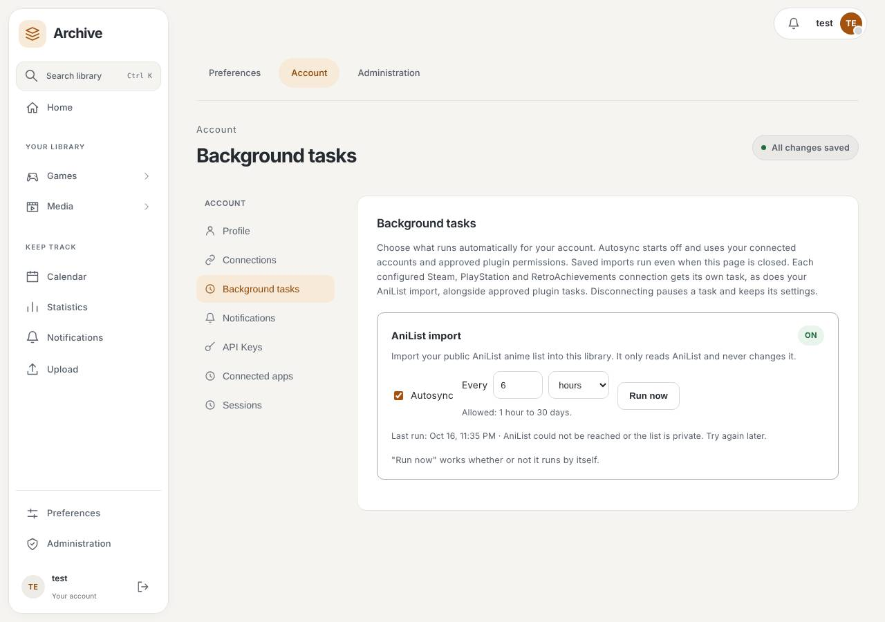
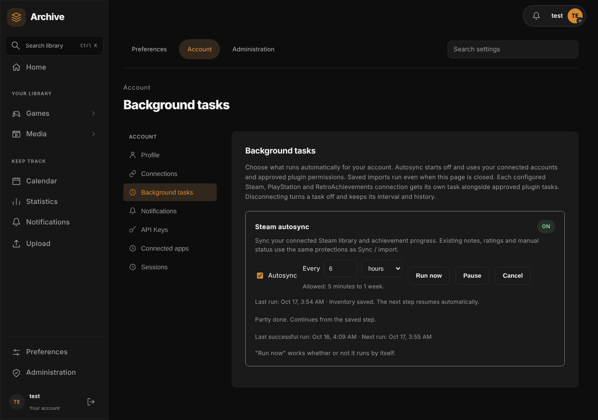
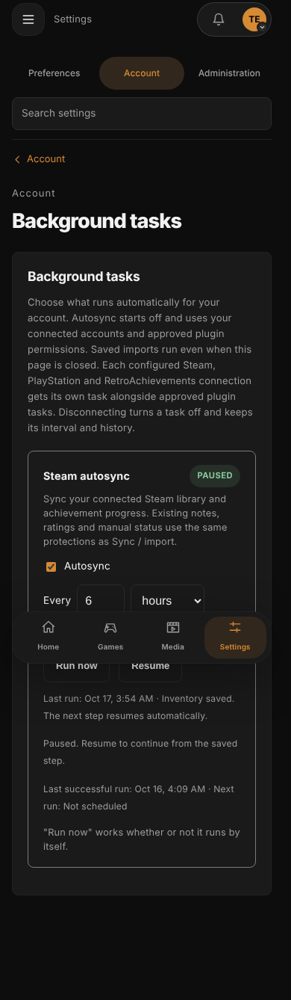

# Scheduled tasks

The backend job loop wakes every minute. Administrators configure jobs through Settings and can enable/disable them, choose an interval within each job's bounds, and request a manual run.

Current deployment-wide jobs are:

- **Plugin updates** — enabled by default, normally daily; follows each installed plugin's update policy and version pin.
- **Airing episode check** — enabled by default, normally every 30 minutes; checks TV/anime airing data and can be manually forced. A title whose provider cannot answer is reported as unavailable in the summary, not as checked, and is asked again on the next run.
- **Anime franchise check** — enabled by default, normally daily; checks completed anime franchises only for accounts that opted in to franchise notifications (see below). With no opted-in account it makes no provider requests.
- **Media refresh** — disabled by default, normally daily; fills missing episode metadata and corrects stale media data.
- **Library backups** — enabled by default, normally daily (1 hour to 7 days); writes each account's rolling JSON snapshot and keeps the last seven. A partial failure is recorded on the task. Settings → Import & export shows the schedule, or that backups are switched off.
- **Trash and session cleanup** — enabled by default, normally every 6 hours (15 minutes to 7 days); permanently removes trash past its retention period and expired sign-in sessions.

These two used to run on fixed private timers; they now use the same schedule, switch, last-run and failure record as every other task, with no second scheduler. A run starts on the first minute after the server starts, then follows the interval. Runs of one task never overlap. Provider health discovery, expiry of public-app and verification secrets, notification delivery and session retention remain fixed internal housekeeping, because they protect correctness or security and are not meant to be paused.

The per-user AniList import is a personal task in Account → Background tasks and runs through this same loop: due tasks start oldest run first, at most four imports run at once, and tasks that are not due never take a slot from tasks that are. External notification deliveries use the same loop, but their retry schedule is owned by the notification delivery coordinator rather than the task settings page.

The task view shows running state, last run, and a bounded summary. A failed run is recorded like a completed one: its time counts towards the job's interval, so a persistent provider error is retried at the next scheduled time rather than every minute, and the summary says that it failed. It does not stop the API server. Run now retries immediately.

## Anime franchise check

Accounts opt in under **Settings → Account → Notifications → Notification types** with two independent types, both off for new and existing accounts: **Anime franchise seasons** and **Anime franchise movies, OVAs and specials**. The check only looks at anime the account marked Watched or Favorite.

- **Franchise identity.** Titles whose stored AniList sequences share an entry are one franchise, identified by its lowest AniList id. Each franchise costs one fetch through the metadata provider gateway, using the completed title latest in the sequence, and respects the account's metadata provider choices.
- **Bounded, resumable batches.** A run checks at most five franchises, visiting opted-in active accounts in a stable order. Its summary and cursor are stored with the job's last result. An unfinished pass continues five minutes later; a restart resumes from the stored cursor instead of starting over. After every opted-in account is checked, the job waits for its interval.
- **Failures.** A provider failure stops the batch and is retried after 5, then 10 minutes, backing off to at most hourly while failures continue. A franchise that fails three times in a row is skipped until the next pass so it cannot block later franchises or accounts. Run now resumes the current pass.
- **Deduplication.** A newly listed entry is announced once per account, whichever title or check finds it. The first stored graph of a franchise is only a baseline. Entries already in the account's library are not announced.

Opening an anime's Related tab refreshes the same stored graph and applies the same rules.

## Plugin schedules

Plugin API v1.1 packages can declare optional `scheduled_tasks` with an explicit
`tasks.background` permission. Each task appears with its plugin name, interval
bounds and Run now control. Scheduling starts off; an administrator enables it.
The existing job table stores intervals and results under an installation-bound
ID, so an update or ordinary reinstall retains the schedule and a new installation
does not inherit another installation's settings.

Tasks use the plugin's existing background administrator identity, rather than
the person currently pressing Run now. Both background and action permissions
are checked before dispatch and again by the isolated runtime. A stopped,
disabled or incompatible plugin, revoked grant, inactive background administrator
or runtime outage pauses controls with an explanation. Per-user subscriptions
remain independently required for delegated background operations.

A task must reference an existing action with a handler and no confirmation.
It receives only `_scheduled_task: {id, trigger}` with `manual` or `scheduled`;
there is no arbitrary action/user override. Existing process limits and the
30-second action wall limit apply. Runs of the same task do not overlap. Public
results retain only `completed` and a summary of at most 512 characters. Removing
a declaration hides its job without deleting saved settings.

Interval amount and unit form one draft per task, saved only with **Save**;
**Reset** restores the saved value. The allowed range and only the units that fit
it are shown beside each task. An invalid or refused draft stays in the field with
nearby guidance. Editing a draft never switches scheduling on, and saving one job
or refreshing run status preserves other drafts. Settings confirms successful
writes for twelve seconds, then shows a quiet Saved state; a concurrent failed
write cannot be hidden by another successful response. Native and sandboxed
scrollbars use the active semantic palette.

## Personal connection and plugin schedules

Account → Background tasks is available to every signed-in user. Configuring Steam,
PlayStation or RetroAchievements makes a personal autosync task available automatically.
New tasks start off, with a daily interval. Disconnecting turns the schedule off while
retaining its interval and history; reconnecting restores availability, and you switch
autosync on again yourself. Xbox and GOG currently store credentials without
a library-sync workflow, so they do not have an executable autosync task.

Every account also has an **AniList import** task. The username and the "update existing
titles" choice stay in Settings → Import & export; the task controls whether the import runs by
itself, how often (1 hour to 30 days), when it last ran and what happened. It starts off and is
unavailable until a username is saved. Failures show a short message without remote details.
Schedules saved before this task existed are moved to it automatically, keeping their state.

Plugins can declare personal tasks using Plugin API 1.1.11, including Epic Games.
Each account controls its own autosync switch,
interval (minutes, hours, days or weeks), manual run and history. Personal schedules
start off and cannot be edited or run through another account's task URL. Server
maintenance jobs remain on the administrator's task page.

Built-in tasks reuse the normal library imports. Steam also runs the existing wishlist
and new-game metadata steps, respecting the user's import preferences. Scheduled and
foreground inventory pulls for the same account and provider do not overlap; other
accounts and providers remain independent. Provider failures are recorded as a failed
run without exposing credentials, and a later scheduled or manual run can retry.
Manual Steam imports save owned games first (one request, committed together, safe to
repeat without duplicating games or touching manual status), then fill achievements,
the optional wishlist, store details and artwork a few games at a time. A game whose
provider details or artwork were unavailable is reported as incomplete rather than
successful: the sync summary names the count and Settings, Connections shows
**Retry details (N)** beside Steam. Retrying only fills fields that are still empty,
keeps manual edits and locked artwork, and creates no games. If the connection drops
while the first request runs, the message says the import may have finished; running it
again is safe. The retry list is kept for the current browser session only.
Unavailable achievement replies retain previously saved unlocks and are reported in
the run summary, rather than being treated as an empty snapshot.

Personal plugin steps recheck the target account and its live permissions. Resumable personal
tasks can request a bounded continuation between 1 and 60 minutes; the ordinary
interval applies after completion. Disabling autosync stops queued continuations.
Disconnecting the provider or disabling/revoking the plugin preserves checkpoints
and turns the schedule off; enable it again after reconnecting. A runtime outage only
pauses it.

### Run controls and status

Every task shows its state (Running now, Paused, Off, On), the last successful run,
the next scheduled run and a short, safe status. **Pause** stops further steps without
losing the saved checkpoint and **Resume** continues from it. **Cancel** ends the current
run: a step in progress finishes, no further step starts, and the saved records and
checkpoint are kept. **Run now** starts the next step immediately and is refused while a
task is paused. Background steps run on the server, so closing the browser or leaving the
page does not interrupt them, and a restarted host continues from the last saved step.

A failed step is retried with backoff (1, 2, 4, 8, then 15 minutes, five attempts), or
later when the provider reports a rate limit, before waiting for the chosen interval.
A run that never completed an inventory does not change what is marked unavailable.
Starts never overlap: a lease in the database blocks a second manual or scheduled run
for the same account and task, including from another host process. Steam, PlayStation
and RetroAchievements run as a single import per run; Pause or Cancel take effect before
the next run rather than in the middle of one provider request.

