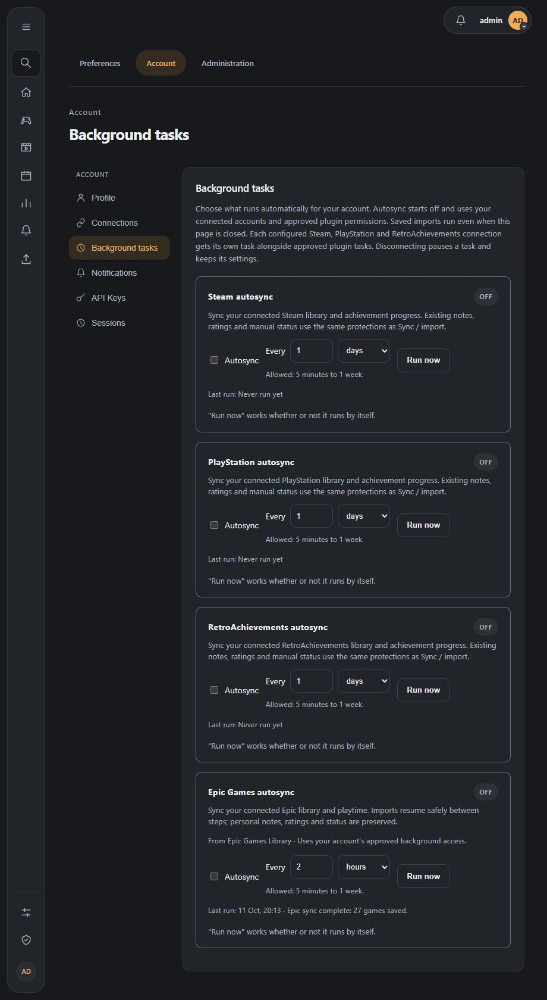
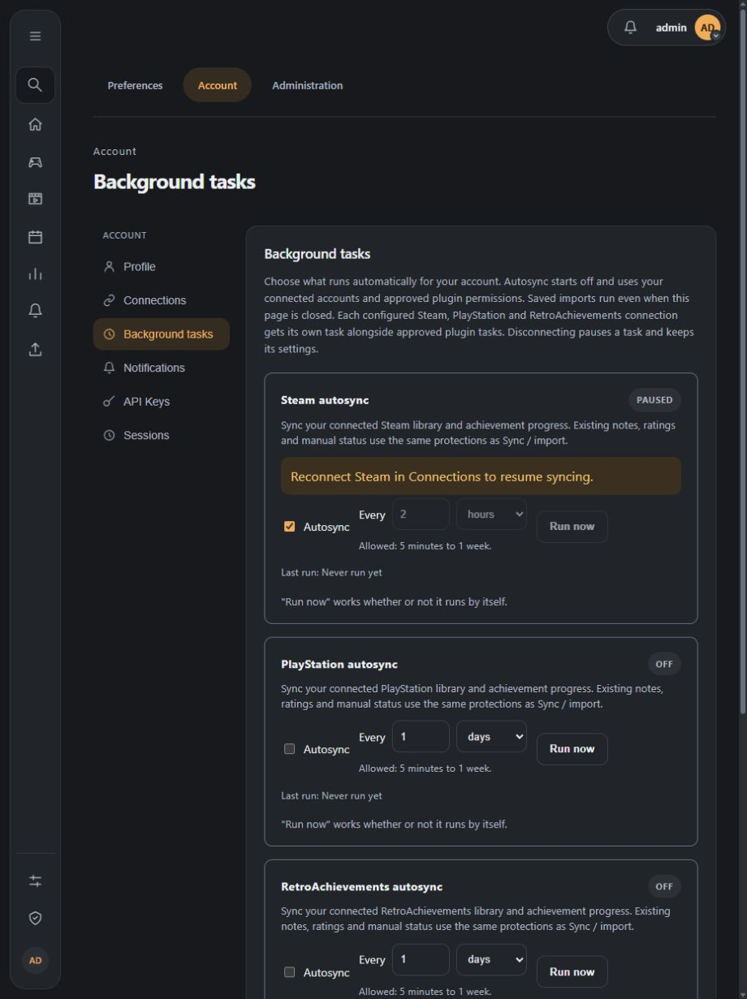
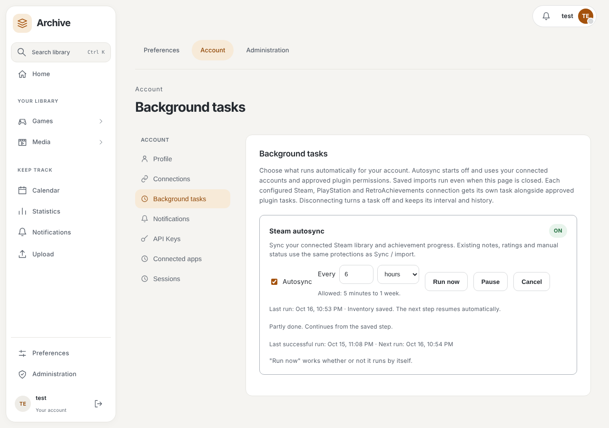
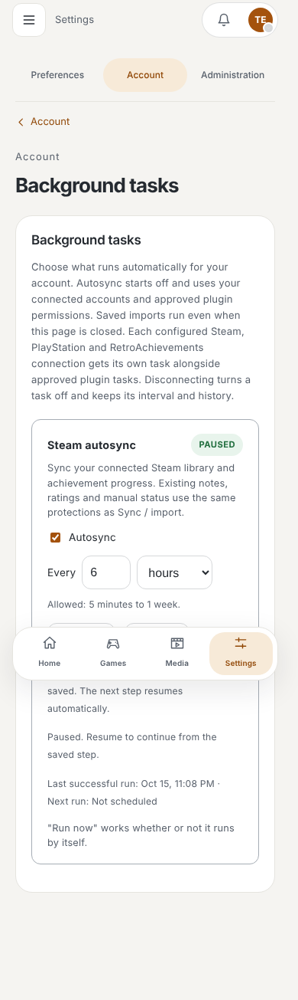

# Scheduled tasks

The backend job loop wakes every minute. Administrators configure jobs through Settings and can enable/disable them, choose an interval within each job's bounds, and request a manual run.

Current deployment-wide jobs are:

- **Plugin updates** — enabled by default, normally daily; follows each installed plugin's update policy and version pin.
- **Airing episode check** — enabled by default, normally every 30 minutes; checks TV/anime airing data and can be manually forced.
- **Media refresh** — disabled by default, normally daily; fills missing episode metadata and corrects stale media data.

Per-user scheduled AniList imports are also processed in bounded batches when enabled in user preferences. External notification deliveries use the same loop, but their retry schedule is owned by the notification delivery coordinator rather than the task settings page.

The task view shows running state, last run, and a bounded summary. A failed iteration is logged and retried by a later loop; it does not stop the API server.

## Plugin schedules

Plugin API v1.1 packages can declare optional `scheduled_tasks` with an explicit
`tasks.background` permission. Each task appears with its plugin name, interval
bounds and Run now control. Scheduling starts off; an administrator enables it.
The existing job table stores intervals and results under an installation-bound
ID, so an update or ordinary reinstall retains the schedule and a new installation
does not inherit another installation's settings.

Tasks use the plugin's existing background administrator identity, rather than
the person currently pressing Run now. Both background and action permissions
are checked before dispatch and again by the isolated runtime. A stopped,
disabled or incompatible plugin, revoked grant, inactive background administrator
or runtime outage pauses controls with an explanation. Per-user subscriptions
remain independently required for delegated background operations.

A task must reference an existing action with a handler and no confirmation.
It receives only `_scheduled_task: {id, trigger}` with `manual` or `scheduled`;
there is no arbitrary action/user override. Existing process limits and the
30-second action wall limit apply. Runs of the same task do not overlap. Public
results retain only `completed` and a summary of at most 512 characters. Removing
a declaration hides its job without deleting saved settings.

Invalid intervals stay in the edited field with nearby guidance. Saving one job
or refreshing run status preserves other drafts. Settings confirms successful
writes for twelve seconds, then shows a quiet Saved state; a concurrent failed
write cannot be hidden by another successful response. Native and sandboxed
scrollbars use the active semantic palette.

## Personal connection and plugin schedules

Account → Background tasks is available to every signed-in user. Configuring Steam,
PlayStation or RetroAchievements makes a personal autosync task available automatically.
New tasks start off, with a daily interval. Disconnecting turns the schedule off while
retaining its interval and history; reconnecting restores availability, and you switch
autosync on again yourself. Xbox and GOG currently store credentials without
a library-sync workflow, so they do not have an executable autosync task.

Plugins can declare personal tasks using Plugin API 1.1.11, including Epic Games.
Each account controls its own autosync switch,
interval (minutes, hours, days or weeks), manual run and history. Personal schedules
start off and cannot be edited or run through another account's task URL. Server
maintenance jobs remain on the administrator's task page.

Built-in tasks reuse the normal library imports. Steam also runs the existing wishlist
and new-game metadata steps, respecting the user's import preferences. Scheduled and
foreground inventory pulls for the same account and provider do not overlap; other
accounts and providers remain independent. Provider failures are recorded as a failed
run without exposing credentials, and a later scheduled or manual run can retry.
Unavailable achievement replies retain previously saved unlocks and are reported in
the run summary, rather than being treated as an empty snapshot.

Personal plugin steps recheck the target account and its live permissions. Resumable personal
tasks can request a bounded continuation between 1 and 60 minutes; the ordinary
interval applies after completion. Disabling autosync stops queued continuations.
Disconnecting the provider or disabling/revoking the plugin preserves checkpoints
and turns the schedule off; enable it again after reconnecting. A runtime outage only
pauses it.

### Run controls and status

Every task shows its state (Running now, Paused, Off, On), the last successful run,
the next scheduled run and a short, safe status. **Pause** stops further steps without
losing the saved checkpoint and **Resume** continues from it. **Cancel** ends the current
run: a step in progress finishes, no further step starts, and the saved records and
checkpoint are kept. **Run now** starts the next step immediately and is refused while a
task is paused. Background steps run on the server, so closing the browser or leaving the
page does not interrupt them, and a restarted host continues from the last saved step.

A failed step is retried with backoff (1, 2, 4, 8, then 15 minutes, five attempts), or
later when the provider reports a rate limit, before waiting for the chosen interval.
A run that never completed an inventory does not change what is marked unavailable.
Starts never overlap: a lease in the database blocks a second manual or scheduled run
for the same account and task, including from another host process. Steam, PlayStation
and RetroAchievements run as a single import per run; Pause or Cancel take effect before
the next run rather than in the middle of one provider request.

