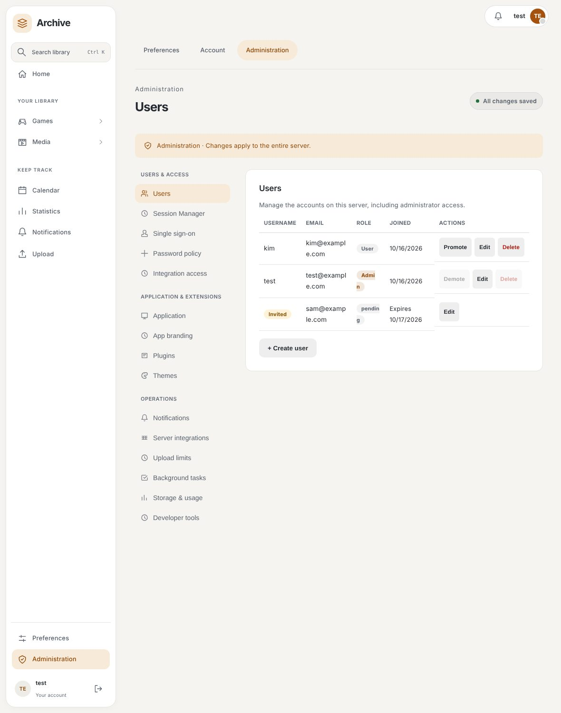
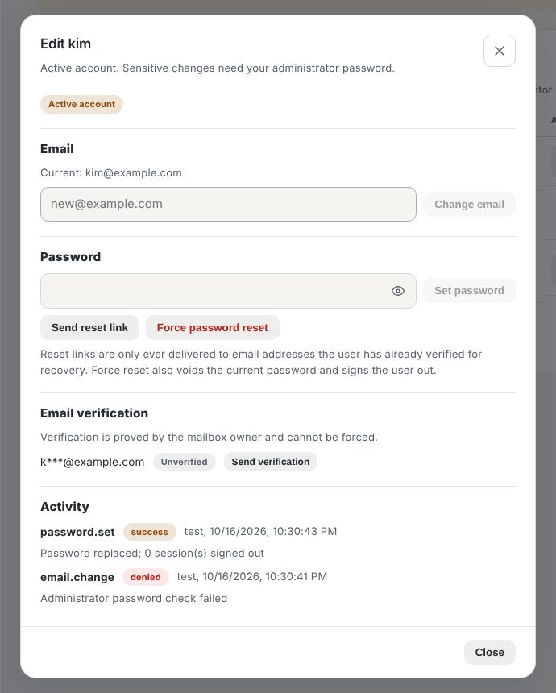
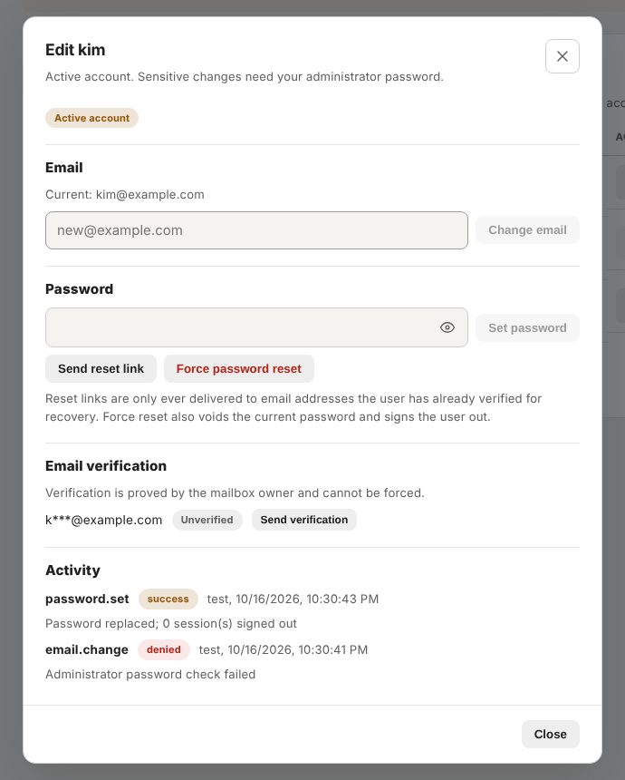

# Users

Administrators can list, create, update, and delete local users from Settings. A user has a unique sign-in username and email identity, an optional display name (not unique and never used for sign-in; the user list always shows the sign-in username beside it), an active state, and an administrator flag. Deactivation prevents normal access without immediately deleting library data.

The configured primary user is reconciled at application startup when `PRIMARY_USER_USERNAME`, `PRIMARY_USER_EMAIL`, and `PRIMARY_USER_PASSWORD` are present. Treat those values as deployment secrets and rotate them through the supported configuration path.

## Usernames

New and renamed usernames are 1-100 ASCII letters, digits, underscores, hyphens or dots, with no spaces. The profile form, the administrator "Create user" form, the invitation form and the first-administrator step of setup check this rule while you type and when you leave the field, and name the exact problem (for example `Username cannot contain spaces.`, `Username is too long: use at most 100 characters (this one has 101).`, or `Enter a username.`). The message is attached to the field for screen readers and the field is marked invalid.

The server applies the same rule when you save and is authoritative. Whether a name is already taken is deliberately not checked while typing, because that would let anyone probe which accounts exist. A profile save by an ordinary user that collides with another account reports one combined message, `That username or email is already in use.`, whatever field collided, so a signed-in user cannot probe which usernames or email addresses are registered. Administrators, who can already list every account, still get the specific `That username is already taken.` or `That email address is already in use.` reply, and user creation (administrator only) keeps it too. The public invitation form likewise keeps one combined message for either collision. No names are reserved. Existing usernames that predate the rule (for example ones containing spaces or `@`) keep working for sign-in, and keeping your current username unchanged on the profile form is never flagged.

## Editing a user

**Settings → Administration → Users → Edit** opens a popup for one account. Only administrators can use it, and every action is written to an append-only activity log shown at the bottom of the popup (actor, action, outcome, time, no secrets). Promote, demote and delete are logged too.

**Active and invited accounts are different.** Invitations from the invitation plugin appear in the same table with an *Invited* badge. An invited address is not an account yet; it becomes an active account only when the recipient accepts the link. For an invited row the popup offers:

- **Resend invitation** issues a fresh single-use link to the same address through the normal invitation rules (granted invitation plugin, configured SMTP, rate limits, duplicate-account check) and invalidates the previous link.
- **Withdraw** revokes the pending link.

Accepted invitations are active accounts and can no longer be resent.

**Sensitive changes need proof.** Changing an email, setting a password and forcing a reset ask for your own administrator password (rate limited) and for the account's username typed back. You cannot use the popup on yourself (use your profile) or on the configured primary user. Passwords and reset tokens are never returned or logged.

| Action | What it does |
| --- | --- |
| Change email | Replaces the account email. Outstanding reset links stop working. Existing notification destinations are untouched. |
| Set password | Replaces the password, signs all of the user's browser sessions out and voids outstanding reset links. Not available for single sign-on accounts. API keys are kept. |
| Send reset link | Queues the standard reset link (requires the password-reset plugin). It is routed by the core notification policy, so it only reaches an email address the user has already verified and allowed for recovery. If none exists nothing is sent and you are told so. |
| Force password reset | Voids the current password, signs the user out and queues a reset link in one step. It is all-or-nothing: without a verified recovery destination nothing changes. |
| Verify account email / Send verification | Enrols the account email as a notification destination if needed and sends the usual verification message to that mailbox. The mailbox owner completes it. |
| Withdraw verification | Removes proof and recovery delivery for a destination until it is verified again. |

**What is intentionally not possible.** An administrator cannot mark an email as verified and cannot push a reset link to an unverified address, because a verified destination is what protects password recovery from being redirected. To act for a user who cannot verify an address, set a password directly instead.

Users can update their own profile and manage their own API keys. API-key values are shown only when created; revoke unused keys rather than sharing them. OIDC-linked identities follow the configured provider and claim rules.

**Settings → Administration → Session Manager** provides built-in cross-user browser-session inspection, search, state/user filters, and confirmed revocation of one session, all sessions for a selected user, or all server sessions. Bulk revocation includes records hidden by filters, including expired but unrevoked sessions. Revoking your own current session returns you to sign-in. Only administrators can use these operations.

The built-in manager shows state, IP, browser details and timestamps without GeoIP databases. The official Session Manager plugin can replace just this section with location, network, anomaly, map and database controls after its separate administrator-session replacement permission is approved. Disabling the plugin restores the basic manager.

Deleting a user is destructive and can affect user-owned library data. Take a verified backup first. Plugin grants scoped to one user do not authorize another user, and a plugin session/document request is checked again against the authenticated user at the gateway.
