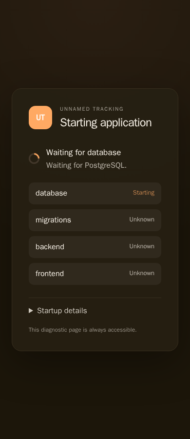
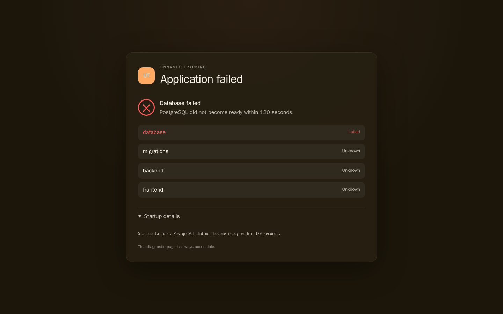

# Startup and Troubleshooting

The production container keeps startup diagnostics available without turning the startup page into a raw log viewer. The page is intentionally concise: it reports lifecycle state and a short failure explanation, while detailed logs remain operator-facing diagnostics.

## Startup sequence

1. Initialise status and diagnostic files.
2. Start Nginx with the startup configuration.
3. Validate database configuration.
4. Wait for PostgreSQL.
5. Run Alembic migrations (`src/database/migrate.py`) under the database advisory lock.
   Recognized pending upgrades run normally. Unknown/unversioned populated histories,
   inconsistent revision records and missing required tables/columns stop startup for
   [operator review](migration-recovery.md), with no automatic stamping or replay.
6. Start Uvicorn on `127.0.0.1:8000`.
7. Wait for `/health`.
8. Select the HTTP, HTTPS, or HTTPS-redirect production Nginx configuration and render TLS certificate paths when required.
9. Validate the selected configuration, copy it to `nginx.conf`, and reload Nginx.
10. Verify the compiled frontend.
11. Monitor the backend process.

## Health semantics

The Docker healthcheck reads the file-backed startup status rather than treating the diagnostic Nginx page as readiness.

`overall=starting` means the container is alive but the application is not ready. `overall=failed` means the operator should inspect the diagnostics. Only `overall=ready` is healthy.

A backend crash after readiness changes the status to `BACKEND_CRASHED` and makes the healthcheck fail while keeping diagnostics available.

## Startup page

The static startup page reports application starting, database state, migration state, backend state, frontend state, application ready, and application failed. Normal startup does not render backend, migration, Nginx, or Docker log output. On failure the spinner is replaced by a failure indicator and a concise diagnostic message.

Nginx serves the startup page over HTTP before checking PostgreSQL. The database
wait uses a 120-second elapsed deadline, with each readiness probe capped at two
seconds, including DNS resolution. A database that remains unavailable moves to
`DATABASE_FAILED` within a few seconds of that deadline while the HTTP diagnostic
listener remains available. API requests return JSON with HTTP 503 and a
`Retry-After: 5` header during startup.

If a reverse proxy only forwards to healthy containers, it can hide these
diagnostics while the application is starting or has failed. Inspect the
container's published HTTP port directly to distinguish proxy routing from an
application startup failure. Embedded HTTPS is activated during the ready
handoff; the pre-readiness diagnostic listener uses HTTP.





These screenshots use the real production image with an intentionally
unresolvable database host. The browser checks confirmed waiting and failure
states at 390px and 1440px, JSON API failures, no horizontal overflow, and a
database failure transition 121.18 seconds after container launch.

Raw logs are intentionally not rendered by default: they are useful for operators but noisy for normal startup. The startup page does not add a reload button or other log-management controls.

## Detailed diagnostics

Use the container logging facilities first:

```text
docker logs <container>
docker logs -f <container>
```

Docker exposes container stdout/stderr through docker logs. The production entrypoint writes lifecycle messages there and Nginx errors are directed to stderr. Detailed backend output is retained at /run/unnamed-tracking/backend.log; migration output is retained at /run/unnamed-tracking/migration.log.

If detailed file contents are needed, use the retained files inside the running container:

```text
docker exec <container> cat /run/unnamed-tracking/backend.log
docker exec <container> cat /run/unnamed-tracking/migration.log
```

They can also be copied out:

```text
docker cp <container>:/run/unnamed-tracking/backend.log ./backend.log
docker cp <container>:/run/unnamed-tracking/migration.log ./migration.log
```

Do not inspect Docker's internal logging-driver files directly.

## Failure states

- `CONFIGURATION_FAILED`
- `DATABASE_FAILED`
- `MIGRATION_FAILED`
- `BACKEND_FAILED`
- `BACKEND_TIMEOUT`
- `FRONTEND_FAILED`
- `BACKEND_CRASHED`

## Failure matrix

Each row is a message the application shows (the startup page, `/_startup/status.json`, or the plugin manager)
and what to do. Messages name the failing part and never include passwords, tokens, connection strings or remote response
bodies. **Retry** says whether waiting can fix it: *yes* means the dependency may recover by itself, *no* means a setting
must change first.

| Failure | Where you see it | The message tells you | Retry | Recovery |
| --- | --- | --- | --- | --- |
| Database unreachable | `DATABASE_FAILED` | the host and port it waited for (`PostgreSQL at db:5432 ... within 120 seconds`), or that the host in `DATABASE_URL` did not answer | yes | start or fix the database container, check `POSTGRES_HOST`/`POSTGRES_PORT`, restart |
| Incomplete database settings | `CONFIGURATION_FAILED` | which of `POSTGRES_USER`, `POSTGRES_PASSWORD`, `POSTGRES_DB` is missing | no | set all three together |
| Persistent storage not writable | `CONFIGURATION_FAILED` | the directory (`APP_DATA_DIR`, default `/data`) and the user id that cannot write to it; your database and settings are untouched | no | mount a writable volume at `APP_DATA_DIR` (default `/data`) or fix its ownership, restart |
| Migration failure | `MIGRATION_FAILED` | the last line of the redacted migration output, and that no data was deleted | no, until the cause is fixed | fix the cause (the full redacted output is `/run/unnamed-tracking/migration.log`); restore your last backup if the database is damaged; restart |
| Invalid encryption key | `MIGRATION_FAILED` / `CONFIGURATION_FAILED` | which key is invalid and how to recover without losing the saved copy | no | see the `SECRET_KEY` recovery steps under [environment variables](../setup/environment-variables.md): restore the original matching key from backup; never generate a new one for an installation with saved data |
| Backend did not start | `BACKEND_FAILED`, `BACKEND_TIMEOUT` | that the process exited or did not answer within 120 seconds | maybe | read `/run/unnamed-tracking/backend.log` |
| Provider network failure | metadata search, provider settings, job summaries | one of `timeout`, `unavailable`, `rate_limited` (with when to retry) or `invalid_configuration` (a key is wrong) | `timeout`, `unavailable`, `rate_limited`: yes; `invalid_configuration`: no | wait and retry, or correct the key in Settings › Metadata |
| Plugin runtime token missing | plugin manager (503) | that `PLUGIN_RUNTIME_TOKEN` is missing or under 32 characters and must be identical on both sides | no | set the same token (32+ characters) for the application and the plugin runtime, restart both |
| Plugin runtime unreachable | plugin manager (503) | the configured scheme, host and port, and whether the host name could not be found, the connection was refused, or it timed out | yes | start the `plugin-runtime` container, check `PLUGIN_RUNTIME_URL` and that both containers share a network |
| Plugin runtime internal error | plugin manager (503) | the HTTP status and to read the runtime logs | yes | read the plugin-runtime logs, retry |

Logging never blocks startup or requests: log forwarding runs beside the application and a failure to write a log line is
ignored rather than propagated.

## Diagnostic endpoints

Inspect:

```text
/_startup/status.json
/_startup/details.txt
```

These are operational diagnostics, not durable log storage.

## TLS failures

TLS is disabled by default and is enabled only when `NGINX_TLS_ENABLED=true`. When enabled, the container uses `readytls.conf` unless `NGINX_TLS_REDIRECT_HTTP=true`, in which case it uses `readytlsredirect.conf`. With both certificate variables empty, an existing `/etc/nginx/tls/tls.crt` + `/etc/nginx/tls/tls.key` pair is used when present; otherwise a self-signed localhost certificate/key pair is generated automatically under `/run/unnamed-tracking/tls`.

Check that:

1. the certificate and private key are mounted at the configured paths;
2. both files are readable by the Nginx master;
3. the certificate chain is in the expected PEM order;
4. the certificate and key match;
5. port 443 is published by the deployment;
6. `AUTH_COOKIE_SECURE=true` is set for an HTTPS public URL.

The renderer reports missing/unreadable files without printing private-key contents. Nginx validation catches malformed or mismatched certificate/key material.

If TLS configuration fails during startup, the diagnostic HTTP listener remains available because the HTTPS configuration is activated only during the ready handoff.

## OIDC and proxy URLs

Nginx forwards `X-Forwarded-Proto`, keeping an outer proxy's value only when that proxy is trusted (`NGINX_REALIP_TRUSTED_PROXIES`), and Uvicorn trusts that header only from the local Nginx hop. This allows request-derived OIDC callback URLs to use `https` when clients connect through embedded TLS.

If another reverse proxy is placed in front of the container, ensure it preserves the external HTTPS scheme and that the deployment’s proxy trust boundary remains limited to the expected internal hop.

If the application frontend loads while setup or authentication requests are
temporarily unavailable, it shows a themed **Backend unavailable** screen. It
rechecks startup after five seconds, retries when connectivity returns, and
offers **Retry connection**. Recovery preserves the requested path and query
without reloading the document. A failed authentication check is retried rather
than treated as a confirmed signed-out response; older responses cannot replace
a newer successful login. A confirmed 401 still leads to ordinary sign-in.

During the initial setup and authentication checks, the frontend shows a neutral
**Loading…** screen. It waits for the confirmed destination before mounting Home,
sign-in, or setup, so Home does not flash ahead of a sign-in redirect. Return
destinations preserve real page paths, queries and fragments. The base page,
sign-in entrypoints and setup are excluded from `return_to`; existing redundant
entry-page queries are removed while other query parameters are preserved.


[Startup recovery validation](../assets/ui-redevelopment/stage-startup-conformance.json)
covers 16 real-backend connection-failure cases across phone/desktop and both
themes, plus automatic recovery.

API requests during startup return HTTP 503 with a JSON explanation and `Retry-After: 5`. They never receive the diagnostic HTML document. The frontend retries temporary startup failures and preserves the requested page.

## Shutdown

Docker stop sends SIGTERM to PID 1. PID 1 forwards shutdown to FastAPI, waits for it, and then asks Nginx to quit. If shutdown behavior is incorrect in a deployment, inspect the container logs for the entrypoint’s shutdown messages.

The production smoke test validates database startup, migrations, compiled frontend/API handoff, authentication, controlled failures and shutdown.

## Secrets

Backend and migration logs pass through credential redaction before private retention and Docker forwarding. Each redacted line is flushed immediately so short diagnostic messages do not wait for a full output buffer or process shutdown. Public startup endpoints contain concise lifecycle status and operator log paths, without publishing raw log files.

Routine successful `POST /api/plugins/runtime/gateway` access entries at INFO level with HTTP 200 are omitted. Gateway failures, warnings and other access entries remain visible; plugin audit and application logs are unaffected.
