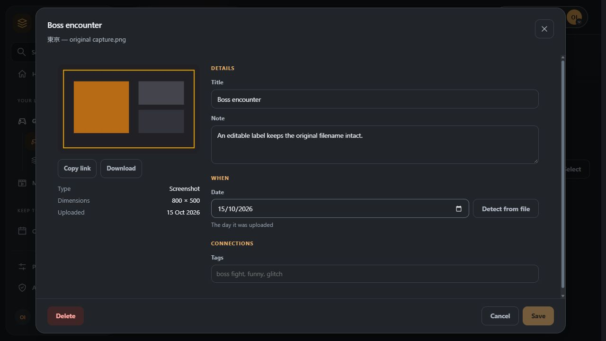
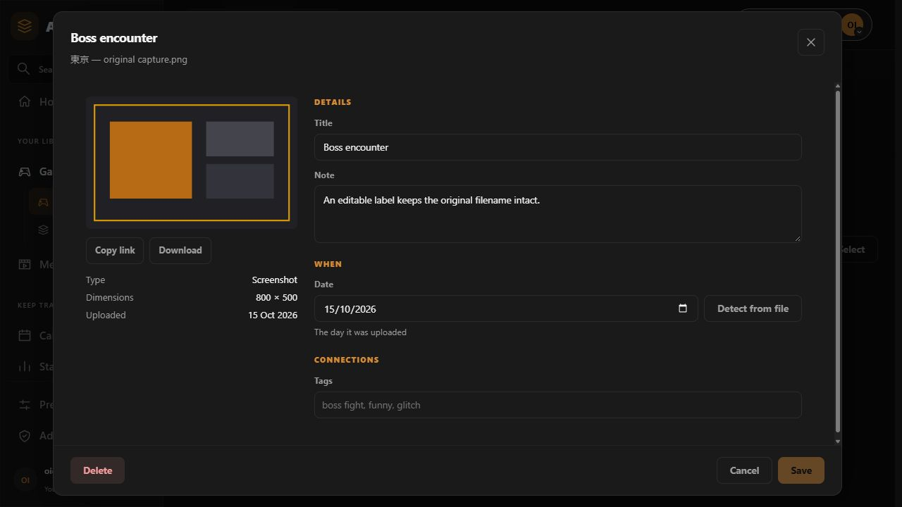

# Architecture

Unnamed Tracking App is split into a Python/FastAPI backend and a Vue/Vite frontend, with PostgreSQL providing persistent application data.

## Plugin platform

The plugin platform adds a separate execution boundary. The frontend calls FastAPI /api/plugins; the backend authenticates the user and communicates with plugin-runtime over an authenticated internal transport; plugin-runtime performs package discovery, integrity validation and isolated process execution.

The backend owns the application-facing API, authentication, compatibility and permission policy. The runtime owns plugin process execution and private plugin storage. Plugin packages do not run inside the backend and do not receive the core environment, database connection, Docker socket or unrestricted network.

Compose connects the backend and runtime through an internal-only network. PostgreSQL and the frontend remain on the normal application network; the runtime is not attached to it and is not published to the host.

The frontend plugin manager calls /api/plugins for lifecycle state and /api/plugins/{id}/ui, /settings and /actions for the declarative plugin host. There is no browser-to-runtime connection.

## Repository structure

- src/backend/src/api/ — FastAPI routes and API schemas.
- src/backend/src/plugin_api/ — plugin contracts, lifecycle, gateway and runtime transport.
- src/frontend/src/components/ — reusable Vue components.
- src/frontend/src/views/ — application pages/views.
- src/frontend/src/services/ — frontend API/service clients.
- src/plugin-runtime/ — isolated runtime service and sandbox supervisor.

Plugin management routes are composed in `api/routes/plugins.py`; their implementations live in `api/routes/plugin_manager/`. Acquisition, catalogue access, lifecycle, updates, contributions and backend dispatch each have their own module. The shared runtime module owns the authenticated client and gateway helpers. Keep patches and dependency overrides at the module that owns the implementation.

`plugin_api/contracts.py` remains the public import surface. It composes the core manifest models in `base_contracts.py` and the declarative UI models in `ui_contracts.py`. The UI branch keeps its v1.1 declarations, scoped placement permissions, tasks, shortcuts and themes when integrating the original Plugin Manager's source extraction.

Large frontend pages keep their state in composables and their styles in `styles/pages/`. Game detail panels share `gameDetailContext.ts`; their stylesheet selectors stay under `.game-detail-page` so panel extraction does not restyle other pages. Integrating the same extraction on both branches preserves the redesigned Games and Media screens and their existing verification.

## Configuration architecture

Deployment configuration is defined by the backend configuration registry. Environment values have higher precedence than persisted settings and environment-owned fields remain deployment-owned.

## Database

PostgreSQL is the normal production database. Schema changes are managed with Alembic migrations and must extend the single current head. The reconciliation revision `b8c7d6e5f403` joins the independently published main and plugin-manager histories without changing their revision IDs or dropping schema objects.

### Logging architecture

Production-container logging intentionally uses the existing stdout/stderr path rather than introducing a second log aggregation system. Entrypoint lifecycle messages go to stdout, Nginx errors go to stderr, backend output is retained in /run/unnamed-tracking/backend.log, and migration output is retained in /run/unnamed-tracking/migration.log.

The structured startup endpoints expose only status and concise details. Raw backend and migration logs are not public HTTP resources. Operators retrieve detailed logs through Docker logging facilities or directly from the retained files inside the container.

The production entrypoint does not print configuration secrets. New logging code must preserve that rule.
## Artwork and local image copies

A game's artwork is stored as PNG files in its folder: `key_art.png` (600 by 900) and `banner.png` (3840 by 1240, often 5 to 10 MB), plus a logo and an icon. A page rarely needs that much, so smaller copies are made and kept in a cache.

Artwork writes use `helpers/save_game_asset.py`. `save_game_asset` loads an active
game under a shared PostgreSQL row lock and retains its session until both the PNG
and standard previews are complete. Folder edits using an exclusive game lock
therefore wait for those writes. Cancellation waits for the preview worker to
finish before releasing storage, including repeated cancellation requests.

Imports and metadata enrichment already hold the game's transaction/row lock and
call `save_locked_game_asset` with that current Game row. They must keep the lock
until the call finishes. This avoids a second session waiting on its caller and
lets artwork be written for newly flushed games before commit. Both entry points
use the same image validation, resizing and preview implementation. These are
internal host helpers; the public plugin API is unchanged.

**Games.** `GET /api/game/<id>/assets/<kind>` accepts `?w=<pixels>` (64 to 4096) and returns a JPEG no wider than that. The route that serves it is `api/routes/default_game_assets.py`, which is registered before the one in `games.py` and so is the one that answers. Copies live at `<data>/users/<user-id>/.cache/asset-previews/<game-id>/<kind>-<width>.jpg` and are rebuilt when the original is newer. They are written to a temporary file and moved into place, so a request never reads half a file. The widths the app uses (banner 1920 and 800, cover 400) are also made as soon as artwork is saved (`helpers/asset_previews.py`). An image already as small as asked for is sent unchanged.

Stored game artwork keeps its private one-hour browser cache. Generated covers for games without artwork use `private, no-cache`, requiring revalidation when the URL is requested again so a newly uploaded cover can replace the placeholder. The standalone default-cover preview still uses its existing one-hour cache.

**Movies, TV shows and anime.** Their posters and backdrops are addresses on TMDB or AniList. `GET /api/media-image/<movie|tv|anime>/<id>/<poster|backdrop|hero>` downloads the picture once, shrinks it (posters to 400 pixels, backdrops to 1920) and keeps it under `.cache/media-images/`. `hero` is the backdrop, or the poster when there is no backdrop. The file name includes a hash of the source address, so editing the address makes a fresh copy and removes the old one.

The address is whatever was saved on the title, so `helpers/remote_images.py`
treats it as untrusted. Cached media and achievement images, plus game artwork
downloaded from a URL, share the same public-network boundary:

- HTTP/HTTPS on ports 80 or 443, without URL credentials, fragments, raw whitespace,
  control characters or backslashes.
- Every DNS result must be globally routable. Private, loopback, link-local,
  shared address space and multicast destinations are refused. Connections pin the
  validated addresses, retain the original Host/TLS hostname and verify certificates.
- Up to three redirects, with a fresh validation and pinned connection for every
  hop. Authentication headers and cookies are never forwarded.
- Five-second connection and fifteen-second socket read timeouts. Cached downloads
  have a 15 MiB byte limit; game URL downloads use the administrator's general upload
  cap. Streaming enforces the limit even without a trustworthy Content-Length.
- Pillow validates image content before persistence, with a 40-million-pixel cap
  before conversion. A claimed image MIME type is insufficient.

The game URL route checks ownership before fetching and performs blocking network
work in a worker thread. Rejected URLs/images return an understandable 400 without
replacing artwork. Cache failure retains the existing redirect to the original
address; that browser fallback does not authorize a server-side private fetch.

`helpers/public_http.py` also supplies the pinned transport for delegated public
instances and public-app image requests. Those callers keep their existing protocol,
permission, header, redirect and size restrictions. General permission-granted
plugin HTTP requests retain their separate network policy and public API contract.

Both caches are disposable. Deleting `.cache/` loses nothing that cannot be rebuilt.

**Frontend.** `utils/gameImages.ts` adds the size to a game artwork URL (`sizedAssetUrl`) and starts a download early (`preloadImage`). `utils/mediaImages.ts` turns a title's stored address into the local URL, with a short stamp of the address so a changed picture is not served from the browser's memory. Card grids use `loading="lazy"` on images, and tiles that are CSS backgrounds use the `v-lazy-bg` directive (`directives/lazyBackground.ts`), which sets the image once the tile is near the screen.

## Uploaded media and filenames

`helpers/media.py` classifies gallery uploads by permitted extension, verifies and
decodes bounded raster images, and checks known video/audio container or frame
headers. It does not transcode video/audio. The game and inbox upload routes inspect
content in a worker thread, read at most the configured cap plus one byte, and report
rejections per file. Arbitrary documents/modpacks retain their download-only path.

MediaItem, InboxItem and GameFileItem preserve `original_filename` independently
of their stored `filename` and editable title. Migration `fed12ab64423` adds nullable
columns after `0e3353138981`, safely preserving adopted columns and existing rows.
Old rows keep a legacy storage-name fallback; no filename or filesystem rewrite is
performed. Assignment carries the original name into MediaItem. Shared Vue gallery,
editor, search/sort and download helpers use it without changing URL/storage identity.

`helpers/range_response.py` adds `nosniff`, a CSP `sandbox` and consistent inline
filename disposition to whole, partial and unsatisfiable media responses. Existing
200/206/416 byte behavior is retained. Document downloads remain octet-stream
attachments with the same security headers. Plugin document APIs, grants, package
handling and their public request/response contracts remain unchanged.

Container identifiers follow the [Ogg framing specification](https://xiph.org/ogg/doc/framing.html),
[Matroska/EBML specification](https://www.matroska.org/technical/elements.html) and
[FLAC format overview](https://www.xiph.org/flac/documentation_format_overview.html).





## How a game page opens

`services/games.ts` keeps every game it has fetched in an entity cache (`peekGame`). Opening a game from the library draws it from that cache straight away and refreshes it from the server behind it. Its achievements, variants and parent game are requested in parallel with the game, and fill in when they arrive instead of holding the page back. The hero and poster downloads start before the game's details have returned. When there is nothing cached (opening the address directly), a loading screen is shown whose hero, poster and tab bar match the real page's sizes, so the page does not jump when it replaces it.

## Shared building blocks

Game duplicate review is host-owned in `features/game_duplicates.py`. The authenticated `GET /api/game-duplicates` reads compact active entries across all import sources without provider calls, suggests conservative title or shared-identity matches, and bounds each response to at most 100 pairs. Known conflicting years, platforms and identities are excluded. `POST /api/game-duplicates/keep-both` records a canonical, user-owned pair in `game_duplicate_dismissals`; repeat/reversed requests are idempotent and ordinary provider replays retain the decision. Neither endpoint merges or deletes library entries.

Movies, TV shows and anime, and game collections and media lists, were near copies of each other. They now share code, and a change to one of these pieces changes all of them:

| Piece | Used by |
| --- | --- |
| `MediaDetailHero`, `MediaDetailTabs`, `ExpandableDescription` | The Movie, TV and Anime detail pages. |
| `MediaFormShell`, `MediaMetadataSearch`, `useMetadataSearch` | The three Add and Edit dialogs. |
| `services/mediaApi.ts` | The movie, TV and anime services (list, get, create, update, delete, trash). |
| `api/routes/media_common.py` | The movie, TV and anime routes (library list, soft delete, trash, restore, purge, title search). |
| `CollectionTile`, `useCardOrder` | The Collections and Lists overview pages. |
| `CollectionDetailHeader`, `CollectionItemTile`, `CollectionAddDialog`, `useReorderGrid` | The collection and list detail pages. |
| `GameMediaPanel`, `MediaTile`, `MediaEditDialog` | Screenshots, Clips, Soundtrack and Docs. |
| `GameArchivesPanel`, `ArchiveCard`, `ArchiveEditDialog` | Saves and Worlds. |

Style rules that were identical across the near copies sit in `src/styles/shared/` and are imported by each component with `<style scoped src="...">`. Rules that belong to one component live in that component. A component's scoped styles do not reach into another component's markup, which is why a shared piece owns the CSS for its own elements.

When adding a field to movies, TV shows and anime, look for the shared piece first and only add per-kind code where the kinds really differ.

## Library ranks

The Movie, TV and Anime list endpoints return `score_ranks`: the position of every rated title for that user across the whole library, highest score first, ties broken by sort title, deleted titles left out. It is computed on the server so a rank does not depend on which page or search result the browser holds.

## Game page settings

What a game's page shows is stored in two places: the user's defaults as the `game_page` preference, and a game's own overrides in `games.page_settings` (JSONB). `core/page_settings.py` validates both, and `utils/gamePage.ts` merges them (defaults, then the game's overrides) and decides which tabs are visible, tucked into the more menu, or hidden. Only what differs from the defaults is stored on a game.

## Migrations for the game pages work

The game pages work adds its tables and columns in one migration, `d4a8b2c6e9f1`, which follows the password policy migration. It uses the create-if-missing helpers, so it is safe on a database adopted from an older history, and its downgrade drops what it added.

## API

The backend exposes the application's REST API under /api; interactive documentation is available at /api/docs.

## Authentication

Normal application authentication uses server-side sessions and host/port-scoped authentication cookies. Plugin management and plugin backend routes use the same request-scoped authentication boundary. Revoked sessions are rejected, and session metadata remains available for the session manager.

OIDC/SSO is integrated into the same application authentication flow. OIDC provider credentials are kept server-side; client secrets are not exposed to the frontend.

See [OIDC / SSO](../user-guide/oidc.md) for provider configuration.

## Production container

The production deployment is packaged separately under `src/docker-container/`.

```text
compiled Vue -> Nginx -> FastAPI -> PostgreSQL
                    |
                    +-> independent startup diagnostics
```

Nginx starts before FastAPI so the deployment always has a lightweight diagnostic path. PID 1 owns the lifecycle and switches Nginx from `startup.conf` to one of three complete production configurations only after the backend is healthy: `ready.conf` (HTTP), `readytls.conf` (HTTPS), or `readytlsredirect.conf` (HTTPS plus HTTP redirect). The selected TLS configuration is rendered with the certificate paths before being copied to `/etc/nginx/nginx.conf` and validated.

The readiness source of truth is the file-backed status JSON. The Docker healthcheck requires `overall=ready`; merely serving the startup page is not sufficient.

The production Nginx configuration may optionally add an HTTPS listener. TLS configuration is generated from deployment environment variables and externally mounted certificate/key files, not from the application configuration UI. FastAPI receives the forwarded protocol from the local Nginx hop so request-derived URLs can preserve HTTPS.

Nginx workers run as `www-data`. The master retains the privileges required for port binding and lifecycle control. Runtime status and diagnostics are ephemeral under `/run/unnamed-tracking`; persistent application state is mounted separately under `/data`.

For runtime integration behavior, including PostgreSQL, migrations, frontend/API handoff, and shutdown, see production issue #206.

## Metadata provider extension (1.1.1)

Search and refresh use the hardcoded core providers and optional installed provider plugins
through one shared metadata handler. Core search does not require the plugin runtime.
Provider configuration and health appear in the host's metadata settings.
See [the progressive metadata contract](../development/metadata-providers.md) for
phase separation, scoped credential migration, deadlines and persistence behavior.
