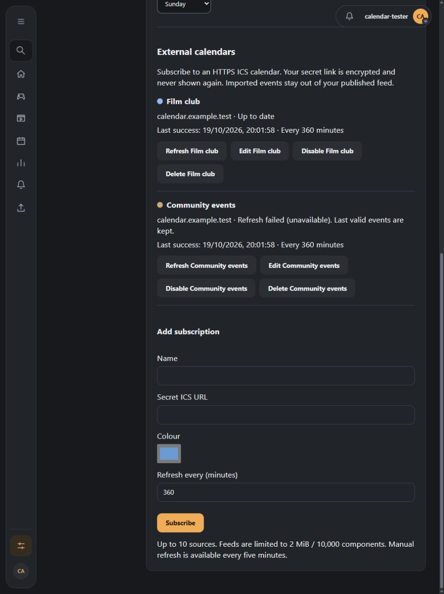
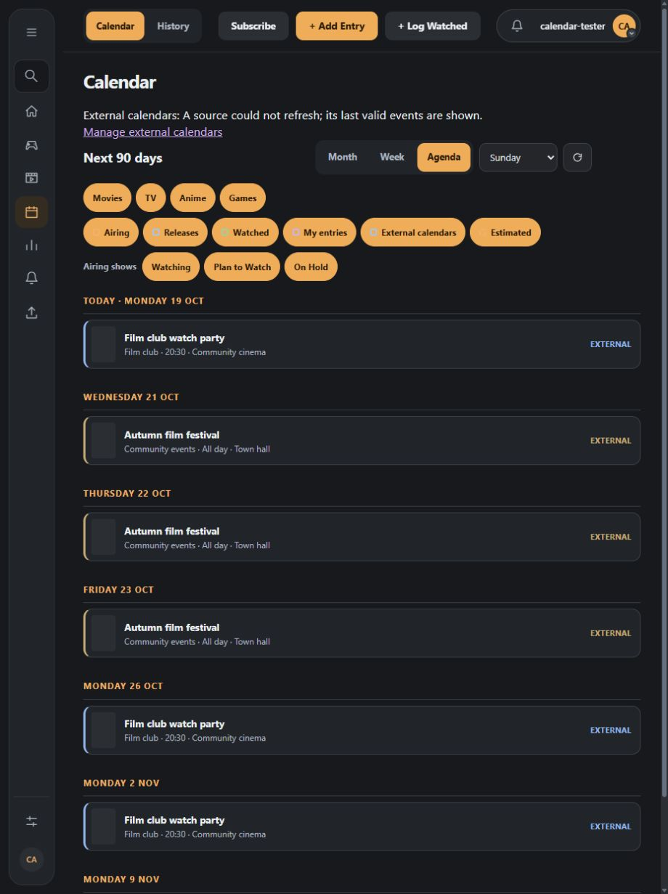
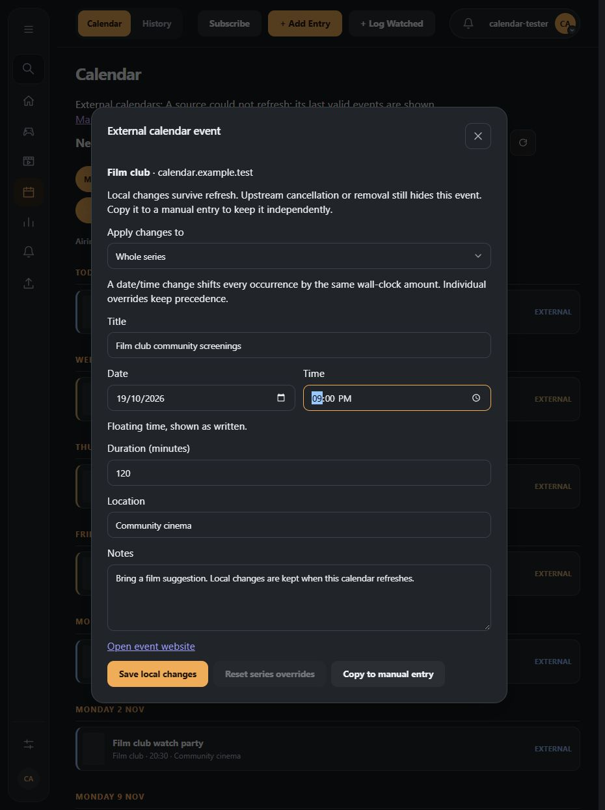
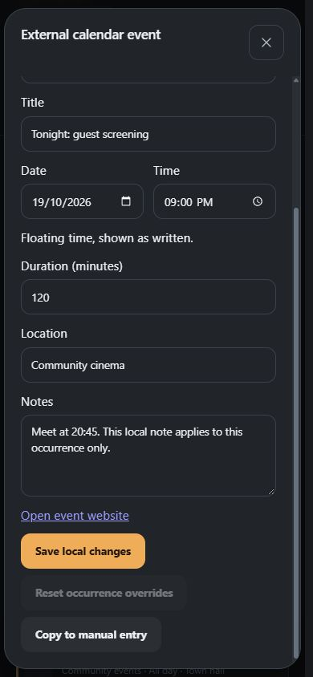
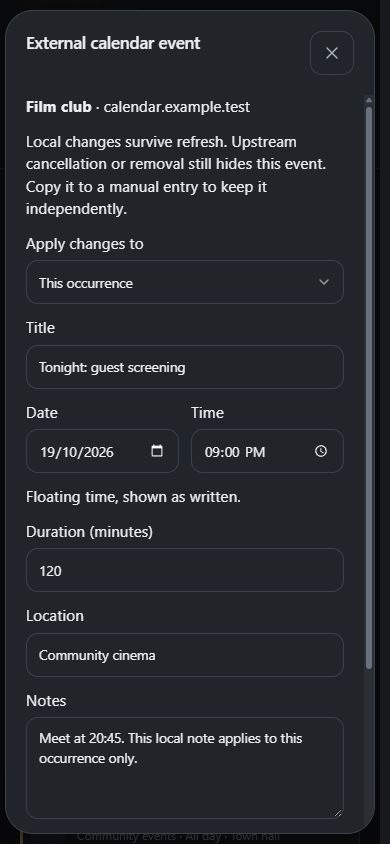
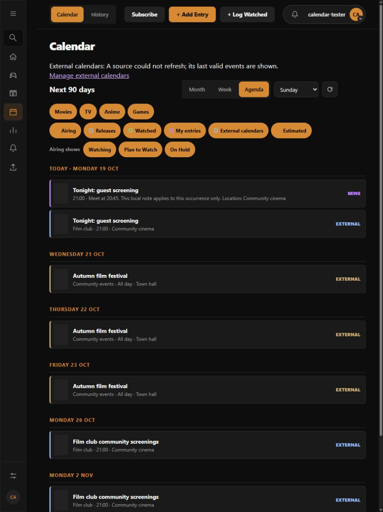
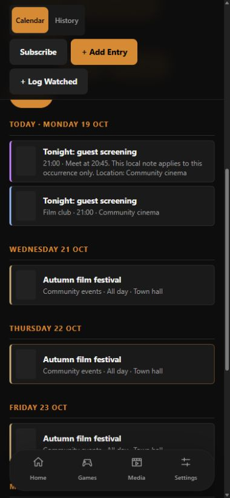

# External calendar subscriptions

Implemented first phase of [#258](https://github.com/obsoletelabs/unnamed_tracking_app_2/issues/258), following the
[accepted decisions](design/ics-subscriptions.md#12-decisions-confirmed-on-19-october-2026). This is a host feature;
it adds no plugin capability or contract, and does not expand Atlas integration.

## Ownership and storage

Revision `5eef5ee3de75` extends `a4c7e19b52d8` with three tables. Existing manual events are unchanged.

| Table | Stored state |
| --- | --- |
| `calendar_sources` | Owner, name/colour, encrypted full URL, display hostname, enabled state, 60–1,440 minute interval, revision, conditional validators, last attempt/success/status, failure count, next refresh and nonce/lease |
| `calendar_source_events` | Source/owner, UID, canonical recurrence identity, sequence, version-1 parsed component JSON, hash, last-seen timestamp and removal tombstone |
| `calendar_source_overrides` | Source/owner, UID, scope key and separately stored field overlay |

Composite source/owner foreign keys prevent cross-account event/override association. Unique source/UID/recurrence
keys make replay idempotent. The master uses the empty string (not nullable uniqueness); exceptions use `D:` date,
`F:` floating or `U:` UTC identity. Series overlays use `*`. Source/user deletion cascades. Downgrade refuses while
subscriptions exist, so snapshots and edits cannot silently disappear. Backups require the database and matching
`SECRET_KEY`; library snapshots do not include subscriptions.

## API

All routes require the existing authenticated application user and resolve sources by owner. Foreign IDs return
404 before any network work. Scoped integration/plugin credentials gain no access to these routes.

| Method/path under `/api/calendar/sources` | Behavior |
| --- | --- |
| `GET /` | `{remote_enabled, sources}`; statuses expose hostname, never URL, ciphertext or validators |
| `POST /` | Name, URL, colour, enabled and refresh interval; validate/fetch/parse before saving, then enforce the ten-source cap under the owner lock |
| `PATCH /{id}` | Name/colour/interval/enabled; an optional replacement URL must load successfully before atomically resetting this source's snapshot and overlays |
| `DELETE /{id}` | Delete this source and its imported/override rows; manual copies survive |
| `POST /{id}/refresh` | Manual refresh, five-minute throttle, 409 while refreshing/disabled; a failed fetch returns recorded sanitized source status and keeps cached data |
| `GET /{id}/events?start=...&end=...&timezone=...` | Inclusive dates, at most 366 days, IANA viewer timezone; events plus source and expansion notices |
| `PUT /{id}/overrides` | Validated event/occurrence target, explicit `occurrence`/`series` scope, merge only supplied fields into the existing overlay |
| `DELETE /{id}/overrides` | Same target and scope with an empty `fields` object; clear that scope only |
| `POST /{id}/copy` | Copy the effective occurrence to a manual start date/time and notes; preserve location in notes |

Occurrence targets include `event_id`, `recurrence_key`, `occurrence_date` (the original upstream start date) and
viewer `timezone`. The server verifies that the current upstream occurrence exists before accepting edits or
copies. Overrides accept title, note, location, typed start and duration. The UI submits changed fields only.
Whole-series start changes store a wall-clock offset, limited to 366 days; occurrence starts remain absolute.
Occurrence overrides win over series fields. Reset reveals the latest upstream value and any remaining other
scope. Changing an all-day event to timed, or floating to zoned, requires a manual copy instead.

## Transport and work limits

`calendar_fetch.py` builds on `helpers/public_http.py`, preserving its DNS pinning and TLS hostname checks.

- HTTPS/443 only; `webcal` is rewritten. No credentials, fragments, control characters, backslashes or environment proxies.
- At most three redirects, each URL and whole DNS answer revalidated. Any non-global address rejects the hop.
- Conditional validators are bounded, reject controls and are dropped on redirects. A 304 is valid only with
  validators at the original URL. Redirect targets are never persisted as replacement secret URLs.
- Connect budget five seconds, transport deadline twenty seconds, caller timeout twenty-five seconds. The OS DNS
  resolver may outlive that timeout; two retained worker slots and database advisory locks prevent unlimited work.
- Connected sockets are shut down at the transport deadline, including during buffered headers/body reads; a slow
  drip cannot extend a read indefinitely. Body reads also check the remaining budget after each underlying read.
- Two fetches globally across nodes/workers sharing this database. Locks remain held until actual worker completion,
  including after a caller timeout/cancellation. Acquisition is bounded; busy processing returns an explicit error.
- Identity encoding only. Declared and streamed body limit 2 MiB; incomplete declared bodies are rejected.
- Strict UTF-8 framing, balanced components, 10,000 total components, 500 KiB per unfolded property, capped text,
  safe HTTP(S) event links. Parse errors reject the entire snapshot rather than imply upstream deletion.
- URL previews share the existing durable request limiter: ten per account per 15-minute window. Cap checks run
  before remote work and again under the owner lock. Manual refreshes are separately limited per source.

Secrets never enter response error text. The normal request validation handler already removes submitted input.
HTML descriptions are displayed as text. No fetched attachment or image is downloaded.

## Reconciliation, recurrence and scheduling

A validated complete 200 response reconciles in one source-locked transaction. Higher sequence (or changed content
at equal sequence) replaces a row; lower sequence is stale. Last duplicate component in a feed wins with a notice.
Absent components are tombstoned only after complete success. Errors and 304 do not infer removal. Cancellation
and exclusions hide events despite local overrides. No refresh writes to the manual-event table or outbound feed.

Date-only events retain exclusive end dates; floating values remain wall times; known IANA zones convert to the
viewer zone; unknown IDs become floating with a notice. DST gaps are skipped in recurrence and do not consume
COUNT; overlaps use the first occurrence. Stored upstream starts preserve their time domain.

Supported RRULE properties are DAILY/WEEKLY/MONTHLY/YEARLY, INTERVAL, COUNT or UNTIL, BYDAY and BYMONTHDAY, with
EXDATE/RDATE and individual RECURRENCE-ID exceptions. Unsupported rules show the base occurrence with a notice;
`THISANDFUTURE` exceptions reject the snapshot. Caps: 366 occurrences/component, 1,000/source/window and 20,000
generated candidates per expansion. Notices prevent a capped result being presented as complete. Ancient unlimited
daily/weekly rules seek close to the requested window; all rules have a window-end bound, including impossible dates.

The built-in **Calendar subscriptions** job uses the existing maintenance loop. Each pass handles at most ten due
sources and expires at most 1,000 old tombstones. Source leases and revision nonces suppress overlap/stale results;
the due time is rechecked under lock. Successful schedules add deterministic per-source jitter. Failures back off;
disabled sources are hidden but retained. `CALENDAR_SUBSCRIPTIONS_ENABLED=false` stops network work while preserving
cached reads, edits and cleanup. Turning off the maintenance job itself stops both scheduling and cleanup.

## Verification

Run against a dedicated migrated test database:

```bash
docker compose exec -e PYTHONPATH=/app backend python -m pytest tests/test_calendar_subscriptions* -q
```

| Coverage | Tests |
| --- | --- |
| Framing, malformed/partial bodies, duplicate components, plain text/URL handling | `test_calendar_subscriptions_parser.py` |
| All-day exclusive ends, floating/known/unknown zones, DST gap/overlap, recurrence/exceptions, overlays and cancellation | Same parser suite |
| Real public resolver/pinning helper with in-memory sockets, blocked/mixed DNS, redirects, proxy environment, encoding/size/truncation, 304 and safe errors | `test_calendar_subscriptions_fetch.py` |
| Worker cancellation and independent-session global advisory slots | Same fetch suite |
| Regular-user CRUD, encrypted secret, cap, disabled deployment, replay/sequence/errors/304, occurrence/series reset, copy, tombstone pruning and in-flight disable | `test_calendar_subscriptions_api.py` |
| Populated upgrade/replay, owner FK enforcement, cascade, guarded downgrade and manual-data preservation | `test_calendar_subscriptions_migration.py` |
| UI stale responses, account switch, retained month data, retry/empty reconciliation, changed-field scope, failed drafts and duplicate submits | Frontend calendar source/editor tests, plus existing `calendarBrowsing.test.ts` |

Network fixtures do not contact third parties. Slow-header/body fixtures verify active socket interruption.
UI acceptance uses a separate PostgreSQL database and a regular
test account with synthetic snapshots, then exercises the real authenticated routes; screenshots contain no real
feed URL or user data. Basic/bearer authentication, one-time import, arbitrary VTIMEZONE evaluation, full recurrence
grammar, CalDAV/OAuth and remote write-back remain outside this phase.

## UI acceptance: 19 October 2026

The isolated `calendar_ui` database contains a regular `calendar-tester` account and synthetic Film club/Community
events sources. It is separate from the automated-test database and other local deployments. The accepted snapshot
is seeded directly for deterministic screenshots; this is not a live third-party feed download. The browser then
uses the real session and endpoints to save/reset series edits, edit one occurrence and create an independent
manual copy. The stale source demonstrates retained events without exposing a secret URL. Mobile document width
is 380 CSS pixels within a 390-pixel viewport, with no horizontal overflow.

| View | Evidence |
| --- | --- |
| Source status, encrypted URL entry and stale source |  |
| External calendar agenda and multi-day event |  |
| Whole-series scope and wall-clock edit |  |
| Occurrence edit and copy/reset actions on mobile |  |
| Saved occurrence scope on mobile |  |
| Independent manual copy alongside subscribed occurrence |  |
| Classic mobile cards |  |
