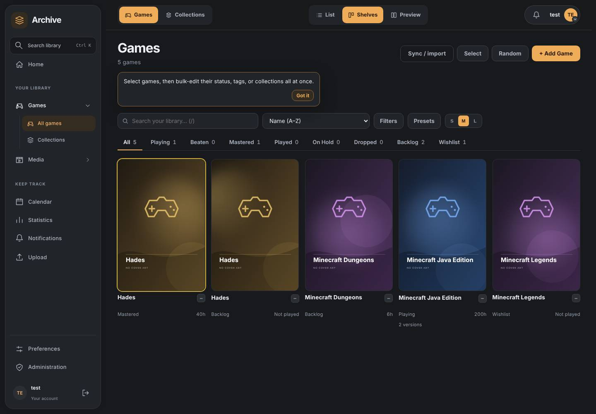
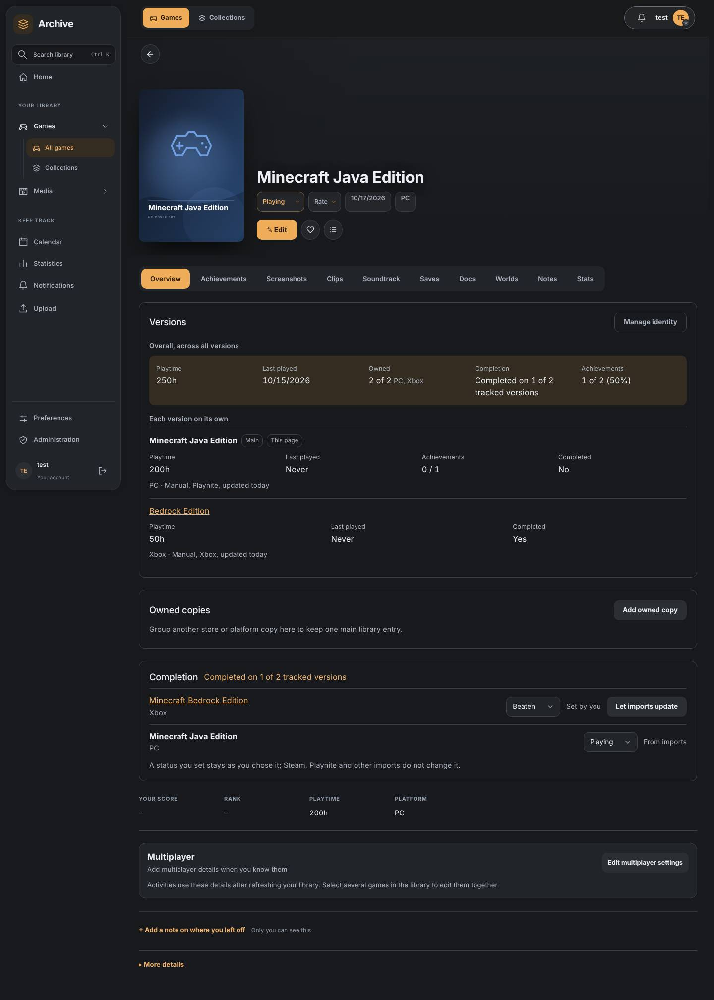

# Game overview, versions and identity UI

Phase 5 of the game identity overhaul
([#91](https://github.com/obsoletelabs/unnamed_tracking_app_2/issues/91)), delivered for
[#101](https://github.com/obsoletelabs/unnamed_tracking_app_2/issues/101). It presents the
[decisions](game-identity-decisions.md), [counters](game-identity-counters.md),
[manual tracking](game-identity-manual.md), [names](game-identity-names.md) and
[matching](game-identity-matching.md) work to people. Backend paths start `src/backend/src/`,
frontend paths `src/frontend/src/`. No migration.

## 1. One entry per logical game

A logical game is a group of games joined by active `same_game` relationships (a merge).
`features/game_identity/overview.py::library_layout` (`GET /api/game-identity/library`)
returns, per group, the umbrella game (the merge root, or the first live version when the
root is in Trash) and each other version with how it is shown:

| Edge `display` | Library | Aggregates |
| --- | --- | --- |
| `default` | folded under the umbrella | included |
| `link` (or identity `presentation = separate`) | also listed on its own | included |
| `hidden` | folded under the umbrella and tucked away in the versions list | included |

Games that are not merged are never grouped, so Minecraft Dungeons and Minecraft Legends stay
their own entries beside Minecraft. Other relationship kinds never merge or aggregate. Their
library presentation comes from the edge's own `display`, or, for `default`, from the user's
rule for that kind (`library_relationship_display` preference, default "list as its own
game"): `link` lists it, `nest` shows it under the parent as a "+ DLC: name" line, `hidden`
removes it from the library. The preference `library_version_display` (`grouped` default,
`separate`) lists every version on its own. Settings, Library, Versions edits both.

`utils/gameIdentityGroups.ts::libraryGrouping` applies the layout to the loaded games and
composes with the owned-copy groups (#56). A group whose umbrella is missing, or a failed
layout request, leaves the plain library. While searching, nested and hidden related games
appear when they match so nothing becomes unreachable. Filters (platform, provider,
achievements) match any record folded into an entry.

## 2. Search

Search matches the title of every record folded into an entry. When exactly one version
other than the umbrella matches ("Minecraft Bedrock"), the card shows that version's label
("Bedrock Edition": the words the two titles do not share, else the platform) and opens that
version. Matching several versions, or the umbrella itself, opens the umbrella.

## 3. Overview and versions

`GET /api/game-identity/games/{id}/overview` returns the overall values beside each
version's own. Overall values come from `counters.reconcile` and the manual-tracking
service, never from the browser:

- playtime: reconciled counters (same counter once, independent counters added); a record
  with no source observation contributes the playtime saved on the game, never zero
  (`playtime_basis: record`). If the overall differs from the sum of versions (a shared
  counter) the panel says so;
- last played: latest of the reconciled value and the records' own;
- owned: versions that are not Wishlist, with their platforms;
- completion: "Completed on 1 of 2 tracked versions" (partial completion is explicit);
- achievements: provider rows plus manual achievements, each counted once.

The game page Overview shows the panel (`components/game/GameVersionsPanel.vue`): overall
block, one row per version with its own playtime, last played, achievements, completion,
sources and freshness. A game with one record shows a single quiet line and the Manage
identity button. Manual completion and achievements stay on the page and in the dialog.
`manual._umbrella_of` now places a game (and its merged group) in an umbrella the first time
an umbrella-wide manual achievement is created, so "every version" achievements work without
waiting for the backfill; nothing about the game changes.

## 4. Manage identity

`components/game/GameIdentityDialog.vue` (opened from the panel, never required for browsing)
reads `GET /api/game-identity/games/{id}/sources` and offers:

| Tab | Shows | Actions |
| --- | --- | --- |
| Versions | versions, relationships, history | merge another game, keep separate, split (unmerge), how a version/relationship is shown, change relationship type, end, add |
| Sources | linked observations per version: source, external ID, availability, freshness, reported values, Playnite GUID | move an observation to another version |
| Decisions | current decisions with actor, rule, confidence, matched/different/missing evidence; kept-separate pairs; replaced decisions | merge anyway (after confirmation) |
| Counters | every counter with raw, effective, selected source, losing sources and why | correct playtime, remove correction, priority, group, ungroup |
| Manual tracking | the completion and achievement controls | as in #97 |

Every action is a call to the existing #95/#96 routes, plus two new ones:
`PUT /relationships/{id}/display` and `PUT /relationships/{id}` (changes kind: the old edge
is ended and a new one created so history shows it). Errors appear in place, the dialog is a
native modal (focus trap, Escape) and every control is labelled. Reversing "keep separate"
always asks.

## 5. Compatibility

Duplicate highlighting stays: a card is flagged when any record folded into it is half of a
possible duplicate, except for pairs already merged, and links to Settings, Library,
Duplicates. Collections, filters and routes are unchanged. Records with no observations or
new metadata (older Playnite imports) read from their own fields. No Playnite endpoint or
payload changes. Tests: `tests/test_game_identity_overview.py`, `src/tests/gameIdentity*.test.ts`,
`gameLibraryVersions.test.ts`, `gameVersionDisplay.test.ts`, and the browser stage
`tools/check_game_identity_ui.mjs` (`game-identity` in `check_ui_redevelopment.mjs`).

