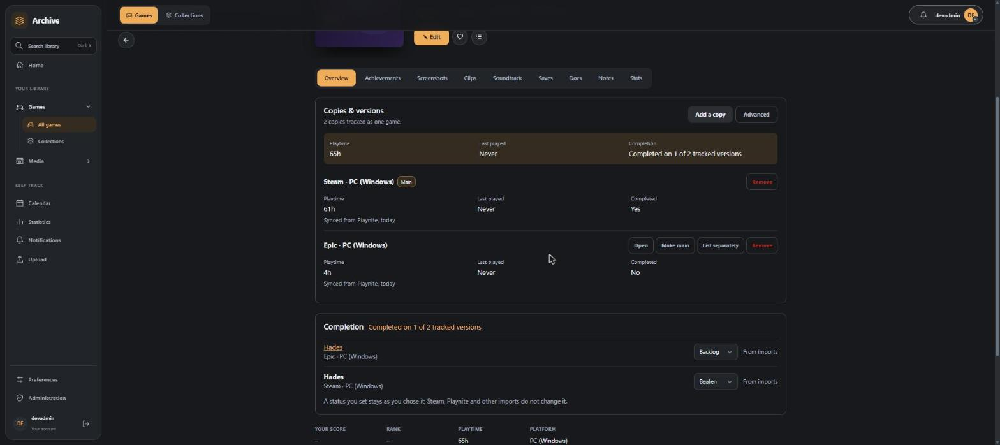

# Game overview, versions and identity UI

Phase 5 of the game identity overhaul
([#91](https://github.com/obsoletelabs/unnamed_tracking_app_2/issues/91)), delivered for
[#101](https://github.com/obsoletelabs/unnamed_tracking_app_2/issues/101). It presents the
[decisions](game-identity-decisions.md), [counters](game-identity-counters.md),
[manual tracking](game-identity-manual.md), [names](game-identity-names.md) and
[matching](game-identity-matching.md) work to people. Backend paths start `src/backend/src/`,
frontend paths `src/frontend/src/`. No migration.

## 1. One entry per logical game

A logical game is a group of games joined by active `same_game` relationships (a merge).
`features/game_identity/overview.py::library_layout` (`GET /api/game-identity/library`)
returns, per group, the umbrella game (the merge root, or the first live version when the
root is in Trash) and each other version with how it is shown:

| Edge `display` | Library | Aggregates |
| --- | --- | --- |
| `default` | folded under the umbrella | included |
| `link` (or identity `presentation = separate`) | also listed on its own | included |
| `hidden` | folded under the umbrella and tucked away in the versions list | included |

Games that are not merged are never grouped, so Minecraft Dungeons and Minecraft Legends stay
their own entries beside Minecraft. Other relationship kinds never merge or aggregate. Their
library presentation comes from the edge's own `display`, or, for `default`, from the user's
rule for that kind (`library_relationship_display` preference, default "list as its own
game"): `link` lists it, `nest` shows it under the parent as a "+ DLC: name" line, `hidden`
removes it from the library. The preference `library_version_display` (`grouped` default,
`separate`) lists every version on its own. Settings, Library, Versions edits both.

`utils/gameIdentityGroups.ts::libraryGrouping` applies the layout to the loaded games and
composes with the owned-copy groups (#56). A group whose umbrella is missing, or a failed
layout request, leaves the plain library. While searching, nested and hidden related games
appear when they match so nothing becomes unreachable. Filters (platform, provider,
achievements) match any record folded into an entry.

## 2. Search

Search matches the title of every record folded into an entry. When exactly one version
other than the umbrella matches ("Minecraft Bedrock"), the card shows that version's label
("Bedrock Edition": the words the two titles do not share, else the platform) and opens that
version. Matching several versions, or the umbrella itself, opens the umbrella.

## 3. Overview and versions

`GET /api/game-identity/games/{id}/overview` returns the overall values beside each
version's own. Overall values come from `counters.reconcile` and the manual-tracking
service, never from the browser:

- playtime: reconciled counters (same counter once, independent counters added); a record
  with no source observation contributes the playtime saved on the game, never zero
  (`playtime_basis: record`). If the overall differs from the sum of versions (a shared
  counter) the panel says so;
- last played: latest of the reconciled value and the records' own;
- owned: versions that are not Wishlist, with their platforms;
- completion: "Completed on 1 of 2 tracked versions" (partial completion is explicit);
- achievements: provider rows plus manual achievements, each counted once.

The game page Overview shows **Copies & versions** (`components/game/GameVersionsPanel.vue`,
redesigned for [#274](https://github.com/obsoletelabs/unnamed_tracking_app_2/issues/274)):
the overall block, then one row per copy named by edition, store and platform
(`utils/gameCopies.ts::copyName`) with its own playtime, last played, achievements and
completion, and the actions in section 5. A game with one record shows an
*Add a copy* prompt. The panel emits the playtime it shows for the page (the overall value on
the main copy's page, the copy's own on a copy page) so the page's fact strip agrees with it. Manual completion and achievements stay on the page and in the dialog.
`manual._umbrella_of` now places a game (and its merged group) in an umbrella the first time
an umbrella-wide manual achievement is created, so "every version" achievements work without
waiting for the backfill; nothing about the game changes.

## 4. Advanced identity tools

`components/game/GameIdentityDialog.vue` (opened from the panel's **Advanced** button, never
required for browsing)
reads `GET /api/game-identity/games/{id}/sources` and offers:

| Tab | Shows | Actions |
| --- | --- | --- |
| Versions | versions, relationships, history | merge another game, keep separate, split (unmerge), how a version/relationship is shown, change relationship type, end, add |
| Sources | linked observations per version: source, external ID, availability, freshness, reported values, Playnite GUID | move an observation to another version |
| Decisions | current decisions with actor, rule, confidence, matched/different/missing evidence; kept-separate pairs; replaced decisions | merge anyway (after confirmation) |
| Counters | every counter with raw, effective, selected source, losing sources and why | correct playtime, remove correction, priority, group, ungroup |
| Manual tracking | the completion and achievement controls | as in #97 |

Every action is a call to the existing #95/#96 routes, plus two new ones:
`PUT /relationships/{id}/display` and `PUT /relationships/{id}` (changes kind: the old edge
is ended and a new one created so history shows it). Errors appear in place, the dialog is a
native modal (focus trap, Escape) and every control is labelled. Reversing "keep separate"
always asks.

## 5. One game with copies (#274)

Before this, merging copies hid one copy's saves behind the other, the main entry was
whichever record was the merge target, owned copies and identity merges were two separate
systems, and copies were indistinguishable ("Hades" and "Hades"). The model is now *one game,
the copies inside it*.

**Main copy.** `decisions.make_main` (`POST /api/game-identity/games/{id}/make-main`) re-roots
the group as a star around the chosen copy: every other member gets a new `same_game` edge to
it, carrying its own `display` and the decision that brought it in; replaced edges are ended,
never deleted. `decisions.split_copy` (`POST /games/{id}/split`) flattens first so exactly
one copy leaves; splitting the main copy promotes `decisions.choose_main` (furthest progressed
status, then most reconciled playtime, then oldest). `POST /merge` takes
`main: target | source | auto` (default `target`, the old behaviour), and accepting a review
suggestion without a choice uses `auto`.

**Content from every copy.** `features/game_identity/copies.py::page_copies` returns the
copies a page shows: on the main copy's page, the main copy and every member not listed
separately (edge `display = link` or identity `presentation = separate`); on any other page,
that copy alone. With `group=true`, the archive, archive trash, screenshot/clip/soundtrack,
media trash, file, file trash and content-count routes list those copies' items, each with
its owning `game_id` and a `copy` label (`title`, `source`, `platform`, `is_main`). Without
it they behave exactly as before, so the Playnite extension and other clients are
unaffected. The page always asks with `group=true` and sends every item action (edit,
delete, add version, restore, read) to `item.game_id` (`useGameDetail.ts::ownerOf`).
`GameCopyBadge.vue` labels items from other copies.

**One grouping model.** `game_ownership.group_copy` (the older **Owned copies** API) also
merges the copy into the main game's identity group and keeps the chosen main;
`separate_copy` splits it. `align_with_identity` keeps legacy `parent_game_id` /
`owned_copy` links pointing at the group's current main after make-main and split, because
the library still folds by them.

**Suggestions.** `matching.assess_copy` (rule `same-game-copy` v1, never automatic, confidence
0.6) compares `base_title_keys`: the title without edition words, platform suffixes ("for
Windows") and bracketed years, as two keys so "Skyrim Special Edition" and "Minecraft: Java
Edition" both work. It needs a real difference (platform, store or edition), refuses provider
ID or relationship conflicts and release years more than three apart, and keeps remakes,
remasters and sequels apart. Queue entries carry `kind: copy | duplicate`, the queue asks once
per pair of groups, and both sides are named with store and platform.

**UI.** Copies & versions (section 3), `GameAddCopyDialog.vue` (library search with
suggestions first and an optional *make main*), the redesigned review queue
(`IdentityReviewQueue.vue`: headline per kind, side-by-side copies, main-copy choice) and
library cards (`useGameLibrary.ts::copySummary`: "2 copies · Steam, Epic", or the store and
platform of a lone copy whose title repeats). Tests: `tests/test_game_identity_hub.py`, the
copy cases in `tests/test_game_identity_matching.py` and `tests/test_game_ownership.py`,
`src/tests/gameCopies.test.ts`, `identityReviewQueue.test.ts` and `gameIdentityUi.test.ts`.

## 6. Compatibility

Duplicate highlighting stays: a card is flagged when any record folded into it is half of a
possible duplicate, except for pairs already merged, and links to Settings, Library,
Duplicates. Collections, filters and routes are unchanged. Records with no observations or
new metadata (older Playnite imports) read from their own fields. No Playnite endpoint or
payload changes. Tests: `tests/test_game_identity_overview.py`, `src/tests/gameIdentity*.test.ts`,
`gameLibraryVersions.test.ts`, `gameVersionDisplay.test.ts`, and the browser stage
`tools/check_game_identity_ui.mjs` (`game-identity` in `check_ui_redevelopment.mjs`).

