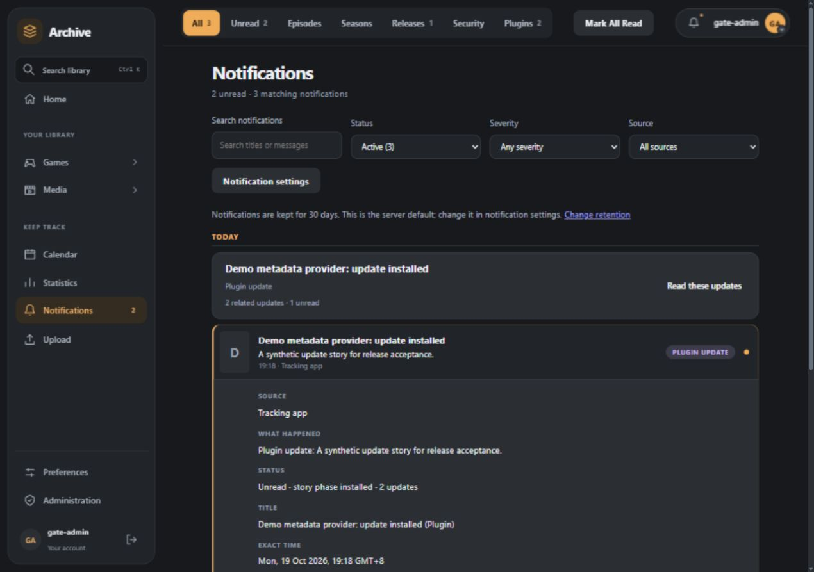
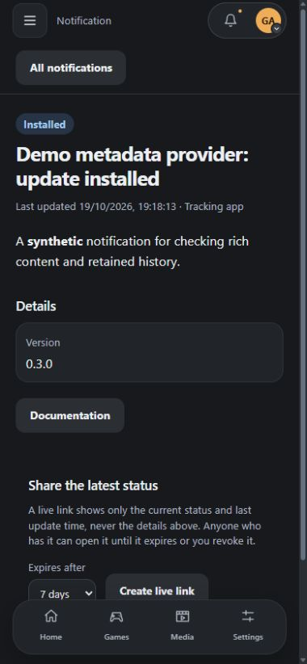
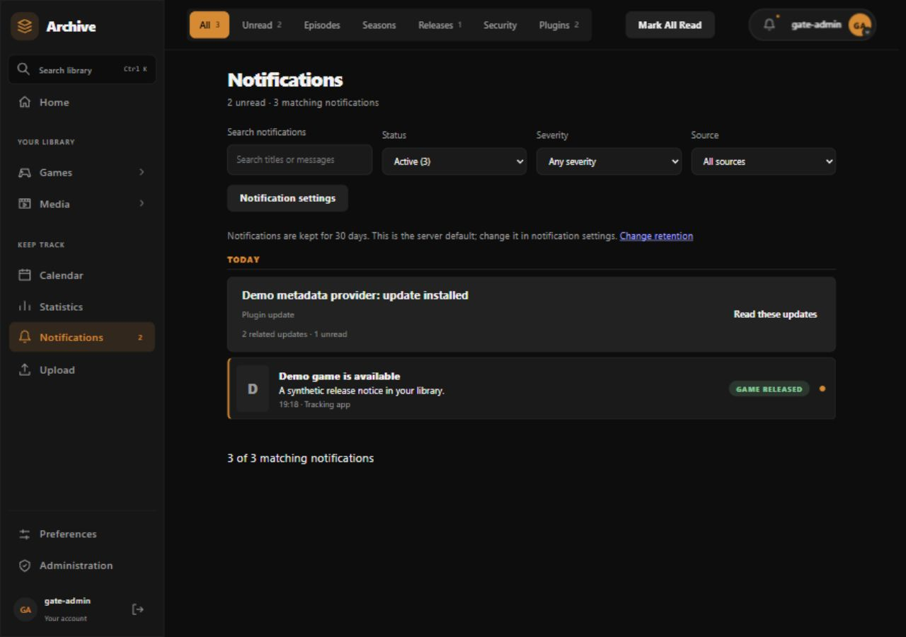
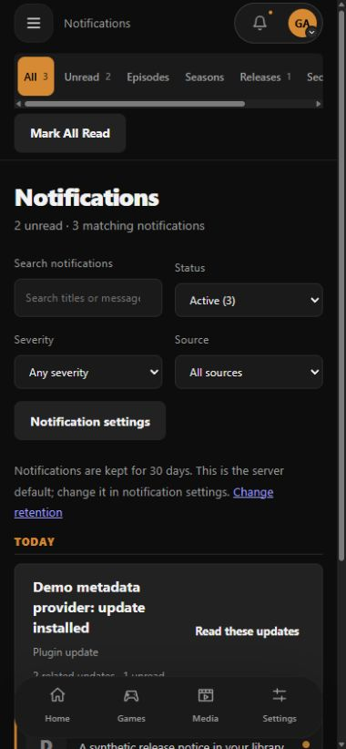

# Notification overhaul: migration, rollout and acceptance

This is the final integration gate for the notification overhaul (#104; features #105 to #117; gate #118).
It records what exists, how existing data and callers are carried forward, the order in which host and
plugins are released, how to roll back, and the evidence that the integrated state works. Contract
details live in [Notification contract](notification-contract.md) and [Notification core](notification-core.md).

`tests/test_notification_rollout_inventory.py` fails if an event type, provider, preference, route,
compatibility surface or notification migration below is missing from this page.

## Inventory

### Producers and event types

| Event type | Producer | Story model |
| --- | --- | --- |
| `media.episode.aired`, `media.season.started`, `media.sequel.announced`, `media.movie.released` | Host media scans (`notifications.py`) | Single-item legacy rows on the same dispatcher; aggregated by entity and release day |
| `media.franchise.season`, `media.franchise.extra` | Scheduled AniList franchise checks (`anime_franchise.py`, rows from `notifications.py`) | Single-item legacy rows on the same dispatcher; opt-in per account |
| `game.released`, `game.sale.started`, `game.price.threshold_hit` | Host game scans | One-item stories from validated quotes (#116) |
| `system.plugin.update` | Host plugin update checks | `available`, then `installed`, `failed` or `resolved` (#116) |
| `security.session.anomaly` | Host session security | Security purpose, never delayed or aggregated |
| `plugin.notice` | `notifications.send` legacy adapter | Single-item story from title and body |
| `auth.password_reset`, `auth.user_invite`, `destination.verification` | Host-reserved interpretations | Reserved purposes, no rich content, no digest |
| Plugin-registered types | `notifications.emit` (legacy) and `notifications.publish` (canonical, Plugin API 1.1.14) | Declared lifecycle |

### Providers

| Provider | Kind | Renderer |
| --- | --- | --- |
| `core.inbox` | Built in | Legacy plain text, host-proxied artwork |
| `core.smtp` | Built in | Canonical rich HTML and text (#111) |
| `core.browser` | Built in | Generic story-addressed Web Push, replace by tag (#114) |
| Plugin transports (`webhook`, Discord, generic `plugin`) | Plugin registered | Legacy DTO or canonical delivery when capabilities are declared (#112, #115) |

### Routes

| Route | Purpose |
| --- | --- |
| `/api/notifications` (list, `unread-count`, read, dismiss, delete) | Inbox and history |
| `/api/notifications/policy` | The existing retention policy (default, maximum, requested, effective) |
| `/api/notifications/stories/{story_id}` | Live story page, actions and live links (#109, #113) |
| `/api/settings/notification-providers` | Destinations, verification, routing and provider status |
| `/api/settings/notification-timing` | Quiet hours, digests, mute and urgency limits (#108) |
| `/api/settings/notification-diagnostics` | Administrator previews, simulation, test sends and owner history (#117) |

### Preferences and settings

Per-person values live in the existing preference document: `notify_*` (one switch per kind),
`notification_types`, `notification_destinations`, `notification_routes`, `notification_timing`,
`notification_url`, `notification_retention_days` and `notification_retention_inherit`. Deployment
values are the `NOTIFICATION_*` environment settings (retention default and maximum, image mode,
follow-ups, browser previews, live-link limits, blocked providers and types, minimum trust).
No new preference store was introduced; the existing retention policy
(`features/notification_inbox.retention_policy`) is the only retention mechanism.

### Plugin contracts and compatibility surfaces

Every surface in `LEGACY_ADAPTERS` keeps working through its adapter: `notifications.send`,
`notifications.emit`, `notification_sources.register`, `notification_sources.unregister`,
`notification_providers.register`, `notification_providers.unregister`, `notification-deliveries`,
`notification-layouts`, `notification-story-actions`, `notifications.lifecycle.poll` and
`notification_destinations.status`.
Plugin API 1.0.0 to 1.1.13 manifests and operations are unchanged; 1.1.14 adds the canonical
capabilities (see [Plugin contract](notification-contract.md#plugin-contract-plugin-api-1114)).

### Database migrations

The existing Alembic graph has one head, with historical merge revisions retained. The
overhaul adds five notification revisions after the pre-overhaul milestone `e4a0157eef4b`;
unrelated migrations and their existing merges also occur between these milestones:

| Revision | Issue | Change | Downgrade guard |
| --- | --- | --- | --- |
| `6f75008c02a6` | #106 | Stories, revisions, item links, receipt story keys | Refused while stories exist |
| `61de2c6d5459` | #107 | Aggregation windows and batch membership | Refused while windows exist |
| `a3c81e5d7f20` | #108 | Requested urgency and timing reason | Refused while non-default urgency or timing reasons exist |
| `b7d41c9a2e65` | #109 | Rich content on revisions and expiring live links | Refused while revisions hold rich content |
| `c91f3a27d5b8` | #110 | Per-revision deliveries, attempt operations, remote message references | Refused while remote references or per-revision deliveries exist |

Earlier notification revisions (`22ff87d4d01c`, `0037e34ac954`, `f1b4375a624c`, `a1a6b04b3606`,
`a4456747e462`, `bb61f2eb639c`, `c4771032f3c4`, `d3b2af990c5d`) are unchanged. Live links are bearer tokens with an expiry; dropping the table on
downgrade invalidates links but erases no history.

## Compatibility decisions

- **Nothing is dropped.** Every host event type maps to a story through `content_from_draft` or
  `content_from_notification`; every plugin surface has an adapter; every provider keeps its
  destinations, proof, consent and settings. Rows written before the overhaul read as revision 0,
  normal urgency and no story.
- **No schema backfill is needed.** Story, window, timing and dispatch columns are additive with safe
  defaults, so existing notification IDs, read and dismissed state, expiry, dedupe receipts, destination
  revisions, verification proof, media consent, deliveries and provider settings are untouched.
  `tests/test_notification_rollout_migration.py` proves this on a populated pre-overhaul database.
- **Adapters stay.** Retiring an adapter needs a separately reviewed change that shows no supported
  Plugin API version or stored registration depends on it. This gate removes none.
- **Retention is unchanged.** Stories, revisions and deliveries follow the inbox policy
  (server default, per-person inheritance, server maximum, visible expiry). Expired items stay
  inspectable through their story link only while retention allows. Minimal dedupe receipts
  remain separate and have no expiry; content expiry must not permit a replayed event to notify again.

## Release order

1. **Back up** the database. Review `alembic heads` (one head expected).
2. **Deploy the host** (backend, frontend, plugin runtime) with all notification changes. The migrations
   are additive and run at start-up. Existing plugins keep working on their current Plugin API versions.
3. **Verify** with the checks below: inbox, one SMTP test send and a Web Push test from the diagnostics
   tools, plugin provider status.
4. **Publish plugin SDK and packages** that target Plugin API 1.1.14 (companion #53, Discord #54,
   producers #55) only after step 3. Never publish a package that declares the 1.1.14 capabilities
   against an older host: the host rejects such manifests, and `notifications.contract` lets an SDK check
   the connected host first.
5. **Enable options gradually:** `NOTIFICATION_BROWSER_PREVIEWS=story` and
   `NOTIFICATION_FOLLOW_UPS=all` are opt-in and can be left at their defaults.

## Rollback

- **Plugins first:** pin or reinstall the previous package versions. Older SDKs and manifests keep
  working on the new host, so this alone restores old plugin behaviour.
- **Host code:** the new host code can be rolled back without a schema downgrade because the schema is
  additive and the previous release ignores the extra columns and tables. This is the recommended
  rollback and keeps stories, deliveries and history.
- **Schema downgrade** (only if the previous release cannot tolerate the schema): each revision above
  refuses to drop populated history. Remove or let expire the rows named in its guard, within normal
  retention, before downgrading. Never edit rows to bypass a guard.
- **Restart safety:** delivery is at least once. A crash after a send and before acknowledgement may resend
  a message with the same idempotency key; leases expire and are reclaimed.

## Scenario to test matrix

| Scenario | Evidence |
| --- | --- |
| Clean database reaches one head with every table | `test_notification_rollout_migration.py::test_clean_database_reaches_the_single_head_with_every_notification_table` |
| Populated upgrade keeps IDs, read state, expiry, receipts, proof, consent, deliveries, settings, retention preference; repeat upgrade is a no-op | `test_populated_upgrade_preserves_every_record_family_and_is_repeatable` |
| Destructive downgrades are guarded; lossless otherwise | `test_downgrade_is_refused_while_new_history_exists_and_lossless_otherwise`; per-revision tests in `test_notification_story_migration.py`, `test_notification_aggregation_migration.py`, `test_notification_timing_migration.py`, `test_notification_rich_migration.py`, `test_notification_dispatch_migration.py` |
| Event, story, delivery and history over real SMTP; duplicate replay; partial provider failure; restart lease reclaim; revision; retention and expiry | `test_notification_rollout_gate.py::test_event_to_history_with_replay_partial_failure_and_retention` |
| Revoked grant suppresses queued work, history kept | `test_revoked_grant_suppresses_queued_work_but_keeps_history`, `test_plugin_notification_contract.py` |
| Digest boundaries and quiet hours | `test_digest_boundaries_hold_through_the_integrated_path` (real SMTP, before/at boundary, next window, no repeat send), `test_quiet_hours_release_real_mail_at_the_boundary_without_delaying_inbox`, and the focused aggregation/timing suites |
| Disable and uninstall keep history | `test_notification_stories.py::test_plugin_uninstall_keeps_history_and_reinstall_starts_new_stories`, `test_plugin_notification_contract.py::test_disable_or_uninstall_suppresses_work_but_keeps_history` |
| Provider edits and follow-ups | `test_notification_dispatch_capabilities.py` (`test_later_revision_edits_the_remote_message_once`, `test_refused_edit_falls_back_to_a_follow_up_and_marks_the_reference`), `test_notification_smtp_rich.py::test_followups_are_selective_and_mail_is_never_edited` |
| Restart recovery and duplicates | `test_notification_aggregation.py::test_restart_reclaims_an_expired_lease_without_losing_or_doubling_the_batch`, `test_notification_dispatch_capabilities.py::test_crash_after_send_resends_with_the_same_idempotency_key`, `test_notification_stories.py::test_acceptance_survives_a_restart` |
| Retention defaults, inheritance, maximum | `test_server_retention_default_is_the_only_retention_mechanism`, `test_notification_inbox.py` |
| Every producer, provider, preference, route, adapter and migration is inventoried | `test_notification_rollout_inventory.py` |
| SMTP captured transport | `test_notification_smtp_rich.py` (local SMTP server) |
| Discord and plugin transports | `test_plugin_rich_delivery.py`, `test_plugin_notification_provider_contract.py`; companion `official.discord-bot-notifications` through `check_host_contract.py` |
| PWA / Web Push worker | `test_notification_browser_story.py`, `src/backend/tests/notification_push_worker.test.mjs` |
| Signed packages | `test_plugin_notification_packages.py` (throwaway keys), companion `check_host_contract.py` |
| Diagnostics, previews, safe test sends | `test_notification_diagnostics.py` |

## Acceptance report

See the pull request for the commands and counts of the final run. Checks that depend on services this
environment does not have (hosted CI, real Discord or mail accounts, a physical device) are listed there
as not run.

## 19 October 2026 integrated acceptance

Tested host `5e0f6143` plus the gate changes in `179b1f00`, against companion
`c0b3be0c`. The follow-up only changes tests and documentation; it does not replace any
notification implementation or remove an adapter. Own disposable Docker services and
PostgreSQL 18 were used; existing deployments were not modified.

| Check | Result |
| --- | --- |
| Full backend, `python -m pytest -q tests` | 4,289 passed; 8 optional companion tests skipped when the checkout was not mounted |
| Those same eight tests with `UTAPP_PLUGINS_REPO` and `PLUGIN_REPOSITORY_PATH` set to the actual companion checkout | 8 passed; original published archive bytes, signatures, reviewed historical trust pins and scheduler contracts verified |
| Runtime `python -m pytest -q tests` | 196 passed |
| Companion preview build and `tools/check_host_contract.py --host-root <host>` | 24 maintained packages passed host manifest/UI, digest, installation and disabled-lifecycle conformance |
| Companion Discord rich delivery, story contract and official-producer suites | 180 passed, capturing Discord payloads at the `network.request` boundary |
| Frontend lint, format, typecheck, test and build | Passed; 1,009 tests in 161 files |
| `node --test src/backend/tests/notification_push_worker.test.mjs` | 26 passed |
| Backend mypy / pylint | No issues in 438 files / 10.00 out of 10 |
| Ruff and strict wiki build | Passed |
| Hosted CI on the tested code | Backend, frontend, migration graph, runtime policy, all Docker images, combined production container and production runtime smoke passed |
| Browser acceptance | Modern/Classic desktop and 390-pixel phone viewport; history expansion, rich story navigation, unread filtering, visible retention and no page-width overflow verified |

The optional-test skips above were all due to an unmounted companion repository, and were
explicitly rerun with that repository present. No skipped contract was counted as a pass.
The Discord capture is a fake remote API at the public network boundary; it is not a claim
of live Discord delivery. SMTP uses a real local socket server. Live mail accounts, actual
Discord credentials, physical push devices and production load remain deployment checks.

### UI evidence

These captures use synthetic data in a separate `notification_ui` database. They show the
current integrated interface, not a new visual design.

