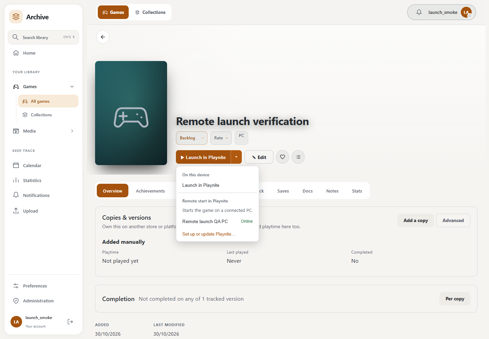
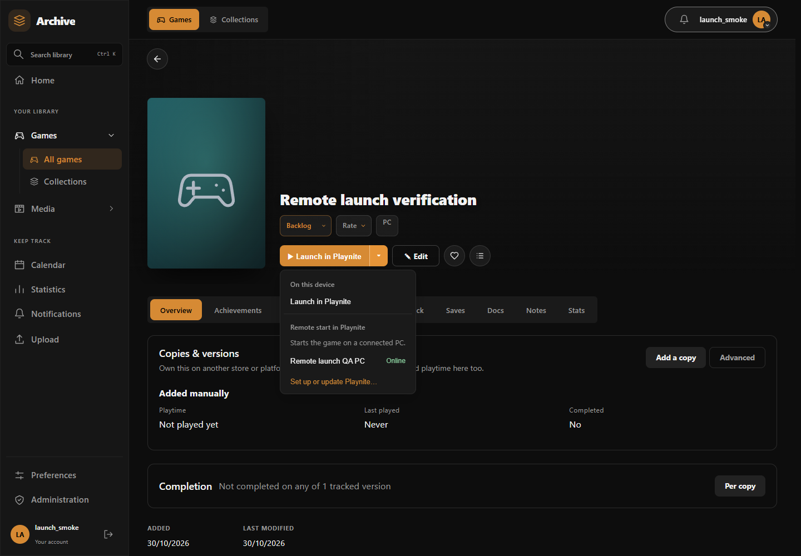
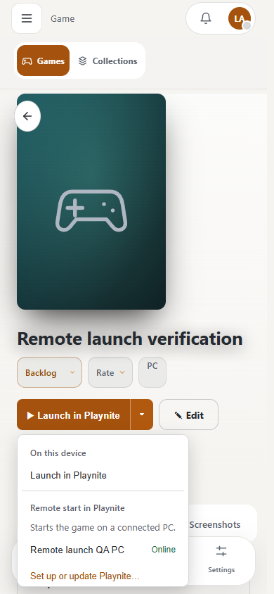
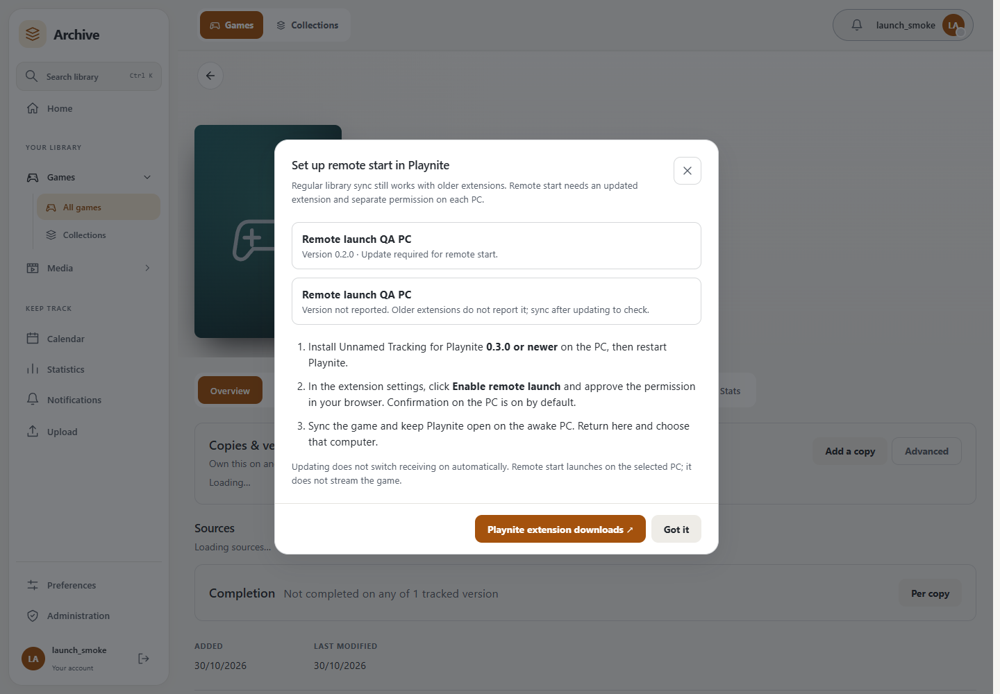
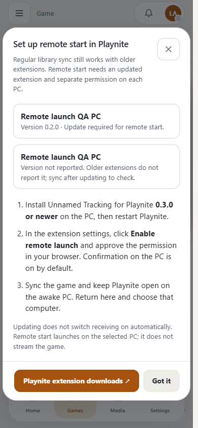

# Playnite remote launch v1

The host API, browser launch menu and Playnite companion receiver implement [host #319](https://github.com/obsoletelabs/unnamed_tracking_app_2/issues/319) and [Playnite #6](https://github.com/obsoletelabs/unnamed_tracking_playnite/issues/6). Both the updated host and companion are required. Steam streaming is [researched separately](steam-remote-play.md) and is not implemented here.

## Set up and launch

1. Update the host (including its database migration) and install the matching updated Playnite extension. Keep Playnite open on the awake Windows computer.
2. In **Add-ons → Extension settings → Unnamed Tracking**, sign in with the browser, then click **Enable remote launch**. Approve the optional `games.launch` permission. Existing sync consent and API keys do not enable receiving.
3. Leave **Ask on this PC before each remote launch** selected unless you explicitly want unattended launches. Sync the game so the host has its Playnite GUID.
4. In a signed-in browser, open the game, open **More ways to launch**, and choose **Remote start on <computer>** under **Remote start in Playnite**. Offline computers are disabled.
5. Confirm on the PC if prompted. The browser reports waiting, handed to Playnite, rejection, expiry or an uncertain outcome. **Check this request** recovers the same request after a transport failure; it does not create another launch.

Disable receiving in the extension or revoke its connected-app permission to stop new requests. This does not wake a sleeping PC, install games, stream video or open firewall ports. Playnite must already have an installed, launchable local entry.

## Trust and consent

A receiver is one approved Playnite desktop grant. Its public device ID is that grant's UUID. The name comes from the consent request and is display context, never identity proof. Two computers with the same name or reported device ID still have different grants. Renewed consent creates a new receiver; requests never migrate automatically to another grant.

The extension must request the new `games.launch` capability through the existing desktop consent flow. Existing `library.sync` grants do not gain it. Consent describes this capability as a write. After consent, the extension must explicitly enable receiving on its own connection; the setting should default off. Only a live `utd_` credential for the enabled `desktop:playnite` client can configure, claim or report. Browser sessions and legacy API keys cannot receive requests. Instance desktop policy, client enablement, account activity, expiry, revocation and scope are checked on receiver authentication.

Only a signed-in browser session can list its receivers, queue an owned game or inspect its requests. Neither API keys nor delegated integrations can queue a launch. The server resolves the Playnite UUID from the owned game row; callers cannot supply a path, executable, command, URI, launch arguments or a replacement Playnite ID. Wishlisted, trashed and unlinked games cannot be queued. Game ownership, trash state, wishlist state and the identifier snapshot are checked again before dispatch. The receiver must separately verify the GUID exists in its local library and reject unsupported or unsafe local conditions. A GUID linked in the host is not proof that every paired computer has the game installed.

## API

Base path: `/api/playnite/launch/v1`. Responses carry `Cache-Control: no-store`. Times are Unix seconds. Unknown request-body fields are rejected. Errors use FastAPI's existing `detail` envelope; 401 means invalid/missing receiving credentials, 403 insufficient authority, 404 an unavailable owned object, 409 an unavailable target or invalid transition, 422 an invalid payload, and 429 the launch quota (with `Retry-After`).

| Method | Path | Caller | Body / result |
| --- | --- | --- | --- |
| GET | /contract | User or games.launch grant | Contract name/version, scope, TTL, polling and online windows, delivery semantics |
| GET | /devices | Browser session | At most 200 enabled receivers with live permission: id, name, last_seen_at, online |
| PUT | /device | Playnite games.launch grant | {"enabled": true/false}; returns own id and enabled state |
| POST | /requests | Browser session | {"device_id": UUID, "game_id": UUID, "request_key": UUID}; returns request status |
| GET | /requests/{request_id} | Browser session | Own request status |
| POST | /requests/claim | Playnite games.launch grant | Empty body or {}; returns {"request": null or {"id", "playnite_id", "expires_at"}, "server_time": UNIX_SECONDS, "poll_interval_seconds": 5} |
| POST | /requests/{request_id}/result | Same receiving grant | {"state": "accepted"} or {"state": "failed", "failure_code": CODE}; returns request status |

Request status includes id, device_id, game_id, state, failure_code, created_at, expires_at, dispatched_at and completed_at. It never includes executable details. The receiver's failure codes are game_not_found, not_installed, already_running, declined and launch_failed. The host also uses game_unavailable when a queued game's identity or availability changed before dispatch. No raw exception text is accepted from a receiver.

The separate launch contract is version 1. It does not change the existing playnite-observations contract or require old extensions to understand remote launch. Before opting in, the companion discovers /contract and verify the name, version and delivery behavior; a missing route or unsupported version disables only remote launch.

## Delivery and retries

The extension uses outbound HTTPS requests only. Poll every five seconds while opted in, stop on sign-out/disable, and back off on network errors, 401/403 or server errors. A successful poll updates last_seen_at. The browser treats a computer as online for 20 seconds after its latest enable/poll and cannot queue to an offline receiver.

Requests expire 60 seconds after creation. One outstanding request per receiver is allowed. Enqueue is limited to six new requests per account per rolling minute and 60 per rolling hour across all of its receivers. A database user lock serializes quota/idempotency checks; grant and receiver locks serialize dispatch, disable and permission reduction across workers.

Generate request_key once per deliberate browser launch action. Retry a transport failure with the same key and identical target; the server returns the existing request, including its terminal state, rather than enqueuing another. Reusing a key for a different target returns 409. Keys are retained with history for seven days; clients must not retry an old launch action after its expiry or retention window. Another deliberate launch requires a new key.

Delivery is **at most once**, not guaranteed execution. The host commits pending → dispatched before returning the claim. Concurrent polls and retries receive no second copy. If the response is lost, or the receiver stops after dispatch, the request becomes unknown at expiry. It is never returned to pending. A user may deliberately create another request after reviewing that outcome.

| State | Meaning |
| --- | --- |
| pending | Queued; not handed to the receiver |
| dispatched | Handed out once; execution is not confirmed |
| accepted | Receiver accepted the local Playnite launch action; this does not prove the game is running |
| failed | Receiver rejected/failed the action, or host invalidated the game before dispatch |
| expired | Undispatched request expired or lost permission/opt-in |
| unknown | Dispatched request expired or was disabled/revoked without a confirmed result |

Repeated identical terminal results are idempotent. Conflicting results, results before dispatch and results after expiry are refused. Disable settles undispatched requests as expired and dispatched requests as unknown; re-enabling never revives them. Browser status reads settle requests after permission removal. Disabling cannot retract an already handed-out request; the extension must check its local opt-in and the deadline immediately before invoking Playnite.

## Companion behavior

1. Keep the opt-in off by default, obtain explicit games.launch consent, then enable this receiver. Do not send API keys as a fallback.
2. Poll serially with cancellation and bounded network timeouts. Prevent multiple receiver loops in one Playnite process.
3. Before invoking the Playnite SDK, persist the claimed request ID as consumed, check the request deadline, local opt-in and the existing local game GUID. Never execute a path or command from the response. Persist-before-launch may lose a launch during a crash; prefer that to launching twice.
4. Notify the PC user and apply the chosen local confirmation policy. Use Playnite's supported start-game API. Report accepted only after that invocation succeeds; actual running/last-played state remains ordinary library synchronization.
5. Report only the closed failure codes. Retry result submission with the same outcome; never retry local execution when acknowledgement fails. On sign-out, clear local receiver state and use the existing credential revocation flow.
6. The companion uses a server-specific, exclusively locked receipt journal. It records a request before calling the SDK and persists the outcome before acknowledgement. Failed acknowledgements retry only that outcome, including across restarts. Corrupt history stops receiving rather than discarding duplicate protection. Consumed IDs remain for seven days.

The companion computes the remaining deadline from `expires_at - server_time` and a local monotonic timer started before the claim HTTP call. Its clock need not match the server, and HTTP/confirmation time consumes the deadline. It checks opt-in, account, server and expiry again immediately before calling `PlayniteApi.StartGame`. Existing Playnite startup scripts and save-download guards still apply; a save guard may pause the game and require another deliberate launch after the download.

## Persistence, retention and verification

Migration 9cc6333e6de6 follows c4e9a2d71b05. It adds remote_launch_devices and remote_launch_requests, grant/game/user cascades, a unique per-user request key, a state constraint and queue/quota/expiry indexes. It does not modify existing grants. Table/index creation uses the existing replay-safe migration helpers so adoption of an older database preserves existing launch rows. Downgrade drops only these new tables.

Lifecycle events are recorded in the existing content-free delegation audit (launch.enabled, disabled, queued, dispatched, accepted, failed, expired, unknown). Request IDs and game/device associations are held in the request table. The existing Trash and session cleanup task deletes expired launch history and launch audit events older than seven days, at most 1000 of each per pass. Execution deadlines are enforced by request paths and do not depend on that task running.

Regression coverage is in tests/test_remote_launch.py. Run it with the consent, desktop access, Playnite contract/observations, route-authorization and trash-sweep suites. It covers dispatch races, idempotency, rejected command fields, caller/device/user separation, permission removal, offline targets, disable/re-enable, expiry, identifier changes, quotas and retention. Migration upgrade, downgrade and upgrade should be checked on a disposable PostgreSQL database.

## Browser appearance

The local launcher and remote PCs share the existing launch dropdown. Remote request status occupies a separate row below Launch, Edit, favorite and collection controls. The menu fits desktop and phone viewports and uses the current appearance tokens. These screenshots use a disposable account and receiver.

## Extension updates and compatibility

Remote start requires companion 0.3.0 or newer. Existing extensions keep their library, note and save routes. The new companion adds an optional X-Playnite-Extension-Version header; older hosts ignore it and ordinary synchronization still negotiates the existing observation contract or legacy fallback. Remote launch remains off until explicitly approved and enabled.

On an authenticated Playnite desktop grant's ordinary /api/playnite/contract probe, the host records a bounded version and check time in that connection's existing display metadata. Other callers cannot set a PC's report, and a reported version never grants permission. Older clients omit the header, so their exact version is unknown. The browser distinguishes a reported version below 0.3.0 from an unreported version.

Opening the remote-start menu shows a dismissible setup/update dialog once per affected connection/version in this browser. An extension which has not synced since the host update is unknown, not asserted outdated; setup remains available manually. A compatible version is not classified as outdated because receiving is disabled. Already enabled receivers are not warned just because a sync-version report is absent. The dialog links to the companion releases and explains installing the update, enabling remote launch and syncing. It never installs software or broadens access automatically.

