# Loading, empty, error and retry state audit

Task [#262](https://github.com/obsoletelabs/unnamed_tracking_app_2/issues/262). The rule being checked: **a failure must not
look like "nothing there", useful data must not disappear on error, retry must be discoverable and must not double-submit
or reuse a stale result.** This page records what was checked, what was fixed and what is still open. It is an audit of the
flows named below, not of every screen.

## Checklist

| Flow | Request or failure | Finding | Status |
| --- | --- | --- | --- |
| Calendar: watched history, games history, your own entries | any of the three requests fails | games history was cleared to empty and the other two failed silently, so the calendar looked complete | **fixed**: each layer keeps its data, the page names the missing layers and offers **Try again** (`calendarBrowsing.test.ts`) |
| Calendar: months beyond the first window | range request fails or is superseded | new feature; had to avoid the same trap | covered: loading, error with retry, results of an older request ignored; loaded months kept |
| External calendars and occurrence editor | source/window request or save fails; account changes | external data must stay separate from manual entries and retain the last valid snapshot/draft | covered: named missing layer, retry, stale response suppression, cleared account cache, cancelled-event reconciliation and guarded submits (`calendarSources.test.ts`, `calendarSourceEventEditor.test.ts`, `calendarBrowsing.test.ts`) |
| Manual watch logging: title search | library request fails or is slow | failure looked like "no match" | **fixed**: loading, failure with retry, and no-match are distinct; the typed text and chosen day are kept |
| Manual watch logging: submit | double click, stale form | submit was guarded by `manualSaving` already | already covered |
| Metadata search in the game, movie, TV and anime editors | no usable provider | only discovered by clicking | **fixed** ([#254](https://github.com/obsoletelabs/unnamed_tracking_app_2/issues/254)): reason and setup link before submitting; server check remains |
| Steam import | details or covers fail for some games | the summary counted "enriched" even without a cover | **fixed** ([#256](https://github.com/obsoletelabs/unnamed_tracking_app_2/issues/256)): failed and cover-less games are named and retryable; retries are idempotent |
| Scheduled task intervals | refresh while editing; server refuses a value | edit was saved on every keystroke/change | **fixed** ([#252](https://github.com/obsoletelabs/unnamed_tracking_app_2/issues/252)): one draft, explicit save, kept on failure, refresh never overwrites it |
| Upload limits | an environment value locks a field | silent override | **fixed** ([#253](https://github.com/obsoletelabs/unnamed_tracking_app_2/issues/253)): source shown, field locked, refused save changes nothing |
| Export / Import tabs | switching mid-import | would have lost a preview if tabs were separate pages | covered: state lives in one component; tested |
| Home (`HomeHub`) | one data source fails | separate loading/error per source already existed | already covered |
| Startup and backend unavailable | backend down | themed unavailable screen with retry already existed | already covered |
| Notification settings | preferences or routing request fails | error shown; stored values kept | already covered; layout changed only ([#273](https://github.com/obsoletelabs/unnamed_tracking_app_2/issues/273)) |
| Media picker search, plugin manager popup | out-of-order search; slow or partial plugin popup requests | sequence guards and per-section tolerance already exist | already covered |
| Collection detail (`/games/collections/:name`) | games request fails | showed "Nothing in this collection yet" with no retry | **fixed**: alert with **Retry**, guarded against double starts, no full-page spinner when reloading with data present (`uiStateAudit.test.ts`) |
| Collections index (`/games/collections`) | games request fails | error without retry | **fixed**: **Retry** with in-flight guard and error reset |
| Media lists index (`/media/lists`) | lists request fails | error without retry | **fixed**: **Retry** with in-flight guard |
| Media list detail (`/media/lists/:id`) | id changes while loading; request fails | an older response could overwrite the newer list and the previous list stayed under the new id | **fixed**: sequence guarded, cleared on id change, error has **Retry** |
| Achievement detail notes | navigate to another achievement | a late response filled the wrong achievement's notes | **fixed**: sequence guarded and cleared on change |
| Settings > Users: invitations | invitations request fails | failure was swallowed into an empty list | **fixed**: message with **Retry**, previous invitations kept |
| Settings > Users: user table | users request fails, or a later action errors | any error replaced the whole table and had no retry | **fixed**: table stays when users are loaded, a load failure shows **Retry**, concurrent reloads are ignored |
| Game page: Docs, Worlds modpack files, Saves, Worlds, Screenshots/Clips/Soundtrack, first load fails | the list request fails | Docs, Saves and Worlds showed a skeleton forever beside the error; media showed the "Add screenshots" prompt, so a failure looked like an empty list; retry only by leaving the tab and coming back | **fixed** ([#334](https://github.com/obsoletelabs/unnamed_tracking_app_2/issues/334)): the error stays, with a **Retry** and no skeleton or Add prompt; an error on an already loaded list is unchanged (`uiStateAuditGamePage.test.ts`) |
| Game page: media, files, saves answering late | the page moves to another game, or another account is picked, before a slow answer arrives | the late answer filled the new game's tab or the wrong account's gallery, and could leave a permanent loading state | **fixed**: each loader keeps only the answer for the game (and, for media, the request) it was asked for |
| Game page: leftover error messages | a failed delete or load on one game or tab | "Failed to delete" stayed visible on the next game, and saves/worlds loads never cleared an earlier error | **fixed**: opening another game clears the media and file errors, and a retry clears the message |
| Game page: edit saved, refresh fails | the re-read after saving an edit fails | the page kept the old values with no message | **fixed**: "Your change was saved, but this page could not be refreshed" with **Reload** |
| Game notes | the note list request fails; switching games; two quick checkbox clicks | a failure looked like "Write your first note"; the previous game's notes stayed (and a late answer could overwrite the new list); a failed first toggle could undo the second | **fixed**: **Retry** instead of the empty prompt, the list is cleared and guarded on game change, checkbox clicks are ignored while one is saving |
| Statistics burn-down card | games request fails | the optional card is silently omitted; the main statistics keep their own error state | left |
| Plugin popup UI and logs | request fails | intentionally tolerated; the popup shows the remaining sections | left |

## Exercised with injected failures

Run against the development stack with the browser's `fetch` forced to answer 500 for one endpoint at a time, then cleared to check that Retry recovers.

| Flow | Injected failure | Result |
| --- | --- | --- |
| Game library, returning to `/games` with a library already seen | `/api/game/list` answers 500 | **fixed**: the cached games disappeared and the error had no Retry. The list now stays, with an alert "The list below may be out of date" and **Retry** (`GameLibrary.vue`) |
| Game page favourite heart | `PATCH /api/game/update/:id` answers 500 | **fixed**: the heart reverted with no message and a second click could race the first. It now shows "Could not update the favourite" beside the heart and ignores clicks while saving (`useFavoriteToggle`) |
| Library favourite star | same | **fixed**: same silent revert; now names the game and ignores a second click while saving |
| Game page | game requests answer 500 | already covered: "We couldn't load this game" with **Try again** and a way back |
| Media lists index | `/api/lists` answers 500 | covered by the earlier fix; Retry restores the lists |
| Settings > Users | `/api/auth/users` answers 500 | covered by the earlier fix; message with Retry |
| Collections index and detail | games request answers 500 | covered by the earlier fix (screenshots above) |

Login, accepting an invitation, first-run setup and the upload section were read, not exercised: each guards its submit with a busy or saving flag, clears it in `finally` and shows the error.

## Not audited yet

Notification pages (they follow the notification overhaul contract), the rest of the game page (`useGameDetail` has 37 error handlers; only load and favourite were exercised), anime, movie and TV detail views, the Steam and connection dialogs and the plugin manager's remaining handlers. The anime, movie, TV and plugin flows need provider data or a running plugin runtime, which the test stack did not have. Each needs the same four questions asked against its real requests.

## How to check a flow

1. Make each request it issues fail, be slow, return empty, and arrive out of order (a newer request must win).
2. Confirm the screen says which part failed, keeps what it had and the user's draft, and offers retry.
3. Confirm retry cannot submit twice.
4. Add a test that fails if the failure shows as an empty state.

## Screenshots

Captured against the development stack with the games request forced to answer 500 (Modern theme, 800 px pane).

| Page | Before | After |
| --- | --- | --- |
| Collection detail | 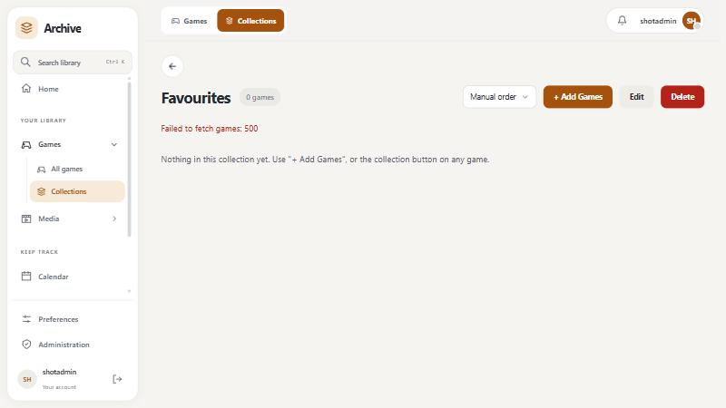 | 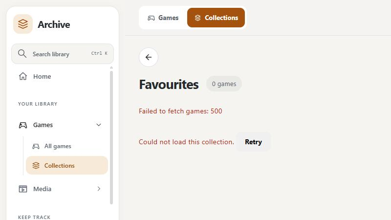 |
| Collections index | 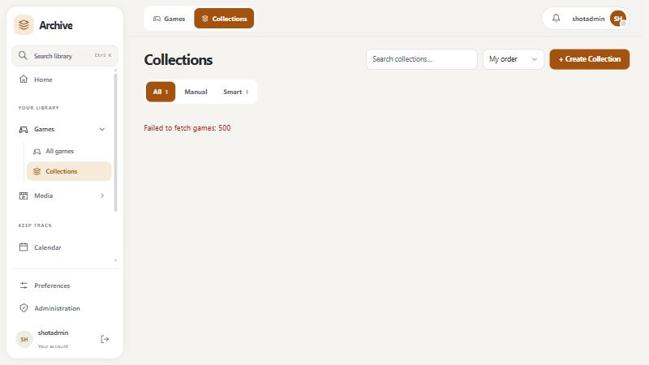 | 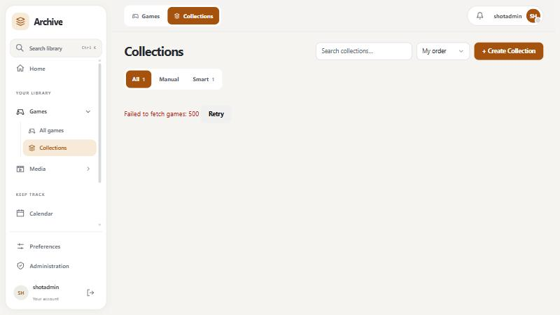 |

### Phone width and Classic

The collection pages were also checked at 375 px in Modern and Classic with the same forced failure. Both keep the layout (header, actions, error and **Retry** on their own lines, no horizontal scroll).

| Collection detail | Modern, phone | Classic, phone |
| --- | --- | --- |
| After | 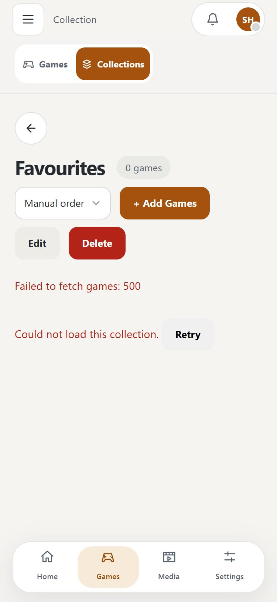 | 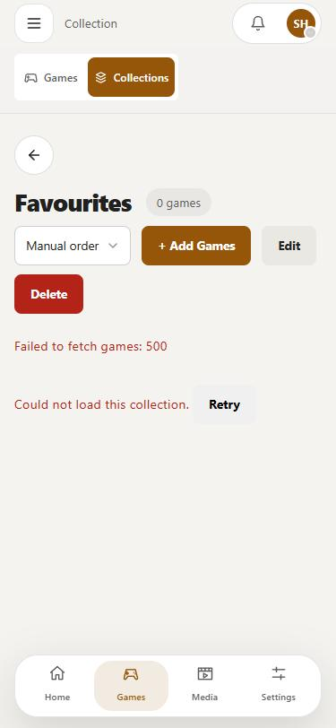 |

Achievement notes are covered by tests only (the test stack has no achievements). The collection detail page also shows two messages for one failure (the raw "Failed to fetch games: 500" and the friendlier "Could not load this collection"), which is redundant but harmless.

### Game page load failures

| Flow | After |
| --- | --- |
| Docs, first load failed | 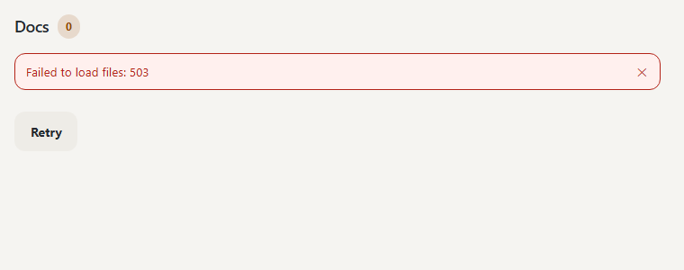 |
| Saves, first load failed | 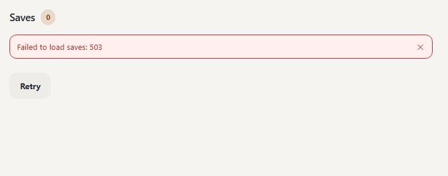 |
| Notes, list could not be loaded | 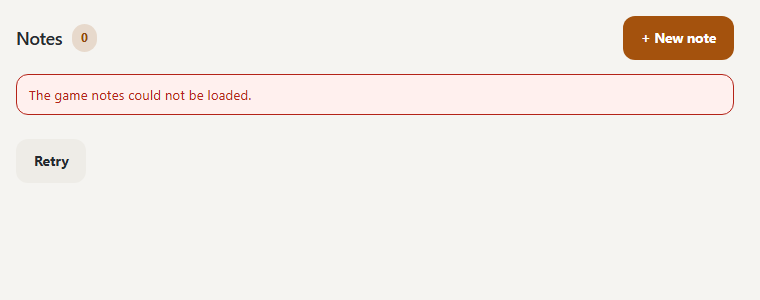 |

### Found on the game page, not fixed yet

- Edit dialogs for media, files and saves close before the save finishes, so the typed values are lost when the save fails.
- Late answers can still write into the wrong game after a status, rating, resume-note or playtime change, and a failed status or rating change reverts silently (and onto the wrong game after navigating).
- Bulk media edits and bulk save deletes apply or trash some items and not others when one fails, and do not refresh the list.
- Trash listings swallow errors, so a failed fetch looks like an empty trash.

### More screenshots

| Flow | Screenshot |
| --- | --- |
| Settings > Users, request failed | 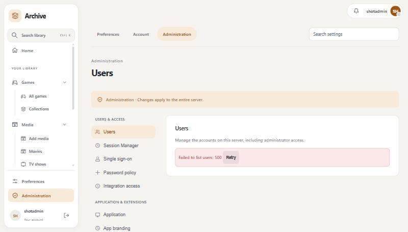 |
| Media lists, request failed | 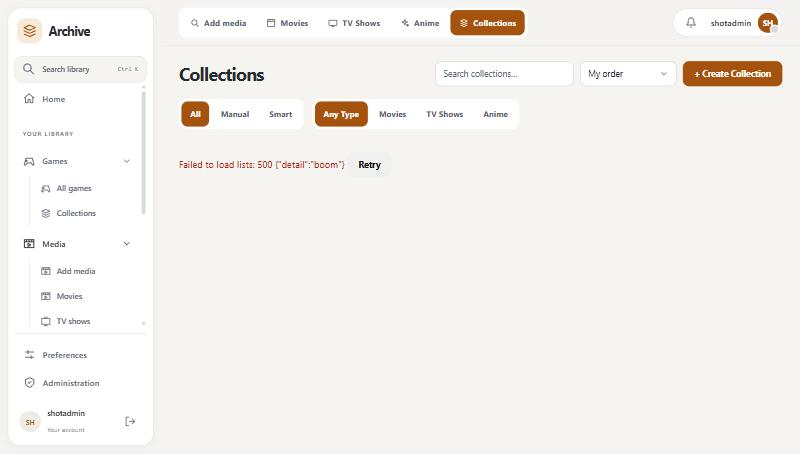 |
| Library refresh failed, games kept | 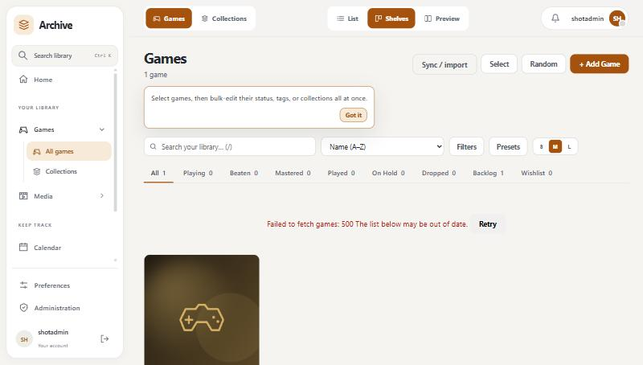 |
| Favourite change failed on the game page | 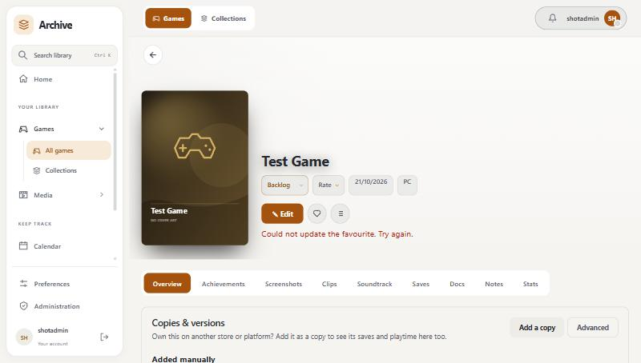 |
