# Metadata providers

While refining or backspacing a query, matching results retain preloaded text
and release years until fresh nonempty provider values arrive. Selecting a
retained result keeps those fields in the preview. Artwork comes from the
current selection; an unselected result does not reuse old artwork.

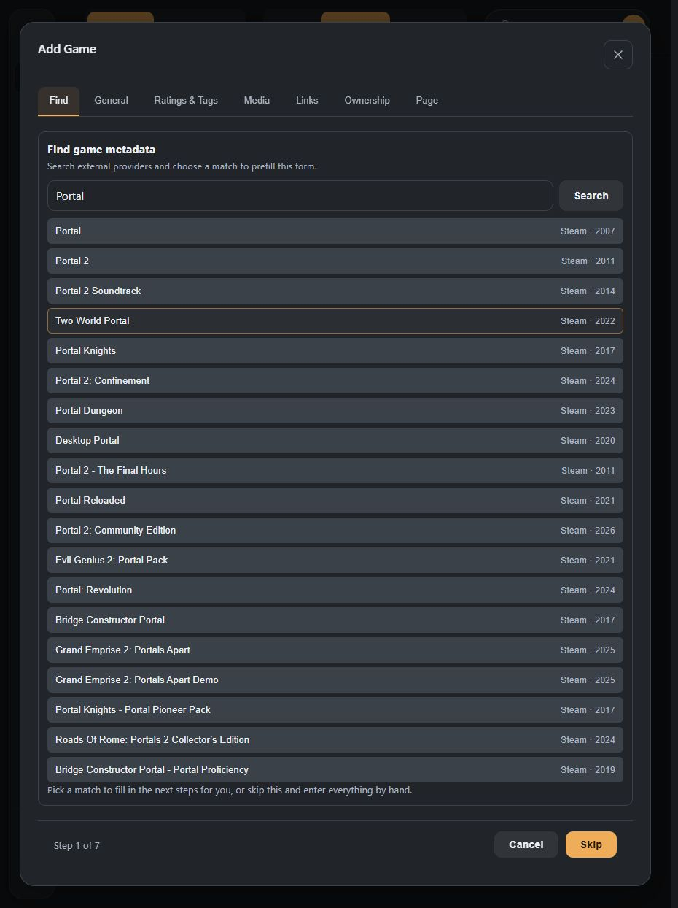

Unnamed Tracking App includes hardcoded Steam, IGDB, SteamGridDB, TVmaze, AniList, AniZip and OMDb providers. Steam game search, TV and anime search work without installing plugins. Optional provider plugins can extend the suite. Search results arrive progressively; from five query characters, up to five metadata fetches run concurrently from the top down. Each completed fetch starts the next while the query stays unchanged. Text patches update the result's year as they arrive. Artwork starts after selection. Configure the built-in providers through **Settings → Metadata/API**. Install optional providers through Plugin Manager. Provider order and field-saving preferences remain per user.

The final text-only verification searched `toaster`, `Portal 2` and `Half-Life`
without selecting results. All 29 results with a supplied release year displayed
it, including entries beyond the initial five; all 30 results had zero artwork
assets. `Toast & Toaster` supplied "Coming soon" without a year, so its year
remained blank. That check kept each query unchanged. The query-change regression
reported in [issue #6](https://github.com/obsoletelabs/unnamed_tracking_app_2/issues/6)
is covered by the retained metadata behavior above.

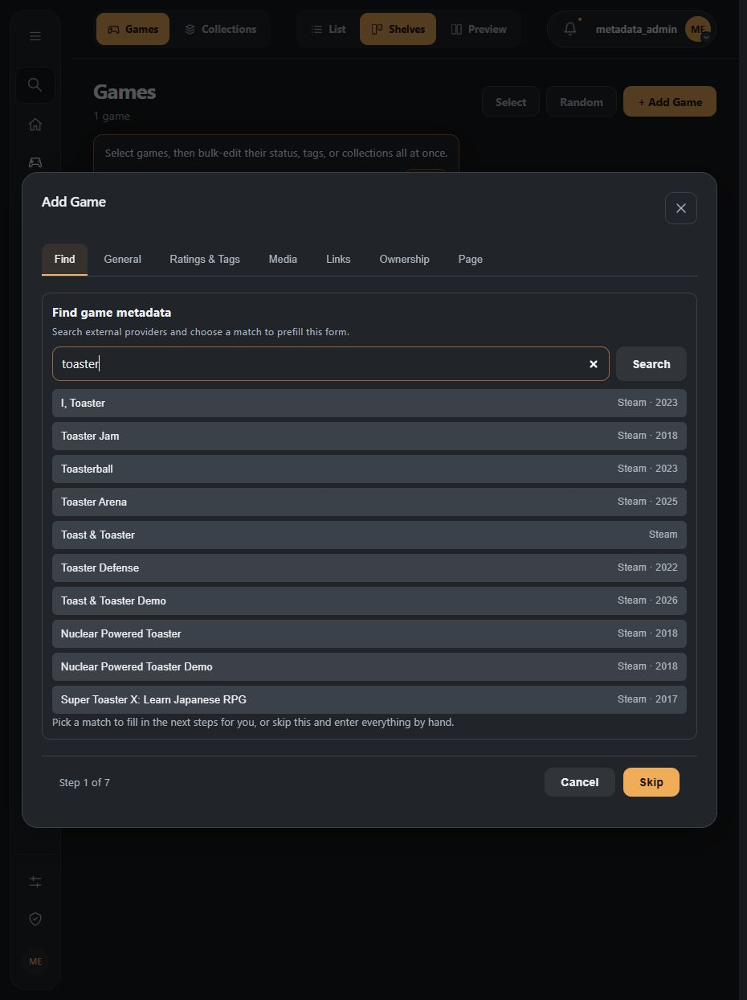

## Protect a title

Typing-triggered provider fetching can be disabled on your account or per
provider. Administrators can restrict shared automatic searches. Explicit Search,
selection, artwork and local filtering continue to work; see [Automatic Search](../user-guide/automatic-search.md).

Edit a game, movie, TV show, or anime and use **Protect title from metadata
updates** beside its title. A checked box means the title is protected. Changing
a title automatically protects it; clear the checkbox to explicitly remove
protection, then save. You can also protect a title without editing its text.

Protection applies on the backend to providers, library sync, imports, and
background refreshes. Only an authenticated application sign-in session may
change a protected title or its protection setting. API keys and ordinary plugin
permissions cannot unlock it. For anime, a protected custom title takes precedence
over the provider's alternate-language spellings.

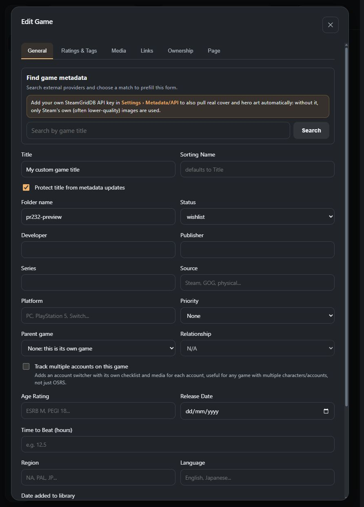

## Review metadata before saving

Search in a game, movie, TV or anime editor and select a result. **Look up metadata**
compares the current and offered values. Empty editable fields start checked;
existing values and real zeroes stay unchecked, and protected fields cannot be
selected. Check the changes you want, then **Apply** to place them in the form.
**Save** persists them. Cancel lookup leaves the form alone; cancelling the form
also discards changes already applied to it. Save waits for Apply or Cancel.

The game editor's **Media → Search artwork** uses the current title/provider
identity and the same review. The old immediate-saving Repull confirmation has
been replaced by this staged workflow. Other explicit/scheduled refresh actions
retain their existing behavior.

On an existing record, **Provider identity** is a separate choice. TV groups it
with the offered season list; choosing a description or picture alone cannot
relink tracking. Save adds only higher-numbered seasons and preserves existing
seasons, manual names, episode counts and watched progress.

Artwork is verified by the host before it is offered. Steam tries a tall cover
and then its header when needed. Failed artwork does not discard useful text.
Manual edits and unchecked choices survive later enrichment; changing the form
title invalidates the old preview and asks for another search.

The **Add media** quick-add dialog also has **Review metadata before adding**.
Its checked choices stay staged while status, rating, dates and episode progress
remain as entered. **Add to library** saves the title and those choices.
The selected title/provider identity remain attached to the new record. The
checklist includes only metadata supported by this add flow; provider diagnostics
and unused fields are not offered as saveable changes.

| Classic light | Modern dark |
| --- | --- |
| 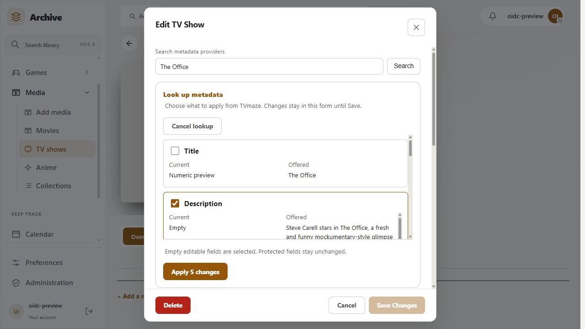 | 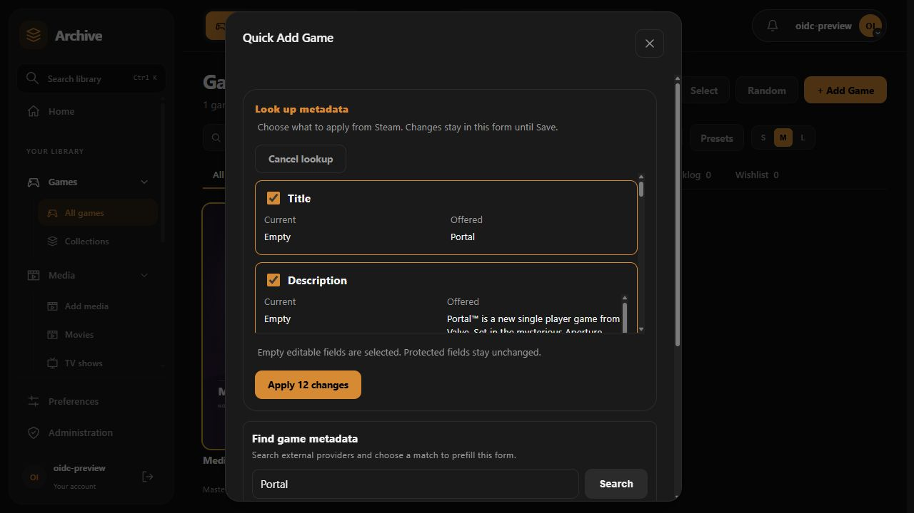 |

[Add media review](../assets/metadata-lookup/modern-dark-media-add-review.jpg)
and [applied choices with the personal rating retained](../assets/metadata-lookup/modern-dark-media-add-applied.jpg).

## Manual fields and locked metadata

When a user manually changes a metadata field through the game editor, that field is recorded as a manual override (`locked_fields`). Future provider refreshes skip it. This protects intentional values such as a custom description, developer/publisher correction, tags, release date, or other supported metadata.

Ratings, playtime, ownership information, notes, status, and other personal library state are not part of the provider refresh and are left unchanged.

If a provider does not return a value, the existing value is not cleared.

## Provider selection and priority

In **Settings → Metadata/API → My account**, each provider has **Use for metadata**.
Turn it off to stop that account's searches, enrichment, artwork and scheduled
metadata requests for the provider, including requests using server credentials.
The choice applies to builtin and optional providers. It does not remove saved
metadata, delete credentials or change connected-library ownership, playtime or
achievement sync. Turn it on again to resume using the saved configuration.

This differs from **Automatic Search**, which controls typing-triggered fetching
only. A whole-provider opt-out also blocks explicit metadata requests. Its saved
Automatic Search choice is preserved and resumes when the provider is re-enabled.
Local library filtering continues to work.

**Settings → Metadata/API → Scan Settings → Provider order** lists every
provider your account can use: the built-in providers and any installed plugin
providers, with a note when one is off for you or still needs setup. Move a
provider up to let its fields win when several providers match. The order is
saved by provider ID, so a plugin provider keeps its place across plugin updates;
providers you have not placed follow in provider-ID order. Searches, refreshes
and background imports all use the saved order.

New unsaved orders place IGDB, then Steam, before every other provider, so Steam
still comes before GOG. Orders saved before provider IDs, which name providers
such as `Steam` or `GOG`, keep applying until you save the list again.
The screen no longer shows a separate image provider order, because the metadata
handler did not use it: artwork is ranked by the priority each provider gives the
assets it returns.

The refresh uses the same generic metadata handler as search. Providers run concurrently. The user's provider order determines field authority, while artwork is a separate selected-entity operation. Provider failures are reported without discarding successful results from other providers.

Provider credentials are declared by each built-in or optional provider and configured in the host provider panel. Field-save toggles remain in metadata preferences. The game editor uses that same configuration.

## Provider failures and stale previews

A provider outage, rate limit, malformed result, or no-match result does not modify the game. If the game changes after the preview but before applying it, the backend rejects the stale apply with a conflict and the editor asks the user to refresh/retry. This prevents a metadata refresh from overwriting a newer edit made in another tab or session.

Metadata changes are recorded in the existing game metadata history, so provider-applied field changes remain visible in the game's **History** tab.

## Developer notes

The editor uses `/api/game/{game_id}/metadata/refresh`, which resolves an existing
library identity through `features.metadata.service` and the shared handler.
The endpoint retains authorization, exact-match validation, field protection,
history, artwork and stale-preview checks. Applying a refresh reloads the owned
row under a lock, so a protection change during lookup is respected.

See [Progressive metadata and Plugin API 1.1.1](../development/metadata-providers.md)
for the public contract, session endpoints and migration details. Provider
optional implementations are maintained in [obsoletelabs/unnamed_tracking_app_plugins](https://github.com/obsoletelabs/unnamed_tracking_app_plugins).

## Where keys go

Open **Settings → Metadata → Sources & API keys**. Administrators can also use
the same provider tiles in **Server integrations**, with System default selected. Fields declare system, user or both scopes. Administrators
may save system values; users may save their own values. A user override wins over
a system fallback when both scopes are supported. Reads show configuration presence
and health, never stored values. Clearing a user override restores the system fallback.
Configuration queues immediate validation; periodic validation defaults to 30 minutes.

Existing IGDB, SteamGridDB and OMDb core keys are carried into missing encrypted
provider scopes. Existing new settings and explicit clears are preserved. Optional
plugins do not receive legacy host keys automatically. Existing Steam,
RetroAchievements and console account-sync credentials remain in account integrations.
IGDB declares system Twitch credentials; other providers declare their own scopes.
TMDB is optional and may be left unconfigured. TVmaze and public anime providers
operate without signup. Movie sources require a configured movie provider such as OMDb.

## Familiar interface, progressive results

The source panel retains the original compact tiles, colored monograms, key
buttons and expandable credential forms. The seven built-in tiles are always
available; installed optional plugins add their own tiles. Each shows its current health; expand a tile for the last validation time
and saved-value presence. Administrators choose **System default** for shared
credentials or **My account** for a personal override. Changing scope clears
unsaved input so it cannot be saved accidentally to the other scope. Accounts you
import a library from (Steam, PlayStation, RetroAchievements, Xbox, GOG and plugin
connections) are not metadata sources: connect, update, import and disconnect them
from **Settings > Account > Connections**, where **Manage** opens a popup rather
than leaving the page.

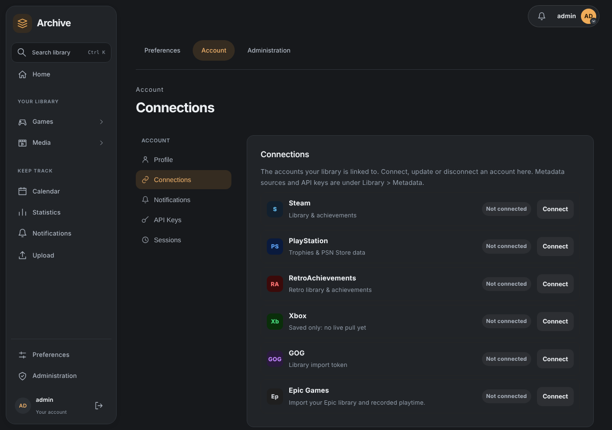

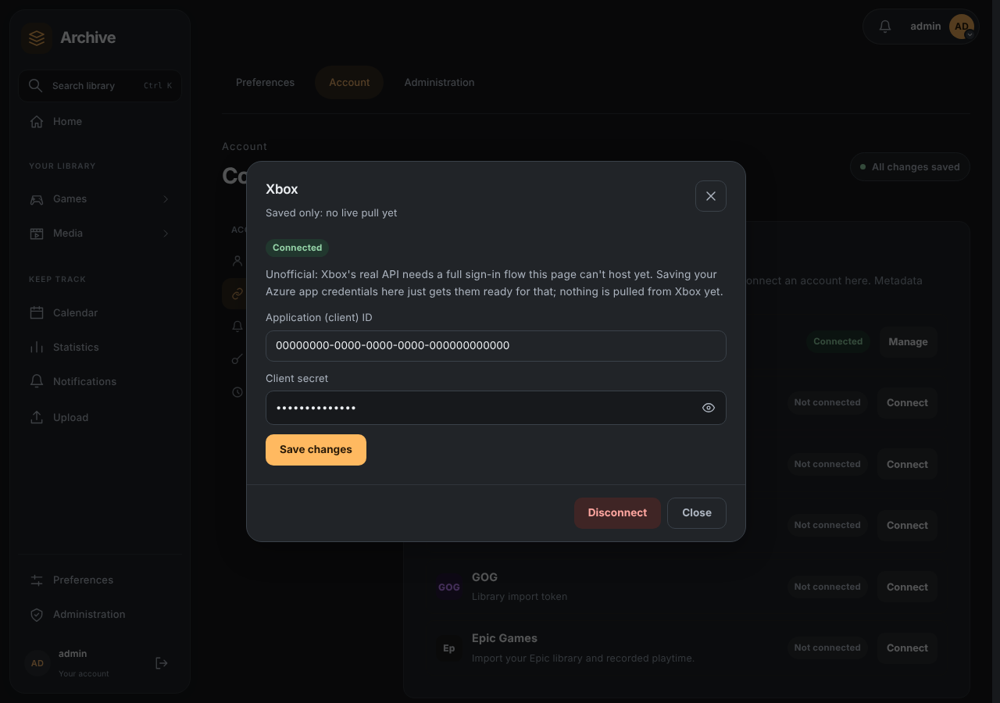

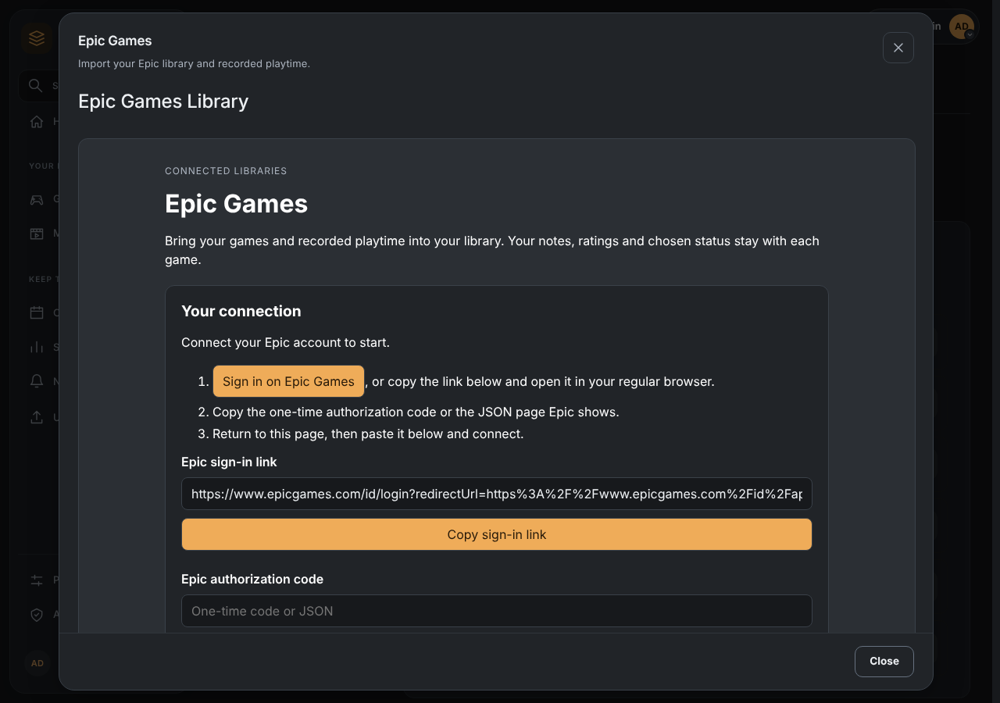

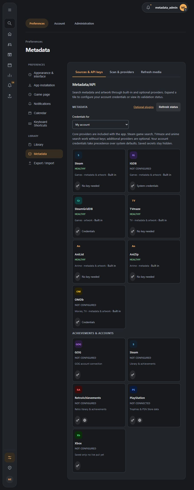

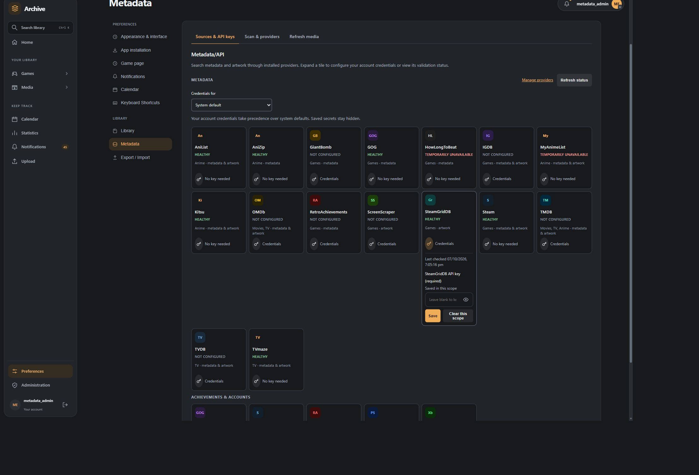

The Add Game editor retains its Find, General, Ratings & Tags, Media, Links,
Ownership and Page tabs. Identity results appear before artwork; failed optional
providers produce a short warning while successful results stay selectable.
Selecting a result populates the existing fields and starts artwork lookup.

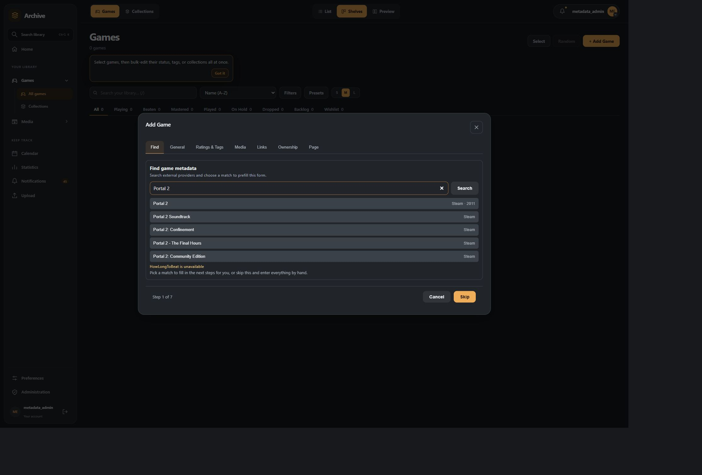

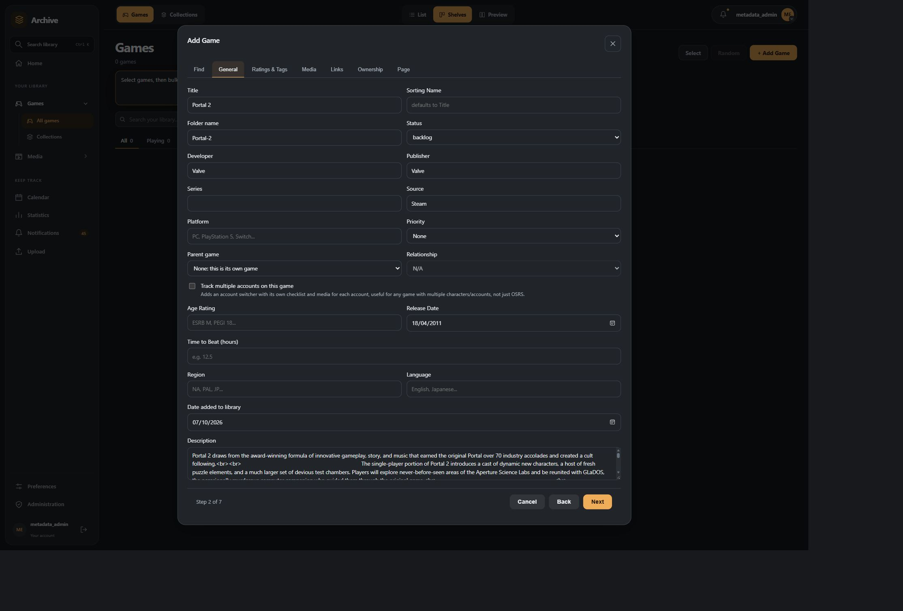

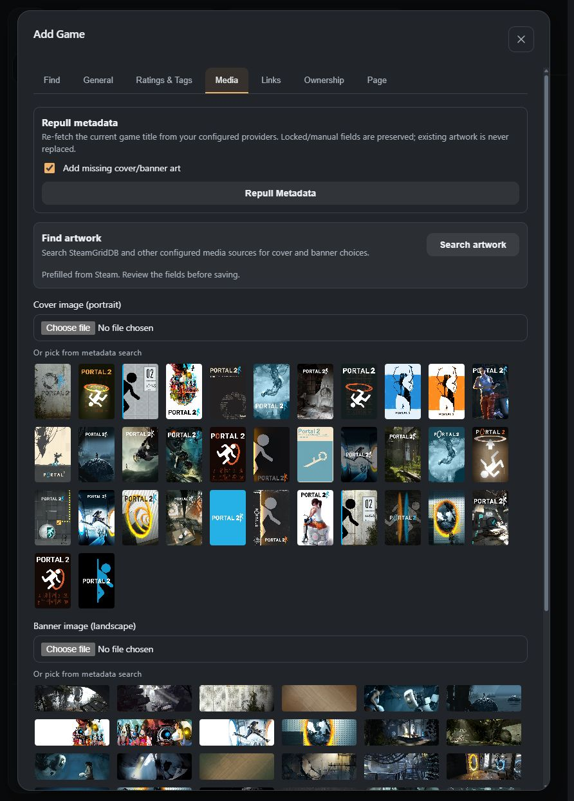

These screenshots were captured on 2026-10-07 using the built-in core providers
and a disposable development library with no installed plugins. They demonstrate Steam and SteamGridDB live data;
they do not imply that every authenticated provider has been configured or validated.

## Safe operation

- Keep secrets out of screenshots, logs, browser storage and repositories.
- Metadata credentials use the application's existing encrypted storage and user/system scopes.
- Native core adapters receive only their resolved credentials; optional plugin actions require their declared grants.
- Disabled and unconfigured optional providers do not produce search warnings.
- Temporary outages and rate limits do not discard successful results.
- Search and selection are previews; review fields before saving.
- Title locks, ownership, personal state and missing-field preservation remain enforced.

## Steam sign-in and privacy

Open **Settings → Connections → Steam → Manage**. Choose **Steam Guard QR**
to scan and approve with the Steam mobile app, or **Account sign-in** to use
your account name and password. Account sign-in supports Steam Guard email and
mobile codes as well as approval in Steam. These methods do not require a
personal Web API key or a profile-ID lookup.

Passwords are encrypted for Steam with its supplied RSA key, sent once, and
never saved. Steam Guard codes are also transient. Browser refresh/access
tokens and pending sign-in state are encrypted at rest with the deployment's
`SECRET_KEY`. The app binds the Store-issued API token to the account Steam
verified during its browser-session exchange. A missing or mismatched account,
failed transfer or rejected Store response cannot establish a connection.
QR codes are rendered locally. Sign-in attempts expire after five
minutes; closing or cancelling the dialog invalidates the current attempt.
The app renews expiring sessions when importing. If Steam rejects or revokes
a session, reconnect in Connections.

Signed-in imports read the account owner's library and achievements through
Steam's owner endpoints, including private achievement progress when Steam
provides it. Steam's compact progress omits untouched locked achievements; the
app expands them only when the returned schema hash matches. Owner achievement
icon filenames are converted to Steam CDN URLs. Unverified, rejected or
incompatible responses retain stored achievements. The app does not use Steam
OpenID as authorization to read private data: OpenID identifies an account only.
An explicit no-match response for the achievement schema is skipped; it does
not remove saved achievements or turn a failed player-progress read into zeroes.

Disconnecting keeps imported games, achievements, manual edits and confirmed
copy groups. The core library supports one Steam account per app user. Its owner
binding is retained on disconnect to prevent another account overwriting that
progress; reconnect the original account. Switching accounts requires permanently
removing the previous account's Steam imports, including any in Trash. Separate
Steam accounts can use separate app users.

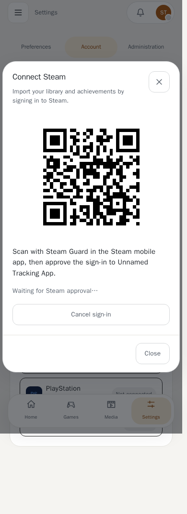

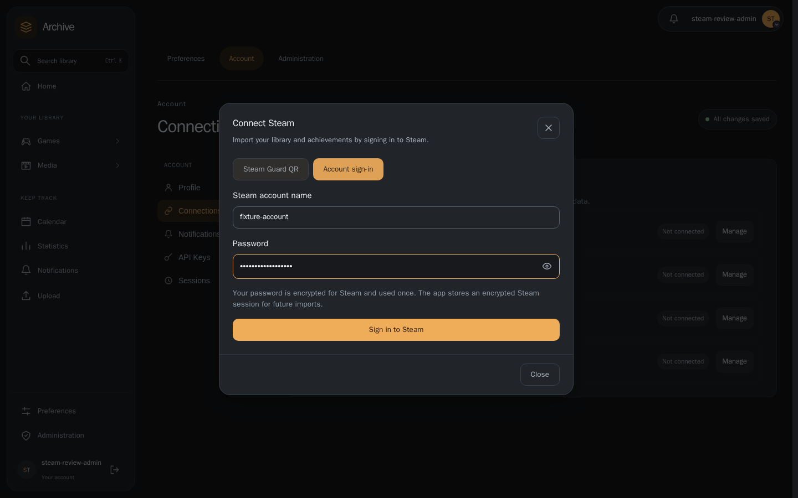

These screenshots use synthetic Steam responses and a disposable app account.
The QR and credentials are fixtures, not a live Steam authorization. The UI
acceptance checks also cover Guard-code submission, cancellation, stopped
polling after closing the dialog, and layout at 390 and 1440 pixels.

### Legacy API credentials

Existing Web API keys continue to work for public-profile imports. The optional
legacy form remains under **Metadata/API → Steam → Legacy API credentials**.
Account sign-in replaces this legacy connection; disconnect it in Connections
before configuring a legacy key again. Saving both the profile and the key first
checks them with Steam (profile lookup, library and player summary); a rejected
key is not saved and the previous connection stays as it was. Saving only one of
the two keeps it until the other is added. The key is encrypted at rest with the
deployment's `SECRET_KEY`; a key saved by an earlier version is encrypted the next
time it is used. A legacy credential save rechecks the connection after each
Steam request; delayed results cannot undo a disconnect or overwrite a newer
sign-in.

**Verify profile with Steam** (in the same legacy section) signs you in on Steam's
own page using Steam OpenID and fills in the profile ID Steam vouches for, instead
of trusting a typed ID. OpenID proves identity only: it gives no access to private
data, imports still need your Web API key and a public profile, and an existing
Steam sign-in or a library imported from another Steam account is never replaced.
Each attempt is bound to your signed browser session and account, expires after
five minutes and is cleared when Steam's answer arrives; Steam re-checks its own
signature before the profile is saved. This is not OAuth: Valve only issues OAuth clients for Steam
Cloud/Workshop integrations, so account sign-in remains the way to import private
progress.

The Steam connection accepts a full `steamcommunity.com/id/...` or
`steamcommunity.com/profiles/...` link, a vanity name, SteamID64, SteamID2
(`STEAM_0:0:11101`) or SteamID3 (`[U:1:22202]`). Numeric identifiers are converted
locally; vanity names use Steam's profile lookup.

If Steam does not share the library with a legacy API connection, sync reports the privacy
problem and leaves existing games unchanged. Set **Profile → Privacy Settings →
Game details** to **Public** and verify the account ID before retrying. An
explicitly empty public library remains a valid empty library.

Steam imports include free subscriptions and apps that Steam's default request
filters as unvetted. Steam can still omit demos and other apps from its games
response, so an omitted app is **not** marked as no longer owned. A successful
sync clears previous omission-based warnings on your active Steam games without
removing games or changing their saved progress. Invalid or incomplete responses
leave the library unchanged. If a reported game has no playtime field, its saved
playtime is retained.

The application saves owned games and playtime first, then reads achievements in
small batches before fetching store details. A failed batch leaves the imported
games available. Unavailable achievement progress keeps the previous snapshot;
the completion message reports any games whose progress could not be read.
Fresh provider evidence advances only eligible Backlog/Wishlist games. All
existing Played choices are preserved, along with Playing, On Hold, Beaten,
Dropped and Mastered. An owned Wishlist game can become Backlog, Played or
Mastered; achievement-only refreshes do not establish Wishlist ownership.
Fully unlocked nonempty provider sets can advance Backlog to Mastered. Local
achievement reports and locally entered playtime are not provider evidence.

API clients retain the immediate achievement sync by default. Clients opting
into `/api/library-sync/steam?achievements=later` receive `achievement_game_ids`
and `status_game_ids` for the subsequent authenticated
`/api/library-sync/steam/achievements` requests. Each request accepts up to 25
game IDs and rechecks ownership, source, deletion and provider identity before
saving. The application's client sends five games per request.
`status_game_ids` lists the games whose sync deferred status progression to the
batch; for those, the playtime that sync saved from Steam counts alongside their
achievements, so a played game with every achievement unlocked becomes Mastered.
The field cannot override eligibility: it uses the current locked row, and a
previously Played game does not settle to Mastered in a later batch. Achievement GET routes remain read-only.

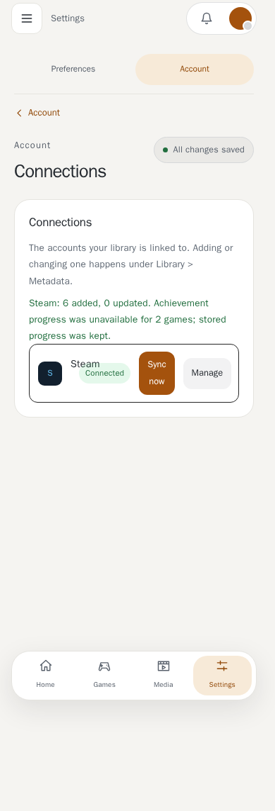

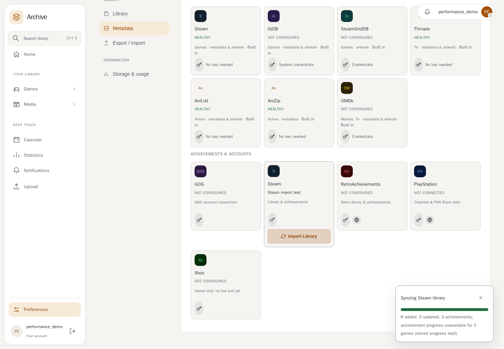

These import-result screenshots use explicit Steam-response fixtures against a
disposable application account. They demonstrate the partial-failure messages
and responsive layout; they do not represent a live Steam account import.

## Steam tags as genres

Steam's own genres are broad: Elden Ring is only Action and RPG. Steam players
also vote on tags, and those describe a game far better. For Elden Ring the
most voted are Souls-like, Open World, Dark Fantasy, RPG, Difficult and Action
RPG.

With **Use popular Steam tags as genres** on (it is on by default), a Steam
game's genres become its most voted tags plus its official genres, so Elden
Ring gets Souls-like, Open World, Dark Fantasy, RPG, Difficult, Action RPG and
so on. Tags that are not genres are left out: how many play it (Singleplayer,
Multiplayer, Co-op, PvP), how it is controlled (Controller support, VR), what
Steam adds around it (Steam Achievements, Early Access, Free to Play),
opinions (Great Soundtrack, Replay Value), and content labels (Violent, Family
Friendly). At most 12 player tags are kept. A game that players have barely
tagged keeps its official genres only.

The setting is under Settings, Metadata, Scan & providers. It applies:

- when a Steam game is added by a library sync;
- when a game's metadata is searched or refreshed. Because other providers such
  as IGDB can fill the genres first, the Steam tags replace them when the search
  matched a Steam game;
- when you press **Update my Steam games now**, which re-reads the tags of the
  Steam games already in the library. It works through them a few at a time and
  reads one store page a second, so a large library takes a few minutes. Tags you
  added yourself are kept.

The tags are read from each game's public Steam store page, the only place Steam
shows them. If a page cannot be read, the game keeps the tags it has. With the
setting off, Steam games get Steam's official genres as before.

## Core-only installation

The core suite works directly in the app; Plugin Manager may be empty. Steam does
not require a Steam Web API key for metadata. Its account/library credentials
are separate. Movie search needs an OMDb key or an optional movie provider; TMDB
is not required. Core metadata also works while the optional plugin runtime is
unavailable.

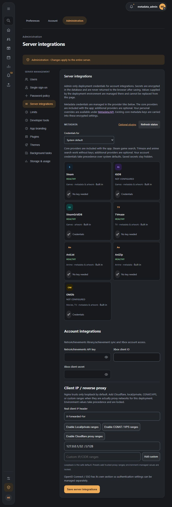

The following verification view deliberately stopped the optional plugin runtime.
The inventory is empty; the core search/details/artwork screenshots above were
captured without relying on that runtime. Optional runtime/catalogue failures
remain visible in Plugin Manager.

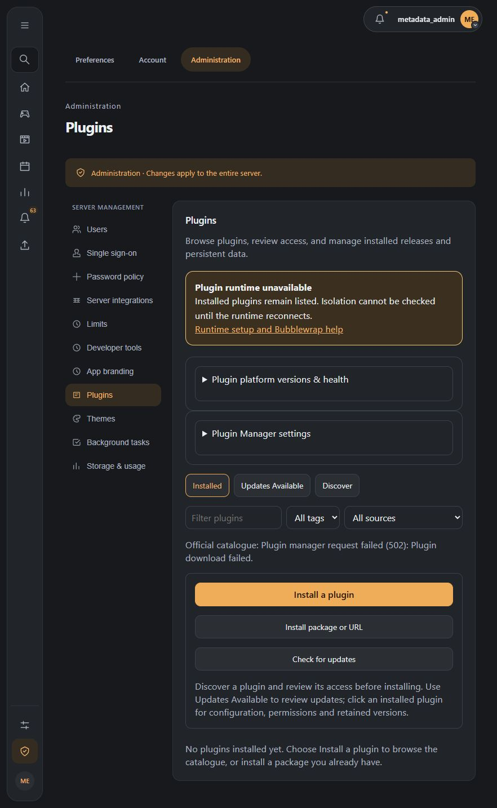
