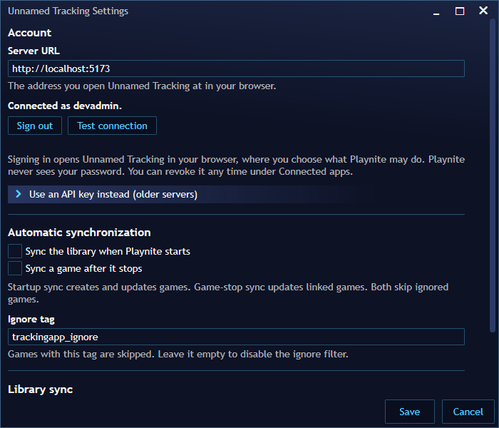

# Playnite

Unnamed Tracking App has a Playnite 10 extension for synchronizing a Playnite library with the authenticated user's game library.

The extension repository is **UnnamedTrackingPlaynite**. The extension signs in through [user-approved integration access](user-delegation.md#desktop-apps), the same consent flow the Discord Activity uses, so nobody pastes an API key. Older extensions and servers can still use a user API key.

## Requirements

The current extension targets:

- Windows;
- Playnite 10.x;
- .NET Framework 4.6.2 / the Playnite 10 SDK;
- an Unnamed Tracking account on a server with **desktop app sign-in** enabled (the default),
  or a user API key beginning with `utk_` for older servers.

## Configure the extension

1. Install the extension package, or load the Release output through Playnite's developer extension support while developing.
2. Open **Add-ons → Extension settings → Unnamed Tracking** (or the Extensions menu entry *Sign in to Unnamed Tracking…*).
3. Enter the base URL of the Unnamed Tracking server.
4. Click **Sign in with your browser** and approve Playnite on the page that opens (see below).
5. Use **Test connection**, then **Sync library now** for the initial synchronization.
6. Optionally configure the ignore tag, startup synchronization, and game-stopped synchronization.



## Authentication

### Browser sign-in (recommended)

The extension asks the server for access with `POST /api/delegation/v1/desktop/playnite/requests`
and opens the returned **Connect Playnite** page in the user's browser. Signed in there, the
user sees the computer's name and approves the capabilities the extension asks for:

| Capability | Used for |
| --- | --- |
| `profile.read` | *Connected as …* in Playnite |
| `library.sync` | Game list, create, update, artwork and the `/api/playnite/*` evidence routes |
| `saves.read` | Listing and downloading save archives |
| `saves.write` | Creating save archives, adding versions and renaming |

They start selected and access defaults to **Until revoked**, because the credential replaces an
API key; the user can untick any capability or choose a timed grant. The extension polls the
verifier-bound exchange and receives a `utd_` credential that the server accepts **only** on the
routes listed in the [access matrix](../development/api-access-matrix.md) as `user-or-app` with the
matching scope; it is refused everywhere else (API keys, settings, administration, other users).


The extension stores the credential encrypted with Windows DPAPI and only uses it for the server it
was issued by. **Sign out** in Playnite revokes it on the server (`DELETE /api/delegation/v1/credential`).
Users can also reduce or revoke it under **Account → Connected apps**, where the computer is listed as
a desktop app:


Instance owners can switch desktop app sign-in off under **Administration → Integration access**
(*Let people connect desktop apps such as Playnite*) or disable the Playnite client row there;
existing Playnite credentials stop working on their next request. It is independent of web
integrations such as the Discord Activity.

### API key (older servers and extensions)

User API keys are created from the application's API-key settings and use the `utk_` prefix.
Authenticated API requests use:

```http
Authorization: Bearer utk_<secret>
```

The backend accepts these bearer keys alongside normal browser session authentication. A key is
associated with the user who created it and has full access to that account, so prefer browser
sign-in where the server offers it.

## Library synchronization

The extension reads the Playnite library and synchronizes game metadata and state.

It can create new games and update existing games. The synchronized Playnite data includes:

- title and sort title;
- description;
- release date;
- developer and publisher;
- series;
- tags and features;
- links and source;
- age rating;
- favourite state;
- notes;
- playtime;
- rating;
- completion status.

Cover and banner artwork can also be uploaded.

The application has a `playnite_guid` field on games. It is an optional UUID association and is indexed, but it is deliberately not globally unique because the same account can receive imports from multiple Playnite libraries.

### Matching

The extension first uses its generated `folder_location` association and then falls back to `playnite_guid`. This lets the extension retain the association when a Playnite title is renamed without creating an unnecessary duplicate.

If a game already exists, the extension updates it through the game's update endpoint. Otherwise it creates the game first and then uploads available artwork.

Creating a game that carries a `playnite_guid` is safe to repeat. If the account already has a game with that GUID, or a game in the same folder that no other Playnite entry has claimed, the create returns that game (HTTP 200, and the GUID is recorded on it) instead of failing on the folder name. Two syncs racing to create the same game also end up with one game. A folder that already belongs to a *different* Playnite GUID is still reported as a conflict (HTTP 409). A GUID whose game is in the host's Trash is also reported as HTTP 409 (`playnite_game_in_trash`, with the trashed game's ID) instead of creating a second game for the same Playnite entry; restore the game or let Trash purge it. Every create and update is additionally recorded as a Playnite observation (see [Game ingestion](../development/game-ingestion.md)); only the fields the request carried are recorded.

## Supported API contract

The extension currently uses these authenticated application endpoints:

| Method | Endpoint | Purpose |
|---|---|---|
| GET | `/api/game/list` | Read the user's game library |
| POST | `/api/game/create` | Create a game |
| PATCH | `/api/game/update/{game_id}` | Update an existing game |
| POST | `/api/game/{game_id}/assets/{asset_kind}` | Upload game artwork |

The application requires authentication for the game API and scopes game lookups to the authenticated user.

`src/backend/tests/test_playnite_contract.py` exercises these endpoints over HTTP with a real `utk_` key. The [game library identity audit](../development/game-library-identity-audit.md#6-playnite-integration) lists the behaviours that must stay supported while the game model changes.

### Observation API and compatibility

Newer extensions also report what Playnite holds through a versioned evidence API (`GET /api/playnite/contract`, `POST /api/playnite/observations`, `POST /api/playnite/inventory`): platform, last played, installed state and the complete list of library IDs. Playnite only reports; it never creates, merges or splits identities, and entries missing from a partial, failed or cancelled sync are never treated as removed. A name or completion status you locked in the application is kept when Playnite syncs, the rest of the update still applies, and Playnite's own changes no longer lock fields. Extensions that do not use the evidence API keep working unchanged. See [Playnite observations](../development/playnite-observations.md).

## Ignoring games

The extension can skip games carrying its configured ignore tag. The default tag is:

```text
trackingapp_ignore
```

The comparison is case-insensitive. Clearing the setting disables the tag filter.

## Automatic synchronization

The extension can optionally:

- synchronize the whole library when Playnite starts;
- update an already-linked game when a game stops.

Game-stopped synchronization does not create missing games. Run a library synchronization first if the game is not already linked.

Manual synchronization reports progress and can be cancelled. Cancellation stops additional game operations after the current network operation completes.

## Save synchronization

Save synchronization is implemented by the Playnite extension and is keyed to the Playnite game GUID.

For a configured game, the extension can:

- configure one or more local save folders;
- upload a save immediately;
- download the latest cloud save;
- enable download-on-start;
- enable upload-on-stop.

Windows environment variables such as `%USERPROFILE%` can be used in configured paths. Before replacing local files with a cloud download, the extension creates a timestamped local backup.

Save synchronization is separate from the normal game metadata synchronization described above.

## Embedded application view

The extension also provides an **Unnamed Tracking** sidebar view for opening the configured server UI inside Playnite.

No credential is put into the page URL or browser storage. The embedded web UI uses the application's normal session authentication, so it may require a normal web login even though background Playnite synchronization continues to use the extension's sign-in.

## Links into Playnite

The extension handles `playnite://unnamedtracking/settings` (open its settings),
`playnite://unnamedtracking/sign-in` (start browser sign-in for the server already configured
in Playnite; a link never changes the server) and `playnite://unnamedtracking/sync` (sync the
library now).

## Saves on a game with several copies

Playnite uploads each save to the game whose Playnite GUID it belongs to. When that game is one
copy of a larger game (for example the Steam copy of Hades grouped with an Epic copy), the main
game's **Saves** tab lists it labelled with its copy, and Playnite keeps syncing the same copy.
See [one game, several copies](../user-guide/games.md#one-game-several-copies).

## Troubleshooting

### Test connection fails

Check that the server URL is correct. With browser sign-in, check **Account → Connected apps**
for the Playnite entry: a revoked, reduced (missing `library.sync`) or timed-out grant needs a
new sign-in, and an owner may have switched desktop apps off. With an API key, check that it
begins with `utk_`, has not been revoked and belongs to the account whose library you want to
synchronize.

### A game is duplicated

Run the current synchronization again and check that the Playnite GUID and generated folder association are being sent. The extension uses those associations to match existing games.

### Artwork fails but game synchronization succeeds

Artwork uploads are treated as per-game warnings by the extension. Check the Playnite extension log for the individual artwork request and response.

### Synchronization is slow

Initial synchronization is per-game and can upload cover and banner artwork. Use **Preview sync** before a large upload and **Cancel** if a manual synchronization needs to stop.

## Optional plugin download and preconfiguration

A plugin settings page could provide the extension download and server URL setup guidance. Fully preconfigured .pext downloads are not a straightforward packaging change: the current extension persists settings through Playnite and has no per-server package bootstrap input. It uses a personal utk_ application API key rather than the Plugin API gateway; utpm_ management tokens are rejected by application endpoints.

Preconfiguration would require an explicit extension bootstrap, private per-user credential delivery and review of installation/signing behavior. Do not embed credentials in repository packages, catalogues, download URLs or shared archives. This investigation therefore records the feasible setup-helper boundary without introducing an unreviewed authentication path. The existing manual extension setup above remains supported.
