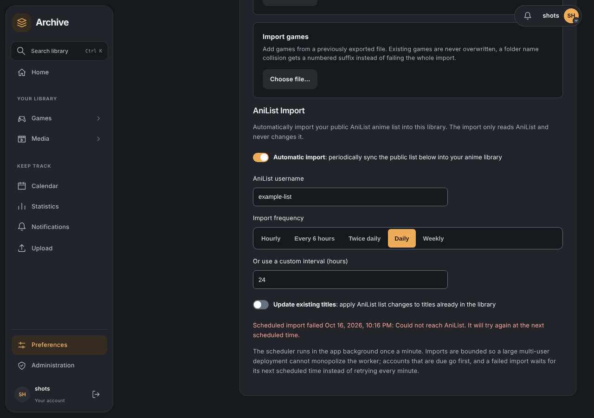

# AniList Import

Unnamed Tracking App can import anime from a user's public AniList list into that user's anime library.

## What the import does

The AniList import reads your public anime list from AniList and creates or updates matching anime in your Unnamed Tracking App library.

The integration is **read-only with respect to AniList**. Unnamed Tracking App does not write changes back to your AniList account.

Matching uses the AniList title identifier, so an existing library entry with the same AniList ID can be updated instead of creating a duplicate.

## Configure automatic imports

Open **Settings → Export/Import → AniList Import**.

The settings are stored per user, so each account can configure its own AniList username and schedule.

### Automatic import

Enable **Automatic import** to have the application periodically import your public AniList list.

Automatic import is disabled by default.

### AniList username

Enter the AniList username whose public anime list should be imported.

The username is limited to 100 characters and is trimmed before it is saved.

The list must be publicly accessible to the application.

### Import frequency

The built-in frequency choices are:

- **Hourly**
- **Every 6 hours**
- **Twice daily**
- **Daily**
- **Weekly**

You can instead enter a custom interval in hours. Custom intervals may be from **1 to 720 hours** (1 hour to 30 days).

The backend stores the interval in minutes.

### Update existing titles

Enable **Update existing titles** if changes from AniList should also be applied to anime already in your library.

When this option is disabled, existing matching titles are skipped while new titles are imported.

An import can report fetched, created, updated, and skipped entries, along with a limited list of per-entry errors.

## What gets imported

For imported anime, the AniList data used by the application can include:

- title and sort title;
- description;
- first-air, start, and end dates;
- episode count and watched progress;
- episode runtime;
- studios, countries, genres, and format;
- AniList score and AniList ID;
- poster and backdrop artwork;
- status and priority;
- rewatches and notes;
- overall rating.

Imported entries are created with a season record containing the AniList episode count, current progress, and status.

## Scheduling behavior

Automatic imports use the application's existing background scheduler rather than a separate worker.

The scheduler wakes approximately once per minute and selects enabled accounts whose configured interval has elapsed since their last scheduled attempt. Only due accounts count towards the batch, oldest attempt first, so accounts that are not due yet cannot hold back accounts that are.

The scheduler processes at most **4 users per tick** so that a large multi-user deployment cannot monopolize the application scheduler. Disabled accounts are never imported.

Each user has an independent:

- enabled/disabled setting;
- AniList username;
- import interval;
- update-existing preference;
- last successful import time;
- last scheduled attempt time and failure reason.

A user's schedule does not change another user's schedule.

Every scheduled attempt is recorded, whether it succeeds or fails. A failed import keeps the last successful import time, shows its reason in the AniList Import settings, and is tried again when the interval next elapses, not every minute. A later successful import clears the reason. If the AniList username is empty, that user's scheduled import is skipped.

## Defaults

New users receive these AniList import defaults:

| Setting | Default |
| --- | --- |
| Automatic import | Disabled |
| AniList username | Empty |
| Import frequency | Daily (24 hours) |
| Update existing titles | Disabled |
| Last successful import | None |
| Last scheduled attempt and failure reason | None |

## Manual versus automatic import

The scheduled path uses the reusable AniList import service rather than maintaining a separate import implementation. The scheduler is responsible for deciding when an enabled user's import is due.

For troubleshooting an import, first check the AniList username, confirm that the list is public, and verify that automatic import is enabled if you expect it to run on a schedule. A failed scheduled import shows its reason below the import options; a manual import from the anime library does not change the schedule.

