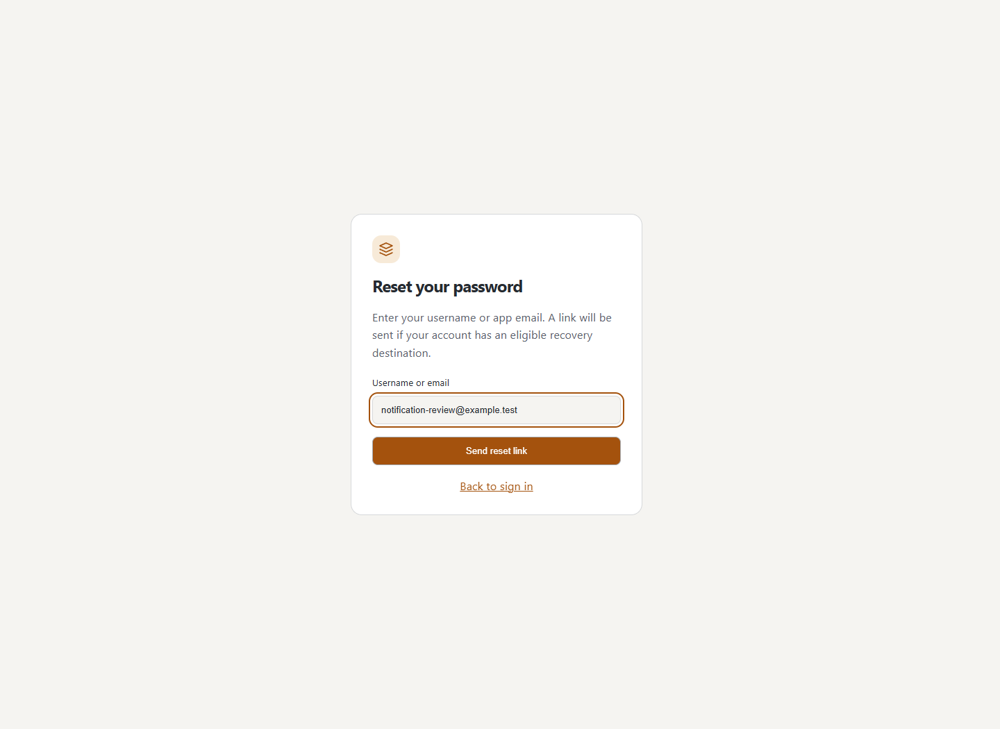
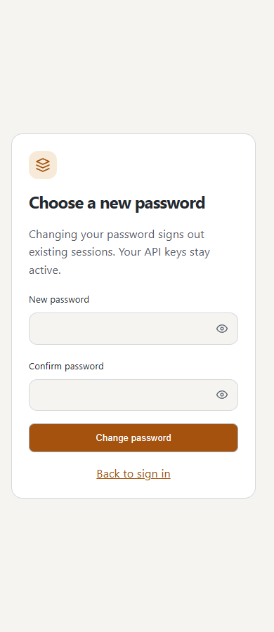
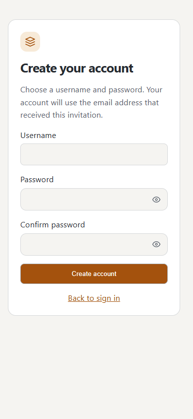
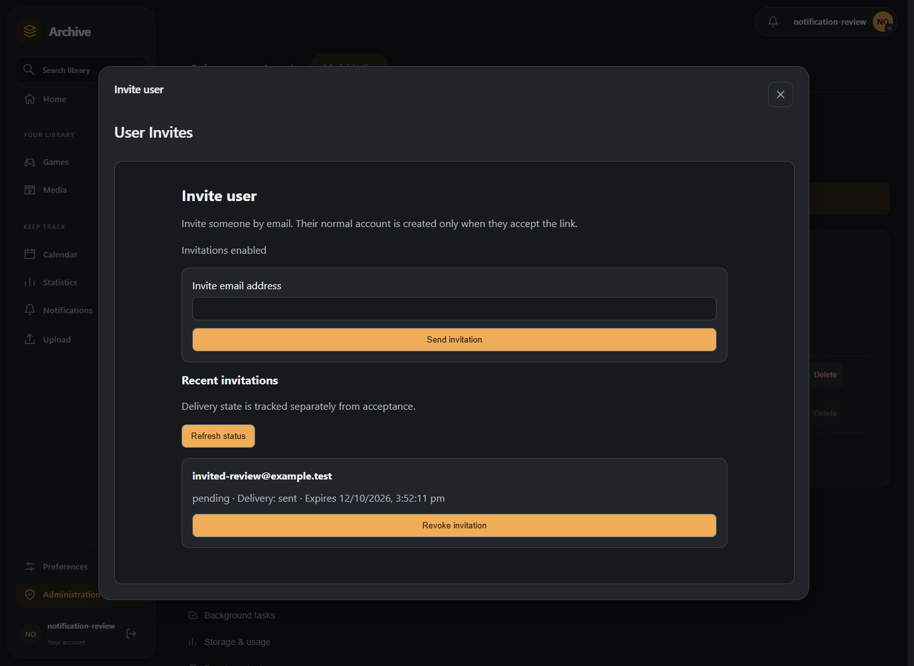
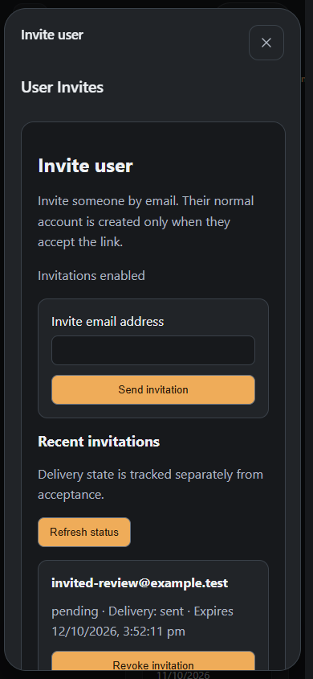

# Authentication

Unnamed Tracking App has two user-facing authentication methods: local username/password authentication and OpenID Connect (OIDC) / SSO.

## Local sign-in

Local accounts use the application's username/password login. A successful login creates a server-side session and the browser receives the application's session cookie.

Passwords are not stored in plaintext. API requests made by the web application normally use the session cookie automatically.

New or renamed usernames use 1–100 ASCII letters, digits, underscores, hyphens or dots, with no spaces. The first-run administrator, invitations and account administration use the same rule. Existing usernames continue to sign in and can be kept unchanged when editing other profile fields. Exact username matching takes priority over the email fallback; email matching is case insensitive.

Changing your password in Profile requires your current password and signs out other active browser sessions. The browser making the change remains signed in. Session audit records are retained; API keys stay active. Concurrent local sign-ins and password changes are serialized so an old-password sign-in cannot create a live session after the change.

## Optional password recovery

An administrator can install the maintained **Password Reset** plugin, approve its
separate critical global permission, then activate it under **Settings → Administration →
Account security → Password recovery**. SMTP delivery remains built into the application. Installation
alone does not enable recovery.

In **Account → Notifications**, configure and verify an external destination, then
enable its separate recovery option. A plugin destination must also support recovery
and have the required high-risk provider permission. The authenticated inbox and
browser push cannot receive reset links.

When recovery is active, select **Forgot your password?** on the sign-in page and
enter your username or configured app email. The response does not disclose whether
the account has an eligible destination. Open the delivered expiring single-use link,
enter and confirm a password meeting the server policy, then sign in normally.
Changing the password signs out existing browser sessions; **API keys stay active**.
Opening the link alone does not change anything. SSO-linked accounts use their
identity provider's recovery flow.





See the [developer contract](../development/plugin-auth-flows.md) for routing,
permission and token lifecycle details.

## Optional email invitations

Administrators can install **User Invites**, grant its separate critical global
permission, and explicitly activate it in **Settings → Administration → Users**. Built-in
SMTP must be configured; no additional email provider is installed by the plugin.
Choose expiry in minutes, hours, days or weeks (one hour to one week), then save
settings and enable invitations. Customize the email sender display name, subject,
heading, welcome message, greeting, button, layout, accent and footer with a preview.
Use **Invite user** beside **Create user** to enter an email address and optional
recipient name. The dialog shows delivery state and lets
administrators revoke outstanding invitations.

The recipient opens the emailed link, chooses a username and password, then signs
in normally. Opening a link alone creates no account. Acceptance creates a normal
account without administrator privileges; links expire and work only once. Replacing
or revoking an invitation, or disabling its plugin, invalidates old links. Invitation
delivery does not automatically configure or verify a personal notification destination.



## Password and secret fields

Password and editable secret fields are masked by default. The eye control in the field can reveal the value temporarily and can be used with keyboard focus.

- New-password fields start empty and are intended for values being entered now, such as local sign-in, account creation, and profile password changes.
- Replaceable secrets also start empty when a saved value already exists. For example, an OIDC client secret is never populated into the browser; leave the field blank to keep the saved secret, or enter a replacement.
- Generated API keys are shown only when they are created. The generated value is displayed in a dedicated one-time field with a Copy key button so it can be copied without selecting the secret manually. Existing keys are represented by their prefix rather than their full secret, and the generated value is not persisted in the browser after the one-time display is dismissed.
- The application does not add a client-side encryption layer to password or token requests. These credentials are sent in authenticated request bodies; deployments should use HTTPS/TLS to protect them in transit.

The application supplies its own visibility control and suppresses Edge's native password-reveal control so that password fields do not show two reveal buttons.

## Profile pictures

Upload a picture in Settings > Profile. JPEG, PNG and HEIC/HEIF images are accepted,
up to 10 MB, and stored as PNG. The profile page and profile menu refresh after a
successful upload. Invalid or oversized uploads leave the existing picture intact.
Accounts without a picture show initials immediately. Existing pictures reuse a
stable private cache URL across page loads; uploading a replacement updates all
profile surfaces. No database migration or re-upload is needed for saved pictures.

## API keys

Users can create API keys for integrations that need to authenticate without a browser session.

API keys use the `utk_` prefix and are sent as:

```http
Authorization: Bearer utk_<secret>
```

Keys are associated with the user who created them and can be revoked. The server stores a hash of the key rather than the full secret.

## OIDC / SSO

OIDC is configured by an administrator under **Settings → OIDC / SSO**. It is a server-side login flow; the identity-provider client secret is not sent to the browser.

After a successful OIDC login, the application creates the same type of local server-side session used by normal login.

See [OpenID Connect / SSO](oidc.md) for provider settings and account matching.

## Session security

Open **Settings → Account → Sessions** to review browser sessions without installing a plugin. Each record shows its active, expired or revoked state, IP address, creation and activity times, and a browser/device summary. Expand **Full user agent** for the recorded browser string. Search and state filters help find a session.

Revoke an active session on another browser or confirm **Revoke all my sessions** to sign out everywhere, including the current browser. Revoked records remain visible for the server's retention period. Browser-session revocation does not revoke API keys.

The built-in page does not require MaxMind databases or show location, network, anomalies or a map. The optional official Session Manager plugin adds those details to this same settings entry when its session-page replacement permission is granted. Disabling the plugin or declining that permission keeps the built-in page. When the plugin is available, the **Advanced sessions** switch at the top changes between the basic and advanced views.

Sessions are stored server-side and have an expiry. Authenticated requests can use a bearer API key or the normal session cookie.

For HTTPS deployments, configure \`AUTH_COOKIE_SECURE=true\` so the authentication cookie is restricted to secure connections.


## Local password requirements

New local passwords are checked in the browser as they are entered and again by the backend when submitted. The frontend displays each active requirement and identifies unmet requirements before the form can be submitted.

The default policy is:

- At least 9 characters
- At least one uppercase letter
- At least one lowercase letter
- At least one symbol
- A number is not required by default

Deployments can customise these rules with the environment variables `PASSWORD_MIN_LENGTH`, `PASSWORD_REQUIRE_UPPERCASE`, `PASSWORD_REQUIRE_LOWERCASE`, `PASSWORD_REQUIRE_DIGIT`, and `PASSWORD_REQUIRE_SYMBOL`. The effective policy is shown in **Settings → Password Policy**. Administrators can change it there when the corresponding values are not supplied by the environment; environment-provided values remain authoritative.

Password confirmation is required when creating a user and when changing the current user's password. Confirmation is checked in the frontend and is not sent as a second password to the backend.

The backend remains the final security boundary: it enforces the same configured policy even if a client bypasses the frontend validation.


Password recovery configuration lives on Settings → Administration → Password
policy. Its enabled/disabled state reflects live host availability. Set expiry in
minutes or hours (10–60 minutes). Save settings, Enable and Disable are separate
controls; disabling preserves saved settings. Invitation settings and the
**Invite user** action are on Administration → Users. These controls
come from installed, explicitly granted official plugins. All SMTP purposes use
the same responsive HTML design and readable plain alternative.






## API key creation and setup access

Create API keys from an interactive signed-in browser session. An API key cannot mint another key, even when the request also carries a browser cookie. Existing key ownership, listing/revocation and integration scopes remain unchanged.

Before the first account is created, the setup configuration remains available for bootstrap. After bootstrap, reading or changing it requires an administrator. Hidden ENV-only secrets, including the legacy database URL, are redacted from the configuration schema.
