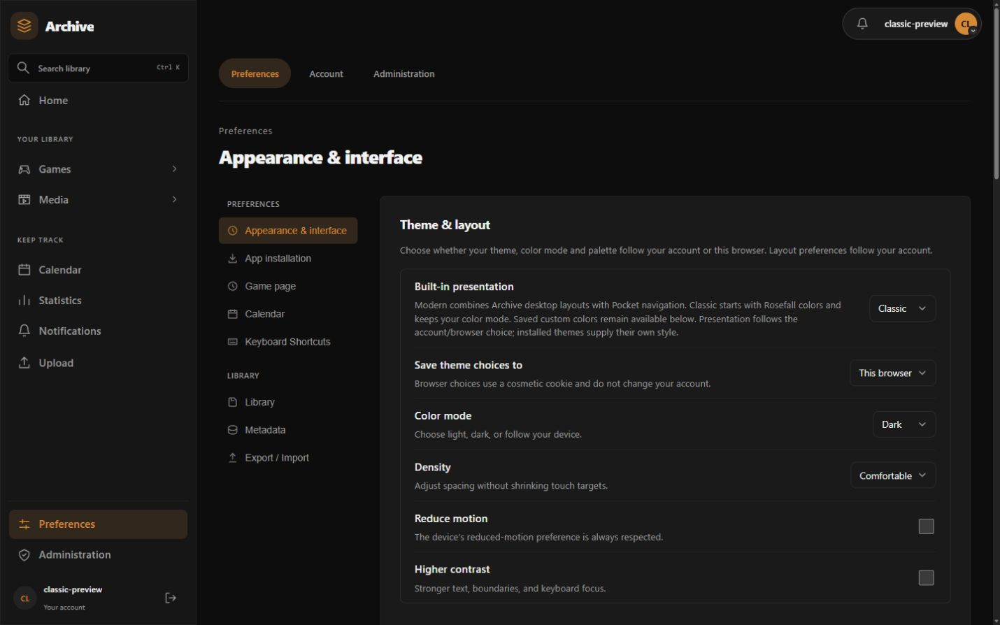
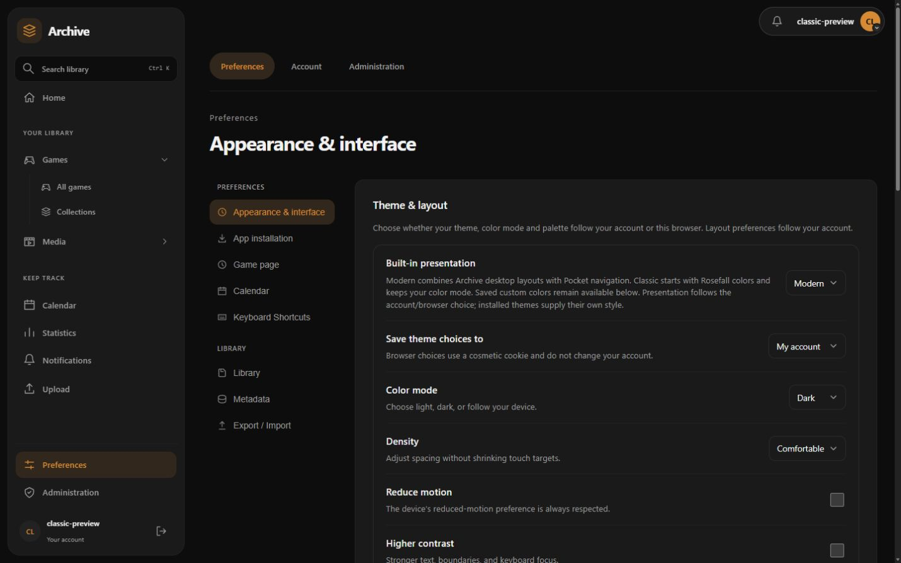

# Classic and Modern

Open **Preferences → Appearance & interface → Built-in presentation**.
**Modern** combines Archive desktop layouts with Pocket navigation. **Classic**
uses Rosefall's near-black panels, orange highlights, flat navigation and compact
controls. Both presentations use the same pages, forms and application features.

Selecting Classic presentation starts with the **Classic** palette and preserves your
Light, Dark or System mode. The light palette adapts the same visual hierarchy.
Green and custom palettes remain available, including complete custom light and
dark colors. Selecting a presentation does not delete your saved custom colors.
Density, higher contrast and reduced motion remain supported.

For the original colors with the current layout, keep **Modern** as the built-in
presentation, then choose **Native colors → Palette → Classic → Apply palette**.
This palette uses Rosefall/Archive's original near-black and orange dark colors
and the adapted light version. It changes colors while keeping Modern's layout,
navigation and controls. Palette choices can follow your account or this browser.

**Save theme choices to** chooses account or browser ownership. Browser choices
survive a reload in a cosmetic cookie; they do not change another device or your
account. An installed interface theme supplies its own appearance when selected.
Choose a built-in presentation to return to the native interface.

Administrators can set **Default built-in presentation** in **Setup → General**.
Alternatively, set `DEFAULT_UI_STYLE=modern` or `DEFAULT_UI_STYLE=classic` in the
deployment environment. A nonempty environment value locks the setup field and
takes priority over its stored server default. Leave it empty to configure the
default in Setup. Saved account and browser choices take priority over the default.
The default also styles a fresh sign-in screen after its public theme catalogue
loads. Existing choices remain intact when an administrator changes the default.

Classic is built into the host and requires no plugin or theme installation.
The current shared editor keeps its existing workflows; the Rosefall #469
form/lookup behavior is reviewed separately in the feature reconciliation.

For UI development, see the [Classic UI porting and design guide](../development/classic-ui.md).
