# Games

The game library supports manual records and provider-backed metadata. Use search, filters, collections, lists, bulk edit, and the detail page to organize a library.

Fresh navigation to Games starts at the top. Returning from a game detail preserves the library position once; visiting another section clears it. Media pages keep their loaded data while the router controls fresh navigation and browser history scrolling.

## Adding and editing

Use **Sync / import** on Games to sync a connected Steam, PlayStation or
RetroAchievements library, or a plugin connection that supports library sync.
The Epic Games plugin opens the same compact dialog used on Connections and starts
or resumes its saved import. Closing the dialog retains its checkpoint.

**Autosync settings** opens Account → Background tasks. Configured Steam, PlayStation
and RetroAchievements connections each have their own task alongside Epic Games and
other plugins that declare personal tasks. Enable autosync and choose each connection's
interval there to continue imports while the page is closed. Disconnecting pauses a
saved task; reconnecting restores its settings and history.
Autosync starts off, applies only to your account and uses your approved access.
Notes, ratings and manual status retain the provider import's existing protections.

**Add Game** in the library opens Quick Add: search the existing metadata providers
or enter a title, choose a status and platform, then save. Metadata results retain
their provider identities, including optional plugin providers. Duplicate and
owned-copy review remains a separate confirmation step.

Selecting a result opens **Look up metadata**. Review current/offered values,
check the changes you want and **Apply** them to the form before saving. Populated
values remain unchecked and protected fields stay unchanged. Artwork is verified
before it is offered. Cancelling the form discards the staged changes; selecting
a result does not immediately create or update a library entry. See the
[shared lookup workflow and screenshots](../integrations/metadata.md#review-metadata-before-saving).

Choose **Full form** for folders, relationships, ownership, artwork and other
fields. Your search selection and edits carry over. Titles that cannot generate
a folder name open the full form so you can supply one; folder collisions remain
visible errors rather than silently creating another copy. The compact dialog
loads parent-game and currency choices only when you open the full form.

A failed artwork transfer leaves the game saved. Its task offers **Retry** for the
remaining artwork on that same game; it never retries game creation. Artwork can
also be changed later in the editor.

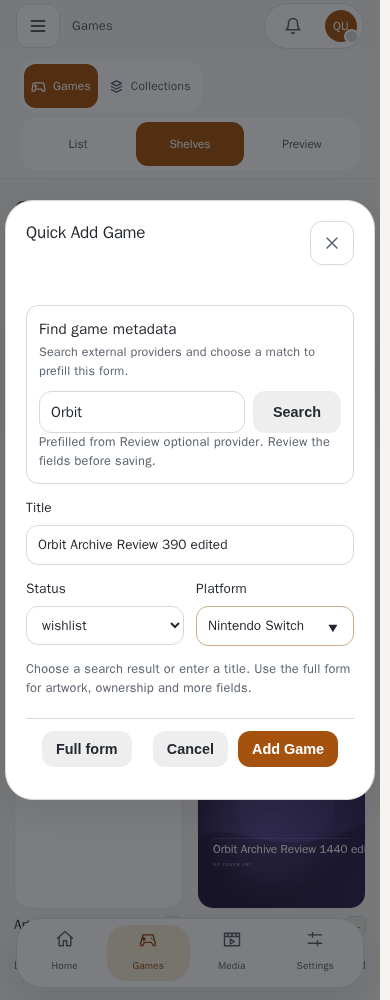

[Responsive validation](../assets/game-quick-add/conformance.json) uses disposable
records, real game saves and synthetic provider responses. The
[full form](../assets/game-quick-add/full-form-390.png) retains the selected identity
and tracking edits.

Editing supports title and sort title, platform, status, dates, rating,
genres/tags/features, description, time-to-beat data, favorite, collections,
playtime, the resume note and artwork; see [Adding a game](#adding-a-game).
Field-change history records supported metadata changes.

Bulk edit changes selected records only. Locked fields are not overwritten by refresh operations.

## Completion estimates

The full editor's **Play** tab has four estimates in hours: **Main story**,
**Main + extras**, **Completionist** and **All play styles**. Leave a field empty
when its estimate is unknown. These community estimates are separate from your
logged playtime and never add to it.

The overview shows Main story when available. Expand **More details > Time to beat**
to see every available category; **Stats** also shows Main story and Completionist.
Modern and Classic use the same fields and save behavior.

HLTB supplies the available categories through its optional metadata plugin. IGDB
can fill missing Main story, Main + extras and Completionist estimates. Unavailable
estimates remain empty. **Save time to beat** in scan settings controls enrichment
for all four fields, and protected fields retain their existing values. Export and
import preserve each category.

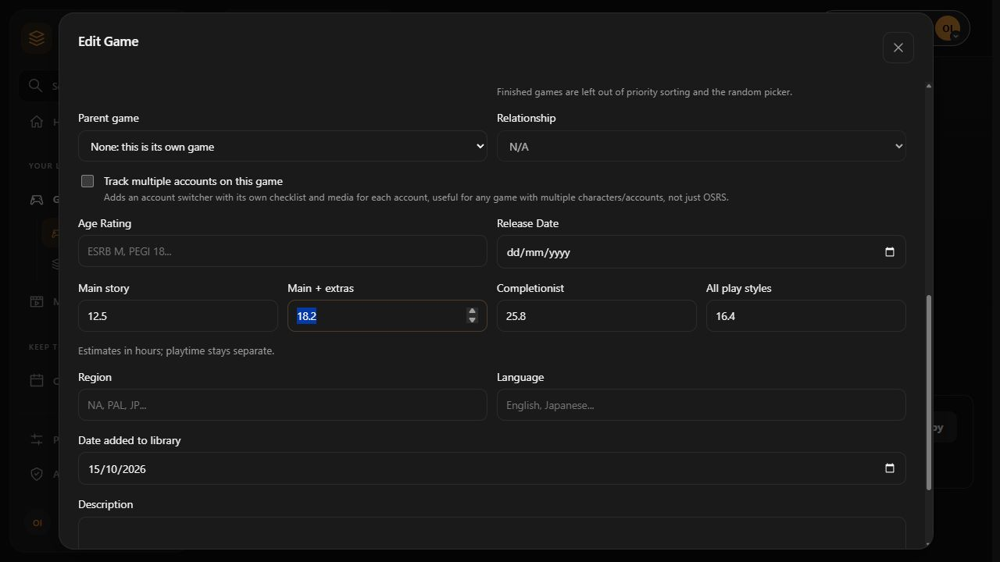

The same fields adapt to the
[Classic phone editor](../assets/game-time-estimates/classic-light-phone-editor.jpg).
Examples also show [Classic details](../assets/game-time-estimates/classic-dark-details.jpg),
[Modern details](../assets/game-time-estimates/modern-dark-details.jpg) and
[Modern light statistics](../assets/game-time-estimates/modern-light-stats.jpg).

## Excluding games

Open **Filters** to exclude statuses, tags/genres or platform families. Status
and platform exclusions are **Not …** chips. Tags and genres use the searchable
picker described below, in **Exclude** mode. Exclusions take precedence; a game
matching both an include and an exclusion stays hidden. Platform exclusions also
check owned copies, such as PS4 and PS5 within PlayStation.

Each exclusion has a removable chip. **Clear advanced filters** and
**Clear all** remove exclusions too. Saved presets and shared filter links retain
them; older presets start with no exclusions. Counts describe the matching games.
These controls filter the loaded library without contacting metadata providers.

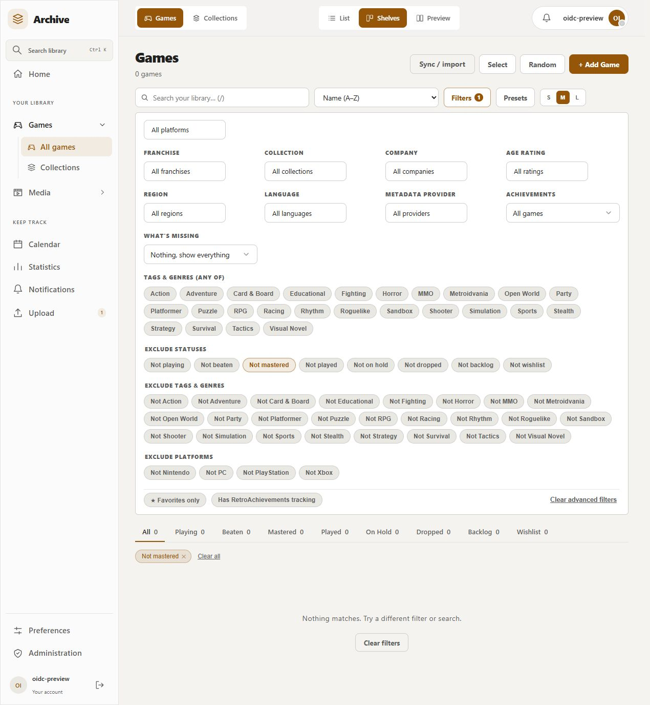

## Card updates and priority

Saving a card's status or favorite updates the library's filters, counts and current
preview immediately. A failed save keeps the previous value and shows a retryable
error. A library/detail response that started before a successful save cannot undo
that saved status or favorite in the local cache.

Cards show their active priority using the same 1–5 policy as sorting and the detail
preview. Beaten, Mastered, Played and Dropped games hide inactive priority. Legacy
HIGH/MEDIUM/LOW values retain their existing normalization. Modern and Classic share
these controls and behavior.

Finished games with an empty **Where I left off** note show a compact add-note action
instead of an empty note block. Written notes remain visible. Keyboard activation
opens and focuses the note editor.

## Possible duplicates

Open **Settings > Library > Duplicates** to compare possible duplicate games across manual entries, Steam, other stores and plugin imports. Suggestions use matching titles or shared provider identities, so a manually renamed game can still be found. Known conflicting years, platforms and provider identities are excluded. Compare each entry's source, release, status, playtime and identities; open its title to inspect notes and files. **Keep both** remembers your decision across future checks and import reruns. Nothing is merged or deleted automatically. **Check again** refreshes the review and shows additional pairs after decisions.

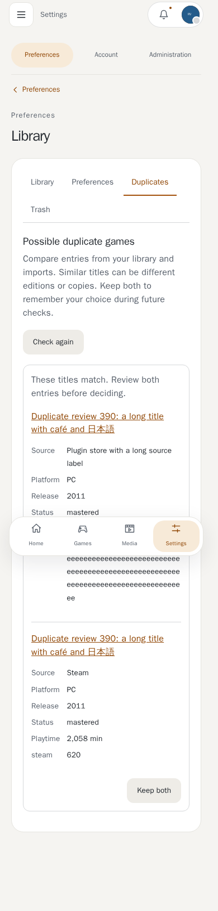

## Owned copies

Choose **Group owned copies** in duplicate review, select the main entry, then
confirm. The library and home shelves show one main game by default. Source,
platform and title filters can find it through its copies; its overall status and
favorite flag come from the main entry. Library cards and lists link current
duplicate-review candidates to the review until you group them or keep both.
Suggestions are bounded; additional candidates appear as earlier ones are reviewed.

The main game's **Owned copies** section lists each store/platform and reported
playtime. Use the main entry for overall status and notes. Open a copy for its own
progress, achievements, notes and files. **Add owned copy** can group existing
entries even when their titles or platforms differ. **Separate** returns a copy
to the library as its own entry without recreating it. DLC and mods remain in
**Variants**.

Each copy keeps its game ID, import identity, status, notes, protected fields,
achievements and files. Imports continue updating the original copy. Grouping
never automatically overwrites fields or relocates files. Reported playtime is
shown per copy and summed in this section; provider overlap is not deduplicated.
Statistics continue to describe the original tracked records. If the main game
is in Trash, its active copies become visible individually; restoring it restores
the grouped presentation.

The [phone grouping dialog](../assets/game-ownership/ownership-confirm-390.png)
and [desktop owned-copy summary](../assets/game-ownership/ownership-main-1440.png)
show this workflow. [Responsive validation](../assets/game-ownership/conformance.json)
uses disposable game records and real grouping/separation APIs.

## Steam imports

Steam library sync saves games and achievements before fetching store details and
artwork in small batches. A failed details batch does not discard the imported
library; the sync result reports games whose details could not be fetched.

Owned-library sync skips player achievement requests for games without an
achievement schema. If Steam supplies a schema but no player progress, existing
achievements keep their stored unlock state until a later successful sync.
An explicit player list with every achievement locked is still applied.

### Automatic status progression

Successful connected-library syncs can advance existing **Backlog** and
**Wishlist** games as well as new imports. An owned Wishlist game becomes Backlog
when no progress is reported, Played when the provider reports playtime or some
unlocked achievements, or Mastered when a nonempty achievement set is fully
unlocked. The first automatic Mastered transition sets a completion date only
when one is not already saved.

Every existing **Played**, Playing, On Hold, Beaten, Dropped or Mastered choice
stays unchanged, including Played games whose achievements later reach 100%.
Only fresh provider evidence counts; locally entered playtime and achievement
reports do not trigger this progression. Unavailable progress does not erase the
previous snapshot or imply completion.

Refreshing achievements can advance a Backlog game, but does not establish
ownership of a Wishlist game. Opening the achievements tab only reads saved
data; it never changes status. Steam's deferred achievement batches follow the
same rule, so a game already marked Played stays Played. When **Sync now** in
Settings defers achievements, it saves Steam's playtime first and waits for the
game's achievement batch to choose between Played and Mastered. Optional store plugins
using the public game-import operation share the host's ownership/playtime policy.

Provider settings show each source's active library game count and the time of
its last successful sync. Trashed games are excluded; restoring them returns
them to the count.

Settings > Metadata > Scan & providers includes **Import my Steam wishlist**, off
by default. When enabled, new wishlist entries are added with Wishlist status and
receive store titles and artwork during enrichment. A later owned-library sync
updates a purchased wishlist game's status. Turning the setting off leaves existing
entries in the library. An optional wishlist failure does not prevent owned-game
enrichment.

Library imports match existing games by provider ID. Different provider IDs with
the same title stay separate, while a matching record without a provider ID can
be adopted. Resyncs preserve locked titles. Import folder names are allocated
within your account and fit the storage limit, including collision suffixes.

## Detail-page data

A game can have:

- achievements and achievement progress;
- screenshots, videos, documents, and other uploaded files;
- notes and checklist items;
- player profiles, linked Wise Old Man statistics, and stat history;
- save, config, mod, and world archives with version history;
- related variants and collection/list membership.

Uploaded files remain user-scoped. Deleted games, files, screenshots, profiles, and archives move to their corresponding trash views when supported and can be restored until purged or swept by retention policy.

Achievement detail pages retain the Games / Collections navigation while loading
or reporting a missing achievement. Use Back to return to the achievement's game.

## Documents and plugins

A game's **Docs** tab takes files of any type and always offers them as normal downloads; see [Game Media and Files](game-media.md#docs). Plugins with an approved `documents.read` grant can receive only safe document DTOs and the content of supported previews (PDF, UTF-8 text, HTML as text, and inactive `.docx`, `.pptx`, `.odt` and `.odp` files within the preview limits); they never receive host paths. See [Plugins](plugins.md).

## Adding a game

**+ Add Game** opens Quick Add (above). **Full form**, adding a game from Home
and a game page's **Edit** all open the same full editor. Its header shows the
cover, the title as you type it and the developer, year and platform. Below it
are eight tabs; click any of them in any order:

| Tab | What it holds |
| --- | --- |
| **Basics** | Title, title protection, sorting name, folder name, status, priority, platform, source, date added and **Favorite**. |
| **Details** | Description, developer, publisher, series, release date, age rating, region and language. |
| **Play** | Your playtime in hours, the 100% completion date, **Where you left off**, the four completion estimates and multiplayer settings. |
| **Ratings and tags** | Your four ratings, tags, features and manual **Collections**. |
| **Artwork** | The cover and banner: the saved artwork, an uploaded file, an image link or a search result. |
| **Links** | Store pages and other links. |
| **Ownership** | Format, purchase date, price, currency and condition. |
| **Advanced** | Parent game and relationship, multiple accounts and OSRS stats, and which parts this game's page shows. |

**Add Game** or **Save Changes** stays at the bottom of every tab, and only the
tab's content scrolls. Nothing is saved until you click it, and switching tabs
keeps everything you have typed or chosen, including staged files. **Cancel**
discards the unsaved edits. Arrow keys, Home and End move between tabs once one
has focus; selecting the cover in the header opens **Artwork**.

**Look up metadata** opens the provider search above whichever tab is showing;
adding a game opens it straight away. Choosing a result shows the
[field-by-field review](../integrations/metadata.md#review-metadata-before-saving):
nothing changes until you **Apply** checked values, and the game is only
written when you save.

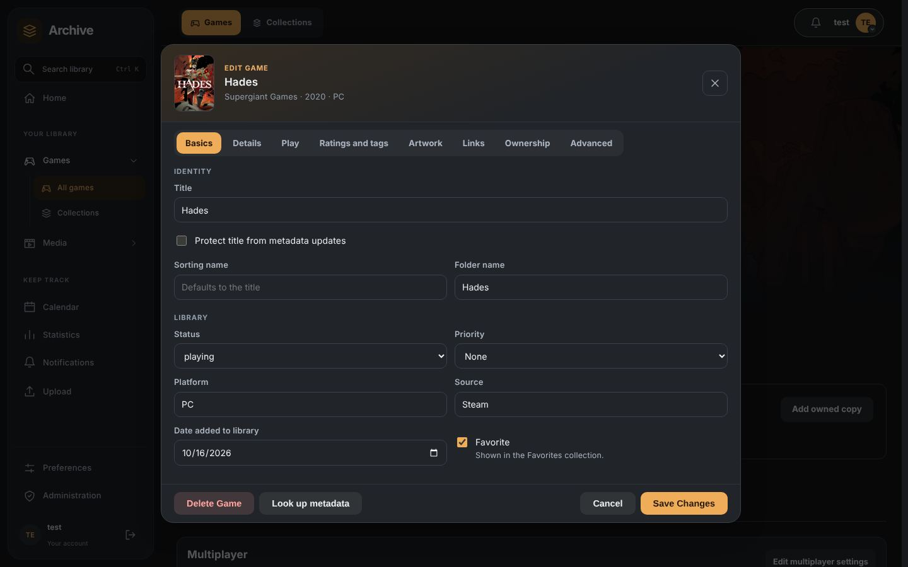

### Favorite, collections, playtime and notes

**Favorite** adds the game to the Favorites collection. **Collections** lists
your manual collections as checkboxes; type a name and **Add** to start a new
one (an existing name in different letter case is reused). Smart collections and
Favorites fill themselves from their rules, so they are not offered here.
**Playtime (hours)** is your total and **Where you left off** is the same note
shown on the game's Overview. These values are saved together with the rest of
the game in one request, so a save never keeps some of them and loses others.
Playtime is only sent when you change it; a connected library sync can later
replace it with the store's total. Totals above 596,523 hours are rejected.

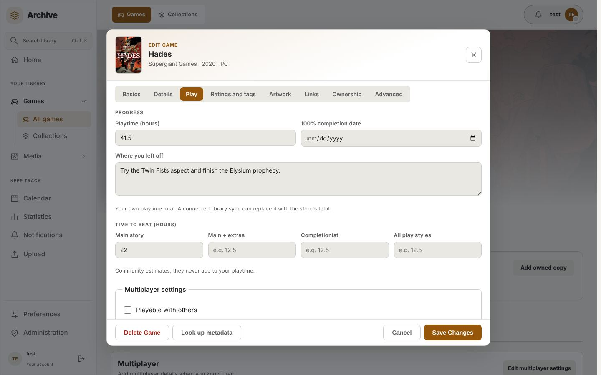

### Artwork

The **Artwork** tab is built the first time you open it and then kept while the
editor is open. For the cover and the banner you can upload a file, paste an
`http` or `https` image link and choose **Use**, or pick one of the images
offered by **Search artwork** or a metadata lookup. The preview is labelled
**Current**, **Local file**, **Link** or **Search**, and **Keep current**
discards the staged choice. The most recent explicit choice wins: an uploaded
file is never replaced by search results that arrive later, only by choosing
another image yourself. Choosing the same file again works, and local previews
are released when they are replaced or the editor closes.

Artwork is uploaded or fetched only after the game itself saves. If that
transfer fails, the game stays saved and the editor closes; the task notice
names the artwork that failed and **Retry** attaches the remaining artwork to
that same game without creating another copy.

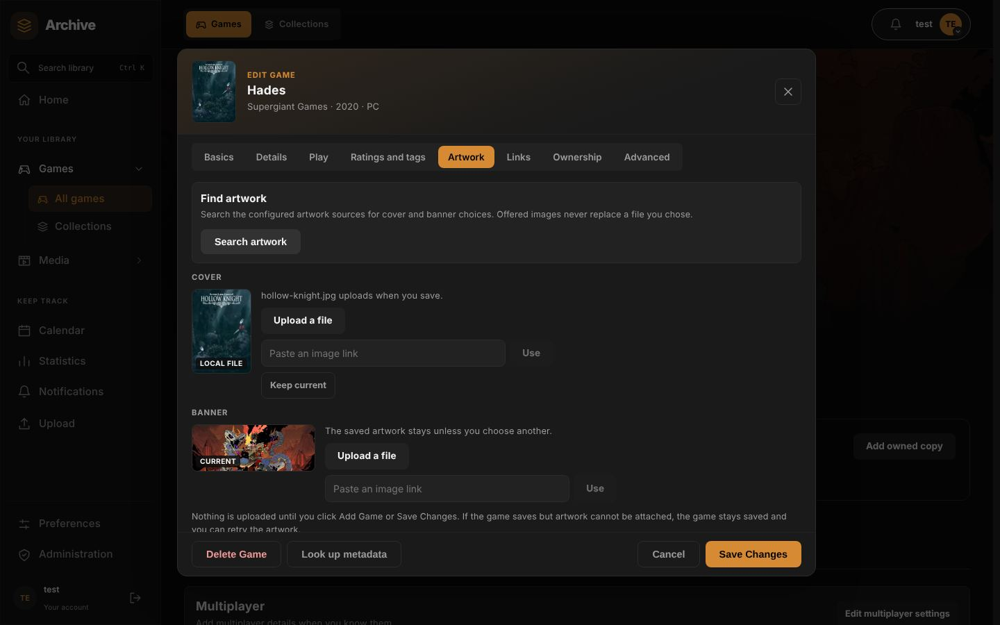

Modern and Classic use the same editor, fields and saving. Classic follows
Rosefall's editor with filled fields and outlined secondary buttons, and both
keep your palette, custom colors, light or dark mode and phone layout:
[adding in Modern](../assets/game-editor/modern-dark-add.jpg),
[collections in Modern light](../assets/game-editor/modern-light-collections.jpg),
[a custom palette in Classic](../assets/game-editor/classic-custom-dark-advanced.jpg),
[Classic on a phone](../assets/game-editor/classic-dark-phone.jpg) and
[artwork on a phone in Modern light](../assets/game-editor/modern-light-phone-artwork.jpg).

### Fields worth knowing

| Field | Notes |
| --- | --- |
| Folder name | Letters, numbers, underscores and hyphens only. It names the game's folder on disk, so it must be unique among your games. |
| Source | Where the copy came from (Steam, GOG, physical...). |
| Platform | The system you play it on (PC, PlayStation 5, Nintendo Switch...). Suggestions are offered but anything can be typed. Without a platform, the source is shown instead. |
| Priority | 1 (highest) to 5 (lowest). Finished games (beaten, mastered, played, dropped) are left out of priority sorting and the random picker. |
| Date added to library | Defaults to today. Change it to back-date a game you've had for a while. |
| Playtime (hours) | Your own total, to one decimal place. Leave it empty for none. |
| Where you left off | Up to 2,000 characters; also shown and editable on the Overview. |
| Region, Language | Edition details, used by the library's Region and Language filters. |
| Currency | Chosen from the currencies the server accepts. |

Clearing a field and saving clears it. A blank sorting name sorts by the
title.

## Filtering and sharing

The Filters panel has one **Tags & genres** picker instead of a chip for every
tag, so a library with hundreds of Steam player tags stays about one screen tall
on desktop and phone. Focus the search box (or press the Down arrow) to open a
list of every tag with the number of games it matches. Shared genres are listed
first, then your other tags, most used first. Type to narrow the list.

- **Include** (default) shows games with any included tag. **Exclude** hides
  games with any excluded tag. Click a row, or press Enter, to use the selected
  mode; **Shift+Enter** uses the other one. The Up and Down arrows move through
  the list, Escape closes it. Choosing a tag in the other mode moves it, so a tag
  is never in both lists.
- Chosen tags appear as chips under the box (**Not …** for exclusions) and in the
  pills above the results. Click a chip to remove it.
- A row shows what it also matches, for example **Also matches Race, Steam: race**
  or **Counts as Action**. Searching finds a tag by any raw spelling it merges, so
  `steam: race` finds **Racing** and `science fic` finds **Sci-fi**.

Selecting multiple included tags shows games matching any of them; the other
filters narrow that selection.

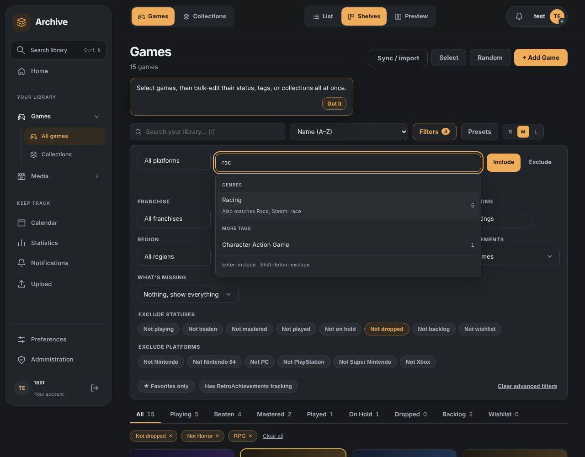

### Tag normalization

Tags are stored exactly as the provider, import or you wrote them. Nothing is
rewritten, so a game's own tag list and its page always show the raw tags. Filters
compare tags through three fixed, deterministic rules that run on your device with
no provider requests and no language model:

1. **Spelling.** Case, accents, spacing and punctuation are ignored, `&` reads as
   `and`, and a leading `Genre:`, `Tag:`, `Theme:`, `Steam:`, `IGDB:` or `GOG:`
   label is dropped. `Rogue-like`, `roguelike` and `Steam: Roguelike` are one
   choice. `Roguelite` stays separate.
2. **Synonyms.** A short fixed list of names for exactly the same thing share one
   choice: `Race` → **Racing**, `Role-playing (RPG)` → **RPG**, `Platform` →
   **Platformer**, `Simulator` → **Simulation**, `Sport` → **Sports**, `FPS` →
   **First-Person Shooter**, `RTS` and `Real Time Strategy (RTS)` →
   **Real-Time Strategy**, `Turn-Based Strategy (TBS)` →
   **Turn-Based Strategy**, `Science Fiction` → **Sci-fi**, `Shmup` → **Shoot 'Em Up**, `Soccer` → **Football (Soccer)** and a
   few more.
3. **Broader genres.** A narrower tag keeps its own choice and also counts as the
   broader genres it belongs to (`Hack and slash/Beat 'em up` also counts as
   **Action**; `Twin Stick Shooter` as **Shooter**, which counts as **Action**).
   This is one-way: choosing **Action** finds the narrower tag, never the reverse.

Related but different tags are deliberately **not** merged: `Roguelike` and
`Roguelite`, `Souls-like` and `Action RPG`, `Driving` and `Racing`. A tag the rules
do not know stays its own choice, spelled as most of your games spell it.
Existing links, presets and saved filters keep working; their tags are read through
the same rules when loaded.

To roll a rule back, remove its entry from `TAG_SYNONYMS` or `BROADER_GENRES` in
`src/frontend/src/utils/genres.ts`. Because stored tags and URLs keep the raw or
canonical text, no data migration is needed; the affected tags simply return to
separate choices (the spelling rule is the only one that cannot be switched off
per tag).

Changing tags, genres, sorting or other query filters on the current page keeps
your scroll position. The URL still updates for sharing. Navigating to another
page starts at the top, and browser back/forward restores its saved position.

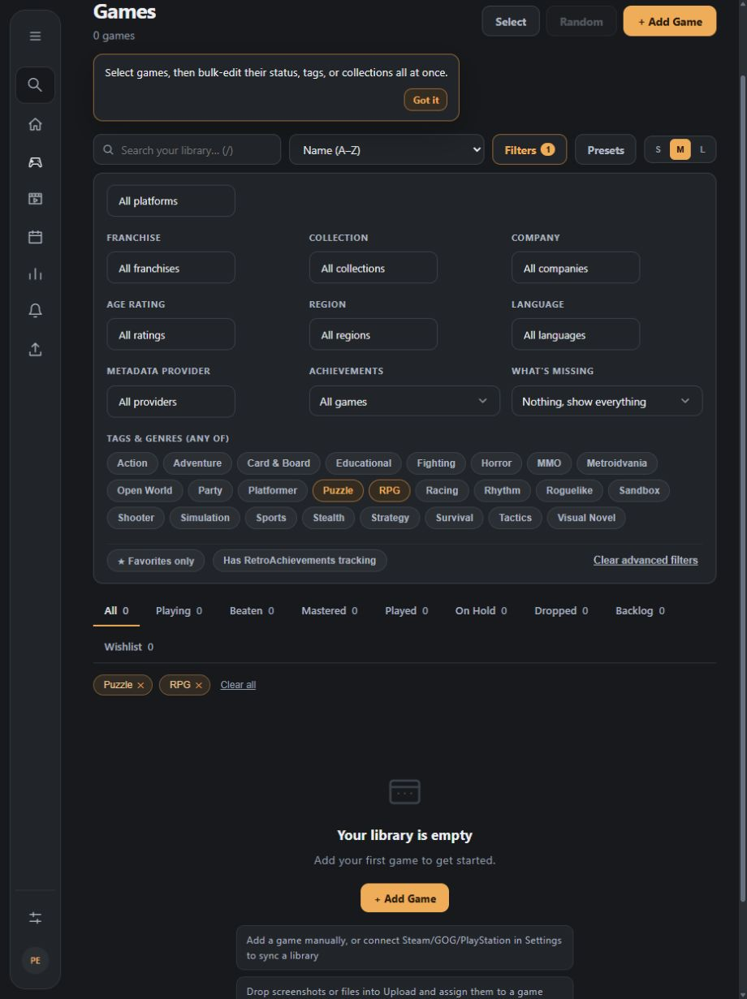

| Before: a chip per tag and per exclusion | After: one searchable picker |
| --- | --- |
| 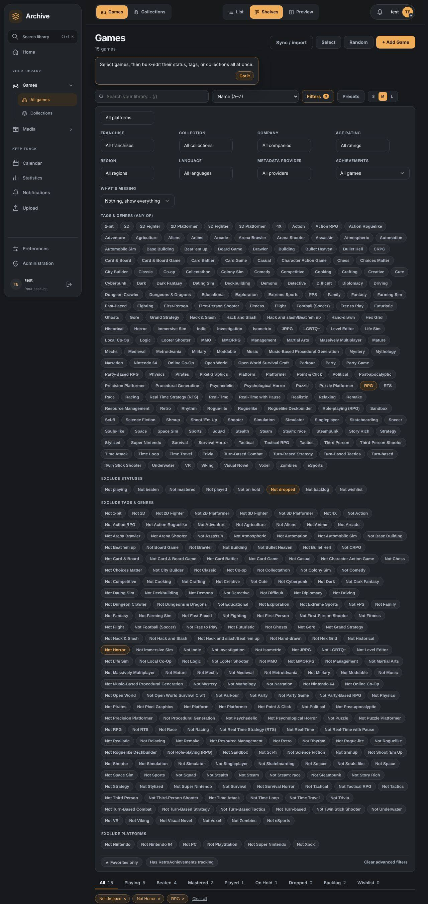 | 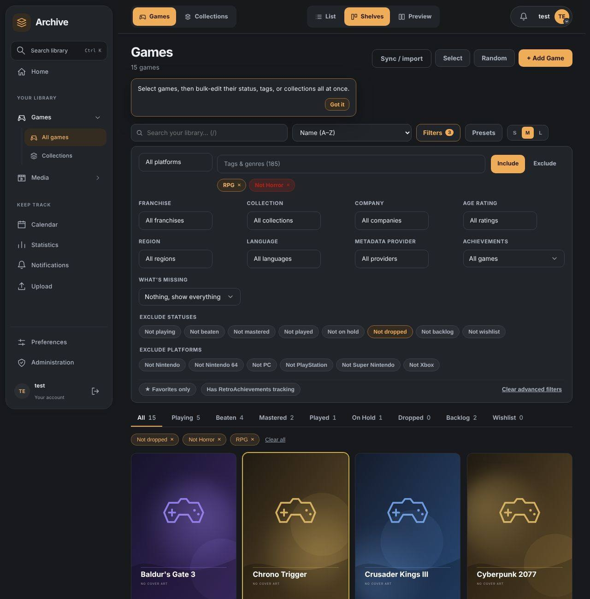 |
| 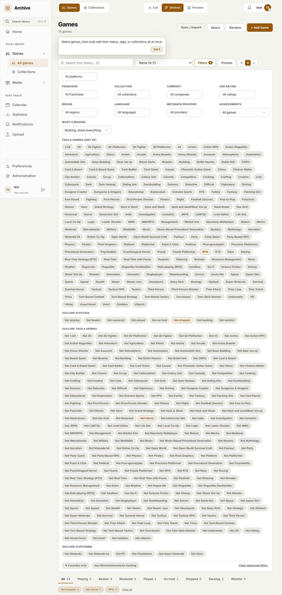 | 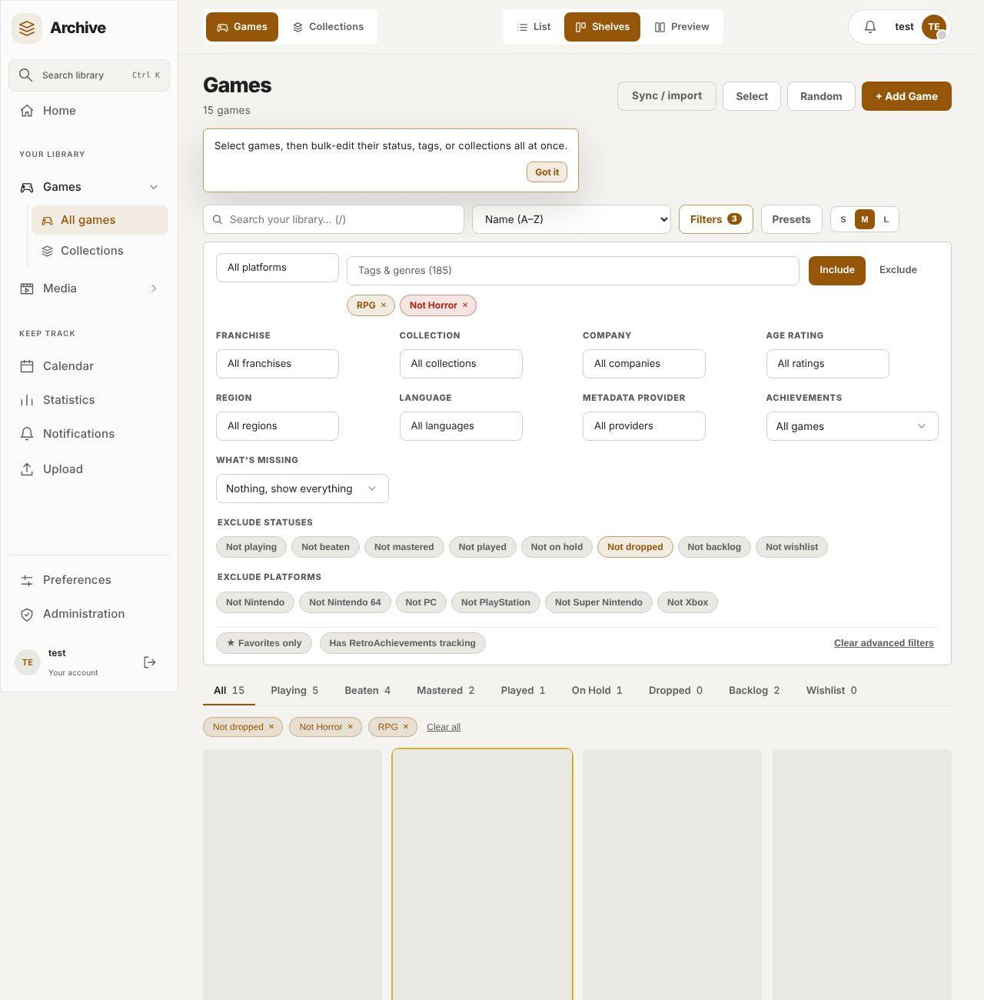 |
| 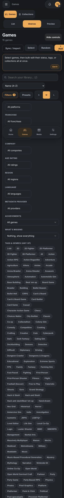 | 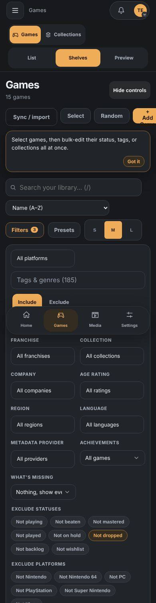 |

On a phone the panel uses two columns and the picker's list scrolls inside a
bounded area; the Classic presentation shares the same controls
([Classic phone search](../assets/library-tag-filters/after-classic-dark-phone-search.jpg),
[Classic desktop search](../assets/library-tag-filters/after-classic-light-search.jpg)).

The game total reflects the visible results. All and each status tab count games
matching the current search and other filters, so switching status remains useful.
Tabs with no matches show zero.

Copy the browser URL to share the selection, search, status and sort. Multiple tags
use repeated parameters, for example `/games?filters=1&tag=Indie&tag=RPG&status=backlog`.
Closing the panel keeps the selected filters and writes `filters=0`, so refreshing
or reopening that link keeps it closed. `filters=1` opens the panel; older links
with filter selections and no visibility marker still open it. An explicit empty
filter link clears saved selections whether its panel is open or closed.
Opening a shared link replaces saved filters in that browser. Removing a pill or
clearing filters updates the URL too. Existing `?tag=`, `?genre=`, collection and
statistics links remain supported; saved genre selections migrate into the picker.

## Sorting the library

The sort menu offers Name (A–Z and Z–A), Recently added, Rating, Most
played, Recently played, Neglected (least recently played), Priority,
Release date (newest) and Time to beat (shortest). Games missing the value
being sorted on go last. The default sort is set under Settings › Appearance & interface.

## Picking something to play

**Pick something random** on Home, or **Random** in the Games library, opens
a picker. Narrow it down by status, platform, genre, the most hours to beat
and priority, then **Pick a game**. With **Favour higher-priority games** on,
a priority 1 game is five times as likely as one with no priority. **Pick
again** never repeats the last pick while there's another choice; when only
one game matches, the picker says so. The filters are remembered in your
browser.

Genre filters, here and in the Games library, match a game whichever
metadata provider named its genre. IGDB, for example, has no "Action" genre
and files Devil May Cry under "Hack and slash/Beat 'em up", which still
counts as Action; "Role-playing (RPG)" counts as RPG and "Platform" as
Platformer. Letter case doesn't matter. See
[Tag normalization](#tag-normalization) for the exact rules.

## Bulk edit

**Select** games in the library, then **Bulk Edit** to set status, favorite,
developer, publisher, series, age rating, platform, priority, tags or
features on all of them at once. Only the fields you tick are changed.

## A game's page

Clicking a game opens its page. The header holds the cover, title, status,
score, favorite heart and collections button, and below it are the tabs:

- **Overview**: the description, ratings, platforms, links and where you left
  off.
- **Achievements**, **Screenshots**, **Clips**, **Soundtrack**, **Saves**,
  **Docs** and **Notes**. See [Game Media and Files](game-media.md) and
  [Game Notes](game-notes.md).
- **Stats**: playtime and dates, with a history timeline underneath.

Which tabs and header parts show is up to you. See
[Game Page Settings](game-page-settings.md).

A game you have already seen in the library opens straight away and refreshes
in the background.

### Clickable details

The developer, publisher, platform, tags and series on a game's page are
links. Clicking one opens the library filtered to every game with the same
value, so clicking a developer lists all of its games. It shows only that
filter, not on top of the ones left on from last time.

### Genres from Steam tags

A Steam game's genres can come from the tags Steam players vote on instead of
only Steam's broad official genres, so Elden Ring shows Souls-like, Open World,
Dark Fantasy, RPG, Difficult and Action RPG rather than just Action and RPG. See
[Steam tags as genres](../integrations/metadata.md#steam-tags-as-genres).

### Multiplayer settings

On **Overview**, choose **Edit multiplayer settings**. Tick **Playable with
others** and save to mark multiplayer without supplying extra details. Exact
player limits remain unknown. Enable **Set known player limits** to enter both
minimum and maximum, or choose a common range. Session duration and confirmed
crossplay are optional. These details are self-reported and also available in
the game's ordinary Edit form.

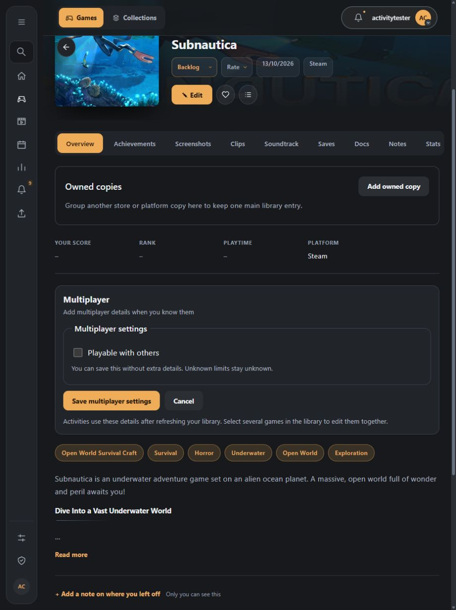

For several games, select them in the library and open **Bulk Edit**. Tick
**Apply multiplayer settings** and review the replacement before saving. It
affects only your selected games. Unchecked fields stay unchanged; applying with
**Playable with others** unchecked clears their saved multiplayer details.

Integrations can read these presets with approved library access. Saving them
through an integration requires the separate `compatibility.write` capability;
ordinary tracking write access does not include it. Game Night can apply a
preset to selected records across connected current instances when each account
has explicitly approved that capability. Refresh the connected libraries to use
the saved changes. Older API-key connections remain read-only in its broker.

## Achievements

Steam, PlayStation and RetroAchievements achievements are synced into the
game.

- **Hidden achievements** are flagged by the provider and shown as a spoiler
  until you unlock them. Steam only publishes a hidden achievement's
  description after you unlock it, so locked ones stay blank. Descriptions of
  the ones you have unlocked are read from your public Steam profile, which
  needs your game details set to public. Refresh the game's achievements, or
  run the library sync again, to fill them in.
- **Of players** shows how many players have each achievement (Steam's global
  percentage, PlayStation's earned rate, or RetroAchievements' count).
- Screenshots, clips and notes can be tied to an achievement, and the
  achievement's page lists what is tied to it.

### Your own achievements and completion

Open the **Achievements** tab and choose **Add achievement** to track one the
game does not report, for example on a platform with no integration. Give it a
title and, optionally, a description, category and icon address. Tick it when you
earn it and untick it to undo; edit or remove it any time. Your achievements are
kept apart from imported ones: a Steam, PlayStation or Playnite sync never
changes, hides or replaces them, and an imported achievement with the same name
is still a separate entry. Choose "Every version of this game" to share one with
all versions grouped under the same game.

The **Overview** tab has a **Completion** section listing every tracked version
with its own status. Pick a status per version; the summary says, for example,
"Completed on 1 of 2 tracked versions" rather than claiming every copy is done.
A status you set is marked "Set by you" and imports will not change it; choose
**Let imports update** to hand it back. Changing a game's status in its edit form
counts as setting it yourself.

## Stats and history

The Stats tab shows playtime, achievements, score and dates. Below the numbers
is the game's story as a timeline. Each entry has a date and a one line
summary, and opens to show the details. Entries cover being added to the
library, being purchased, achievements unlocked, metadata updated, a price or
status change, and media added. Things that happened together are grouped. The
timeline can be switched off in the page settings while the numbers stay.

## Library totals and Trash

Library-wide numbers describe the games currently in your library. A game in
Trash is left out of Settings > Storage & usage (game count, favorites, total
playtime, storage used, total spent, average rating, most played and every
breakdown), the Home **This week** widget, and the game figures on the
Statistics page. Another account's games are never included.

Trashing a game does not erase what was recorded about it. Its playtime, last
played time, achievements and metadata history stay with the game while it is
in Trash, and restoring it returns exactly the same values to every total.
Trashing and restoring are not counted as activity themselves. When Trash is
purged after seven days, the game and those records are removed permanently.

These totals are built from what is recorded on each active game, not from a
separate activity log:

- **Total playtime** is the playtime each platform last reported for a game, not
  the time played during a particular period.
- **Games played** in **This week** counts each active game once if its most
  recent recorded play is within the last seven days, however often it was
  played that week.
- **Achievements unlocked** and **Metadata changes** in **This week** count the
  unlock and change times recorded on active games during those seven days.
- A game's own Stats tab and history timeline are unavailable while it is in
  Trash and return unchanged when it is restored.

## The library at a glance

The library has card, list and shelf layouts. Covers are small local copies
rather than the full artwork, and they load lazily: only the games near the
screen fetch their picture, and the list layouts skip drawing rows that are far
off screen. A library of hundreds of games opens quickly and loads more as you
scroll. See [Artwork](../development/architecture.md#artwork-and-local-image-copies)
for how the copies are made.

## Metadata provider extension (1.1.1)

Search and refresh use the hardcoded core providers and optional installed provider plugins
through one shared metadata handler. Core search does not require the plugin runtime.
Provider configuration and health appear in the host's metadata settings.
See [the progressive metadata contract](../development/metadata-providers.md) for
phase separation, scoped credential migration, deadlines and persistence behavior.
