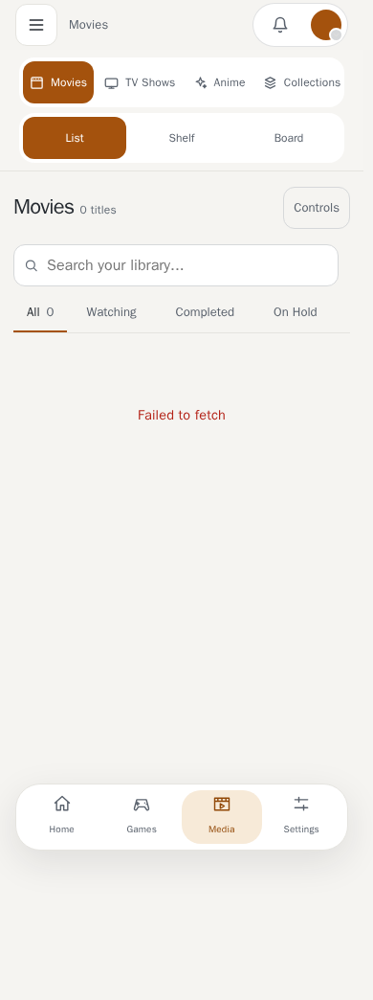
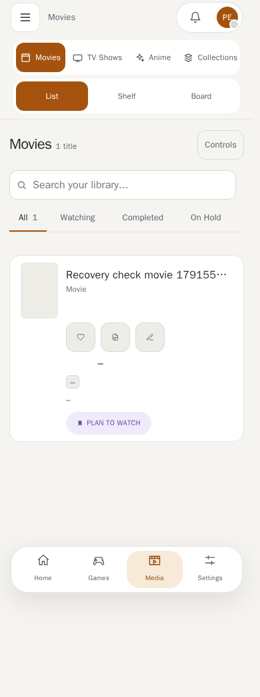
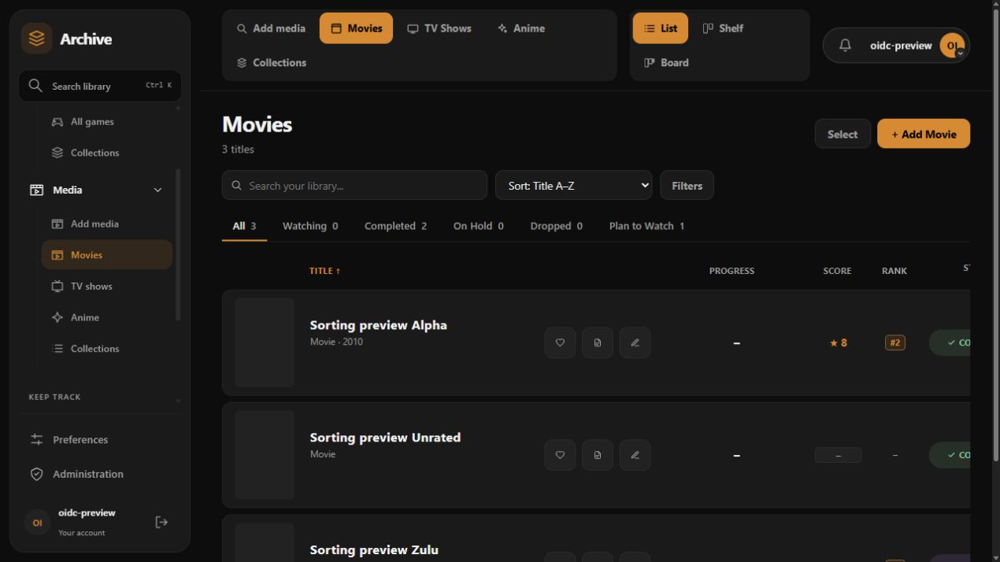
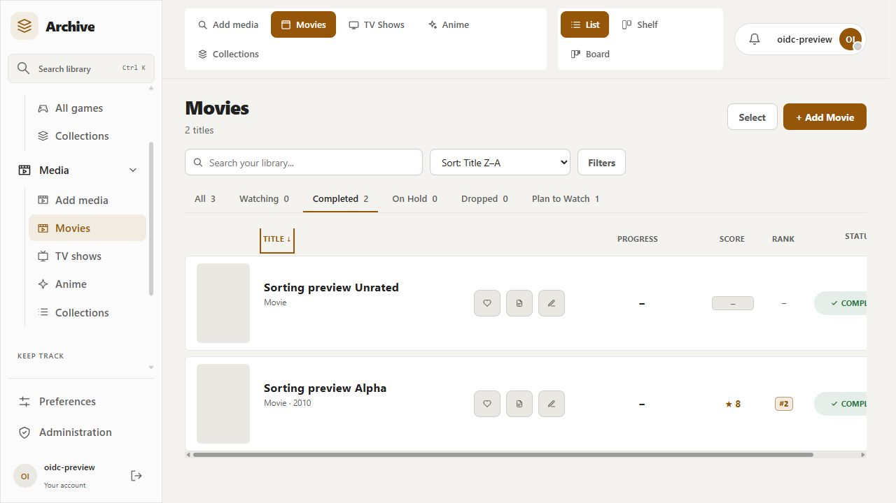
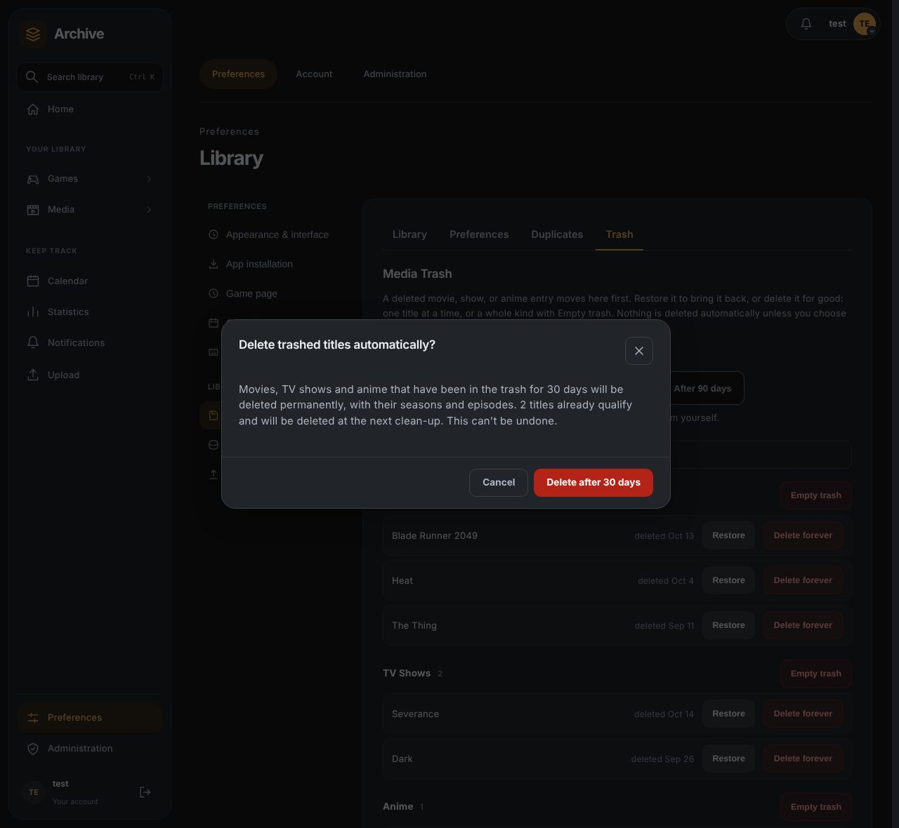
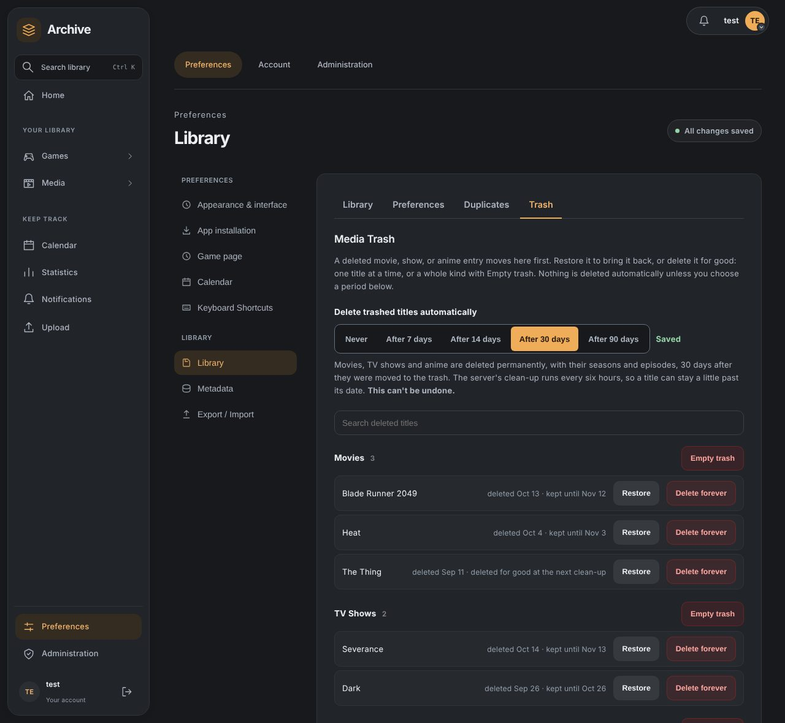
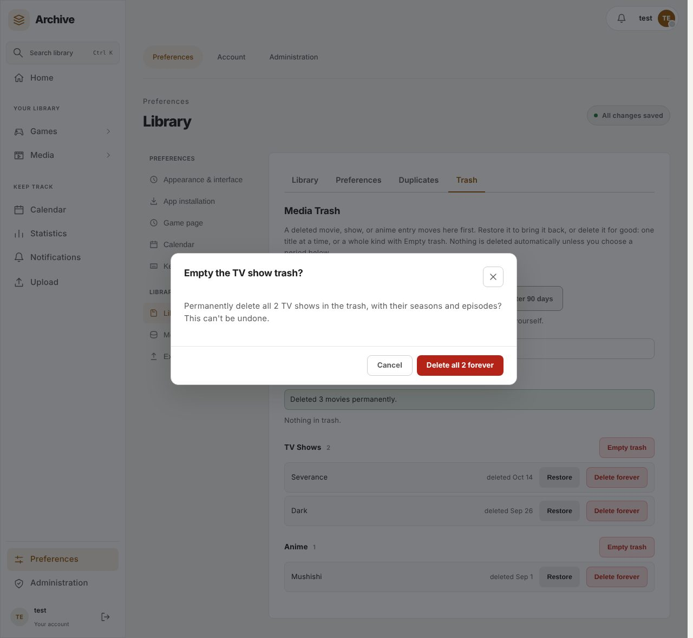
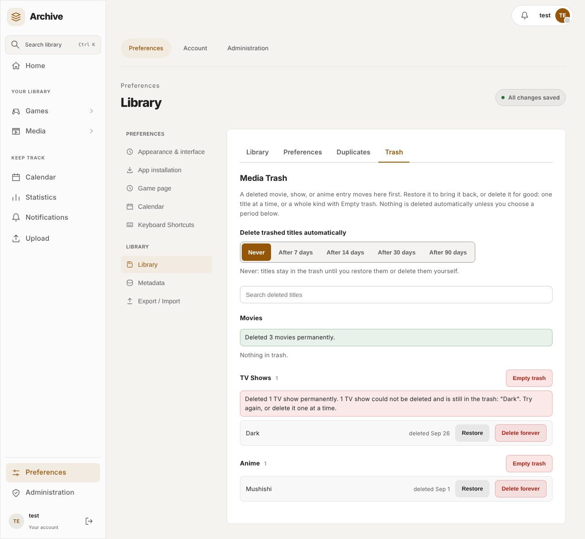

# Movie, TV and Anime Libraries

Status tabs survive a page refresh. Loading the next page keeps the existing cards
on screen and preserves their scroll position. Posters, backdrops and achievement
icons are downloaded into the server's cache when saved, with the original URL used
as a fallback if the download fails. Existing images are cached when first viewed.

After a connection loss, the visible library retries when internet access returns.
If the tab was hidden, it waits until you return. A failed load also retries when
you focus the window again. Successful requests clear the previous error and keep
your selected filters; you do not need to reload the browser page.

The [browser recovery checks](../assets/library-recovery/conformance.json) cover
games, movies, TV and anime at phone and desktop widths, using actual backend
responses after injected connection failures. The same browser document recovers.

| Connection unavailable | Connection restored |
| --- | --- |
|  |  |

[Desktop before reconnecting](../assets/library-recovery/unavailable-1440.png)
and [after reconnecting](../assets/library-recovery/recovered-1440.png).

Yamtrack CSV imports continue to skip anime entries while their mapping and duplicate
matching remain unresolved. Movies and TV shows can still be imported.

These three libraries share one layout, so what is described here applies to
all of them. Their own pages cover what is specific to each.

## Ratings and numeric edits

Clearing an optional number, such as your rating, runtime or total episode count,
removes its value. Entering `0` keeps a real zero. Episodes watched requires a
whole number; a blank or fractional count keeps Quick edit open with an explanation.
These controls work the same way in Modern and Classic.

In long episode lists, saving watched state, a rating or a note keeps your chosen
episode page. Switching to a different season or ordered episode list selects the
page containing its next unwatched episode.

IMDb, Letterboxd and Yamtrack list imports normalize user ratings to 0–10 with
two decimal places. Letterboxd's five-point scale is doubled first. Finite scores
outside the range are bounded to 0 or 10, and invalid/nonfinite scores are left
unrated. Rounding uses half to even (`8.765` becomes `8.76`). Other numeric values
keep their existing precision. An app JSON restore reports and skips an entry
with a nonfinite numeric value while continuing with valid entries.

## Sorting, counts and returning to the library

The sort menu orders the complete matching library before pages are loaded. Choose
Rank, Score, Title, Recently added, Year or Progress. In List layout, the Title,
Progress, Score and Rank headers are keyboard-accessible sort controls; selecting
Title again reverses its direction. Missing scores/dates stay last, with stable
ordering when values tie.

Progress uses the same watched/known-total episode ratio as the cards. An unknown
or zero total has zero progress. Movies use their existing seen status. Sorting
does not download every title into the browser.

Status tabs sum all real statuses into the five displayed groups. **All** counts
the matching titles across statuses; the result total can be smaller when a status
tab is selected. Search and other selected filters still apply to those counts.

Returning within two minutes reuses fresh loaded data. When a refresh is needed,
it refreshes the extent already loaded, preserving the current query and sort
instead of shrinking to the first page. Successful local saves invalidate that
freshness window. Old pagination replies cannot append to a newer query, and an
empty or repeated page stops further loading while retaining the server's total.

| Modern: title order | Classic: keyboard reversal and Completed filter |
| --- | --- |
|  |  |

## Rank

A title with a score gets a **rank**: its place among every title you have
scored in that library, highest score first. Titles with equal scores are
ordered by name, so each rank is different. Ranks are worked out over the whole
library, so they stay the same whether you are searching, scrolling or looking
at only one page of it.

Rank shows as a badge on cards, in the Rank column of the list layout, and as
the **Sort: Rank** order. Movies, TV shows and anime are ranked separately.

## Filtering from a title's page

The genres on a title's page are links. Clicking one opens that library with
only that genre selected and the filter panel open, replacing whatever filters
were left on before. This works on Movie, TV and Anime pages.

## Pictures

Posters and backdrops are stored by TMDB or AniList, but your server keeps its
own small copy of each one. The first time a picture is needed, the server
downloads it, shrinks it (posters to 400 pixels wide, backdrops to 1920) and
stores it. After that, pages load it from your own server and nothing waits on
another site.

- Changing a title's poster or backdrop address makes a fresh copy.
- If a download fails, your browser is sent to the original address instead, so
  a picture never just disappears.
- The server only fetches public web addresses. Addresses that point at your own
  machine or local network are refused.
- The copies are a cache and can be deleted at any time. They are made again when
  needed. See [Data, Exports and Backups](data-and-backups.md).

Libraries also load pictures lazily: only the cards near the screen fetch
theirs, and more load as you scroll.

## Editing

Use **Add media** in the media navigation to search movies, TV shows and anime
together. Each library's Add button opens the same page with its type selected.
Results appear as providers respond; a slower or unavailable provider does not
hide results from the others. Switching the type tabs filters the results locally
without another provider request, and refining the title immediately filters
already received results while the next search is prepared.

Pick a result to set status, episode progress, rating and dates before adding it.
The selected provider identity and available metadata are saved directly, so two
adaptations with the same title do not get mixed up by another title search.
Details and artwork can continue arriving while the dialog is open; your progress
and rating stay as you entered them. Completed fills known episode totals.
If a season-progress request fails after the title was saved, the confirmation
links to that saved title and explains that its progress needs updating.

The [browser conformance checks](../assets/media-search/conformance.json) cover
phone and desktop entry points, partial responses and real database saves.
Provider timing uses explicit fixtures; the separate
[live provider check](../assets/media-search/live-providers.json) uses the
configured core providers without fixtures.

Use **Review metadata before adding** in the add dialog to choose individual
metadata/artwork fields without losing personal tracking inputs. The Edit dialogs
use the same checked comparison after selecting a lookup result. **Apply** stages
the selected values; **Save** persists them. Cancelling the form discards them.
Provider identity is an explicit choice, grouped with offered TV seasons. Selecting
an unrelated description or picture cannot change the tracked provider identity.
See [the shared lookup workflow](../integrations/metadata.md#review-metadata-before-saving).

## Trash, Empty trash and automatic deletion

Deleting a movie, TV show or anime entry moves it to the trash. Open
**Settings > Library > Trash** to see the three trashes. **Restore** brings a
title back with its seasons, episodes, progress and ratings. **Delete forever**
removes one title permanently.

### Empty trash

Each kind with something in its trash has an **Empty trash** button. It asks
first, naming the exact number of titles, and says that shows and anime lose
their seasons and episodes too. Emptying covers the whole kind, including titles
hidden by the search box; the confirmation says so when a search is active.
**Emptying is permanent and cannot be undone.**

- Only titles that were in your trash when you confirmed are deleted. A title
  trashed afterwards, a title restored meanwhile (on another device, for
  example), your active library and other accounts' titles are never touched.
- Large trashes are emptied in batches of 200; the page repeats them for you.
- The result stays above the list. When something could not be deleted, it
  names those titles, and they stay in the trash unchanged. Each title is
  deleted on its own, so one failure never leaves a show without some of its
  seasons. If the connection fails part-way, the message says how many were
  already deleted; the rest are still in the trash.

### Delete trashed titles automatically

Choose **Never**, **After 7 days**, **After 14 days**, **After 30 days** or
**After 90 days**. **Never** is the default for every account, including
accounts that existed before this setting: nothing is deleted automatically
until you choose a period.

- With a period chosen, a title is deleted permanently, with its seasons and
  episodes, once it has been in the trash that many days. The time counts from
  when it was moved to the trash, so titles already older than the period go at
  the next clean-up. Each row shows when that will happen.
- Turning automatic deletion on, or shortening it, asks for confirmation first
  and says how many titles already qualify. Keeping titles longer or choosing
  **Never** saves straight away.
- The server's regular trash clean-up applies the choice. It runs when the
  server starts and every six hours, so a title can stay a few hours past its
  date. It deletes at most 200 titles of each kind per account, and 2,000 in
  total, per clean-up; anything left goes at the next one.
- If saving the choice fails, the page shows the choice that is actually saved.
  Choosing **Never** takes effect at once: the clean-up re-reads your choice
  just before deleting anything from your trash.

This is separate from game trash. Deleted games and game files keep their
fixed seven-day retention, described in [Games](games.md) and
[Game Media and Files](game-media.md).

| Modern: turning on automatic deletion | Modern: 30 days chosen |
| --- | --- |
|  |  |

| Classic: Empty trash confirmation | Classic: a title that could not be deleted |
| --- | --- |
|  |  |

[Classic dark with 14 days](../assets/media-trash-retention/classic-dark-retention-14.jpg)
and [Modern phone width](../assets/media-trash-retention/modern-dark-phone.jpg).

## Metadata provider extension (1.1.1)

Search and refresh use the hardcoded core providers and optional installed provider plugins
through one shared metadata handler. Core search does not require the plugin runtime.
Provider configuration and health appear in the host's metadata settings.
See [the progressive metadata contract](../development/metadata-providers.md) for
phase separation, scoped credential migration, deadlines and persistence behavior.

## Statistics requests

Statistics loads the selected tab first and reuses tabs already visited on that
page visit. Returning to the page shows the last loaded numbers while refreshing
the visible tab; other cached tabs refresh when selected. **Refresh** retries a
failed request or updates the current tab without discarding its previous numbers.
Cached statistics are cleared when the signed-in user changes.

The authenticated `/api/media-stats` endpoint accepts an optional `section`:
`overview`, `games`, `movie`, `tv` or `anime`. A selected library returns only
that section and does not calculate unrelated libraries or the activity summary.
Overview combines all libraries and includes game favorites and unlocked
achievements. Omitting `section` retains the complete response for existing clients.
Watch time, rewatches, title-language preferences and active-library filtering use
the same calculations in both response forms.
