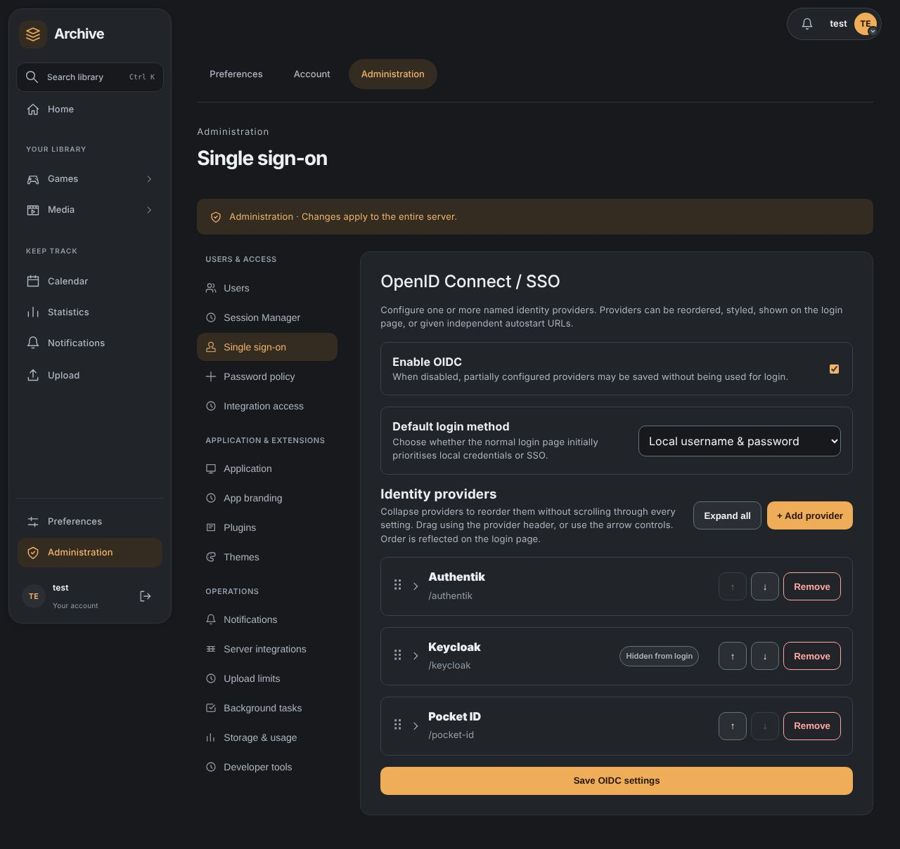

# OpenID Connect / SSO

Configure named OIDC providers under **Settings → Administration → Single sign-on**. First-run Setup can also register an initial provider from setup fields or environment configuration.

## Before configuring

Create an OIDC client in your identity provider using the authorization-code flow.

For a named provider, the callback is:

```text
https://<application-host>/api/auth/oidc/callback/<provider-slug>
```

Use the exact redirect URI displayed in Settings when registering the client.

## Provider settings

Each provider can configure:

- Provider name and slug
- Issuer / discovery URL
- Client ID and client secret
- Scopes, defaulting to `openid profile email`
- Groups claim, defaulting to `groups`
- Optional administrator group
- User matching by email or username, or disabled
- Whether new users may be created
- Whether the provider must explicitly confirm a verified email
- Login button text, image and colour
- Whether the provider is enabled and shown on the login page
- Whether autostart URLs are enabled

Providers can be added, removed, reordered, and configured independently.

The **Default login method** setting controls whether the normal login page initially prioritises local credentials or SSO.

## Collapsing and reordering providers

Each provider is a collapsible row. Saved providers open collapsed, showing only the provider name, slug, a status label when the provider is disabled or hidden from the login page, and the reorder and **Remove** controls. Select the provider name, or the arrow beside it, to show or hide its settings. A newly added provider opens expanded so it can be filled in. With more than one provider, **Expand all** and **Collapse all** switch every row at once.

Collapse providers to reorder a long list without scrolling through every setting:

- **Mouse:** drag a provider by its header and drop it on another provider.
- **Keyboard and touch:** use the **↑** and **↓** buttons. Focus stays with the provider that moved, so repeated presses keep moving it, and screen readers announce its new position.

Expanding, collapsing and reordering only change the page. Unsaved edits are kept while a provider is collapsed. Select **Save OIDC settings** to store the new order; the login page lists providers in that order.



## Redirect URI

The settings UI generates the redirect URI from the address currently used to access the application and displays it as read-only. Use **Copy URI** beside the field to copy the current value, including unsaved slug edits. A confirmation appears after copying; if the browser blocks clipboard access, select the field and copy it manually. Sign-in generates it again from the current request, preserving the scheme, host, port and proxy mount path. A previously saved generated preview does not pin users to the administrator's old address, and the shared **App URL** setting does not replace the sign-in address.

No explicit callback setting is required. Register the exact callback for every application address you use with the identity provider. An optional `OIDC_REDIRECT_URI` can pin the matching environment-managed issuer/client to a fixed callback, including its named callback aliases. Behind a reverse proxy, configure the existing trusted proxy forwarding correctly; the OIDC code does not interpret arbitrary forwarded-host headers itself. Callbacks require HTTPS, except loopback development with `DEBUG=true` or `STARTUP_MODE=development`.

For example:

```text
https://archive.example.com/api/auth/oidc/callback/authentik
```

Register exactly that URI with the identity provider.

## ID-token validation

### Provider network policy

Provider discovery, token, JWKS and UserInfo requests require HTTPS, refuse redirects, use bounded responses and disable environment proxies. The exact HTTPS issuer origin chosen by the administrator is trusted for public or private DNS routing. Other origins must resolve exclusively to public addresses; those connections pin their approved addresses. Every HTTPS connection verifies the certificate's trust chain and hostname. Discovery cannot override transport, TLS, proxy, headers or PKCE options.

No extra environment allowlist is needed for an internal or split-DNS issuer. Configuring the provider already trusts its exact scheme, hostname and port, including endpoints on that origin. Changing the hostname or port leaves that trust boundary, even if both names resolve to the same server. A provider's discovery document cannot grant private access to other origins. Use a trusted CA and a certificate valid for the issuer hostname; install an internal CA in the backend trust store when needed. `OIDC_PRIVATE_ISSUER_ORIGINS` remains accepted as a legacy setting but is no longer required. Plain HTTP is allowed only for loopback destinations when `DEBUG=true` or `STARTUP_MODE=development`.

Authorization-code sign-in uses PKCE S256. Discovery must name the configured issuer exactly (legacy discovery-URL inputs allow that same issuer path with either trailing-slash convention); only supported asymmetric ID-token signature algorithms are accepted. The signed nonce must match even if a provider reports `nonce_supported=false`. UserInfo can fill missing profile information only after ID-token validation and only when its subject matches. Unsigned token-response fields cannot supply identity, verification or administrator-group claims.

Sign-in requires an ID token and the nonce saved when the browser started the
authorization-code flow. Authlib must validate that token successfully before
the application resolves an account or creates a session. Missing tokens/nonces,
invalid signatures and malformed or unavailable signing keys fail sign-in;
a UserInfo response never replaces failed ID-token validation.

The provider must publish valid signing keys at its discovered JWKS endpoint.
Fix the provider's discovery/key configuration when validation fails rather than
disabling verified-email checks. Provider errors return a generic sign-in failure;
application logs record safe failure classifications without copying provider response text.

## Account matching

After the authorization-code exchange, the application requires an OIDC `sub` and an email identity claim.

**Require verified email** is off by default. When off, the provider's email may be used without a true verification claim, including for account matching, legacy binding migration and email updates. When enabled, the provider must supply the boolean `email_verified=true`; false, missing, string or numeric claims are rejected before account linking, provisioning, profile changes or session creation. This setting controls verification consistently; account matching does not add a hidden verification requirement.

Providers sharing the same issuer and client ID use the strictest saved or environment requirement across their named and legacy callback aliases. Different clients/providers keep independent policies. `OIDC_REQUIRE_VERIFIED_EMAIL=true` applies to the matching environment-managed provider; omitting it preserves the false default.

Existing users are matched according to **User matching**:

- **Email** matches the local account email.
  An address a user typed into their own profile is not proof of ownership, so such an account is not linked by email on a first SSO sign-in (`email_unverified`). An administrator can change the address, which clears the mark, or the user can sign in locally and link by username matching. Accounts created by an administrator or an invitation, and existing accounts, are unaffected.
- **Username** uses the string OIDC `preferred_username` claim without also requiring email matching. A free-form display name cannot select an account.
- **Disabled** performs no email or username lookup. Already linked identities can still sign in, and **Allow new users** independently controls whether a distinct new account may be created. A local account's existing email cannot be claimed by creating a duplicate account.

Accounts bind to the exact configured issuer and opaque, case-sensitive subject, using a versioned digest stored in the existing subject field. Renaming a provider slug preserves this binding; repointing a slug at a different issuer does not. Existing raw or slug-prefixed subjects migrate on a successful sign-in under the configured verification policy, including when optional account matching is disabled. Subject whitespace is never trimmed and numeric/object identity claims are rejected. Email ownership comparisons ignore case, and ambiguous legacy addresses fail safely.

The OIDC subject is linked to the matched account. A subject already linked to another account is rejected as an identity conflict. A linked or username-matched account cannot adopt an email owned by another account. That sign-in fails safely without changing the existing account or opening a session; accounts are never merged by this process.

When **Allow new users** is enabled, an unmatched identity creates a local account. When it is disabled, an unmatched identity cannot sign in until an account is available to match.

## Administrator groups

If **Admin group** is configured, the application checks the configured groups claim. Membership in that group controls the user's administrator flag when the OIDC account is created or updated.

## Authentik example

Create an OAuth2/OIDC provider and application using authorization code, an asymmetric signing key and an exact redirect URI. Use `openid profile email` scopes and the per-provider issuer mode. Copy the complete issuer, including its trailing slash, from discovery; for example `https://sso.example.com/application/o/archive/`. Its discovery URL is `https://sso.example.com/application/o/archive/.well-known/openid-configuration`.

A provider with a public hostname and valid certificate can resolve to a LAN address inside Docker or a split-DNS deployment. Configure its ordinary issuer/discovery URL; the application trusts that exact HTTPS origin automatically. No private-origin environment setting is required.

Choose the matching and verified-email settings according to the identity provider you trust. Enabling **Require verified email** requires the provider to confirm address ownership; leaving it off permits unverified email for matching and sign-in. Keep the administrator group empty until its mapping and membership are confirmed. For an issuer using an internal CA, install that CA in the backend trust store.

See the [Authentik provider documentation](https://docs.goauthentik.io/add-secure-apps/providers/oauth2/) for provider, signing, issuer and redirect configuration. This implementation is tested with a mock OIDC provider and an ephemeral real HTTPS issuer; those checks do not substitute for acceptance testing a particular live Authentik deployment.

## Security verification

| Boundary | Enforced behavior | Regression coverage |
| --- | --- | --- |
| Browser authorization | PKCE S256, saved nonce, provider-specific state, request-generated callback or optional explicit override | Real authorization-code exchange; state replay and wrong-provider callback denial; origin/alias/port/mount-path callback tests |
| Tokens and keys | Configured issuer, asymmetric signatures, audience/expiry/nonce validation, no UserInfo downgrade | Actual signed invalid-token matrix, signature failure and JWKS rotation |
| Account ownership | Exact issuer/subject binding, administrator-selected matching and optional email verification | Matching enabled/disabled, optional/required verification, legacy bindings, issuer-change denials, opaque subjects and email ownership conflicts |
| Provider network | Administrator-configured HTTPS issuer origin supports private routing; other origins use DNS-pinned public HTTPS; no redirects; 1 MiB responses | Private/metadata address denial, exact-origin/port isolation, hostile discovery options, response bounds and actual certificate validation |
| Errors and secrets | Fixed sign-in guidance and safe stage/reason/type logs | Provider errors containing token/client-secret text never appear in captured logs |

Run the focused tests from `src/backend` against a dedicated migrated test database:

```bash
python -m pytest tests/test_oidc_callback.py tests/test_oidc_signed_tokens.py tests/test_oidc_network.py tests/test_oidc_login_ui.py -q
```

Deployment administrators choose which issuers and administrator groups they trust. A verified address claim is useful only when that issuer actually verifies ownership. Existing browser sessions retain the application's normal revocation and expiry policy.

## Environment-managed settings

Deployments can supply supported OIDC values through environment configuration. Environment-managed values can be locked in the settings UI and cannot be overridden there. A saved client secret is never populated into the browser; when one is already configured, leave the client-secret field blank to keep it or enter a replacement.

For ordinary application configuration, use **Settings → OIDC / SSO**.

## Troubleshooting

The public sign-in page, `/login/local`, provider entry pages and callback error screens follow the device's saved theme and palette. A provider uses the app accent by default. Administrators can disable **Use app palette for this sign-in button** and choose a provider color; the host chooses readable black or white button text. Hidden providers remain accessible through their enabled `/login/{slug}` entrypoint. Disabling provider autostart prevents that direct entrypoint, while its explicitly enabled manual sign-in button still works. Saved issuer/credential changes take effect on subsequent sign-ins without a server restart.

- **Callback rejected:** compare the identity provider callback with the exact URI shown in Settings.
- **Provider unavailable:** check the issuer/discovery URL and client credentials.
- **Sign-in fails before reaching the provider:** inspect the backend log for `OIDC login failed`. It records the provider slug, stage (`registration`, `callback_url`, `discovery` or `authorization_redirect`), a fixed reason and the exception type. It does not include URLs, response text, authorization codes, tokens, client secrets or a traceback. For example, `reason=private_address` means a cross-origin provider endpoint resolves privately; configure the provider's endpoints on its trusted issuer origin or use publicly routable HTTPS for the other origin. The configured issuer itself supports internal DNS without an extra environment setting. HTTP failures include the status in their fixed reason, for example `provider_http_404` or `provider_http_403`, without logging the response body. `certificate_error` and `timeout` indicate backend certificate or connectivity problems. `insecure_callback` means the request or explicit override generates HTTP outside local development; correct the callback or trusted reverse-proxy forwarding. `issuer_mismatch` requires the exact discovery issuer, including its trailing slash. Retry after correcting the deployment; do not disable certificate, issuer or network validation.
- **Discovery endpoint not found** (`provider_http_404`): check the issuer/discovery path and that the server is enabled as an OIDC provider. Atlas returns 404 with its provider toggle disabled; enable **Admin → Settings → Federation → Act as a sign-in provider (OIDC)**. Other HTTP discovery failures show provider-unavailable guidance, with their exact status recorded in the safe log reason.
- **Provider hostname could not be found** (`dns_name_not_found`): the backend's resolver returned no usable address for the hostname. Check the saved issuer/discovery URL for a typo, then test resolution inside the app container. This covers missing names and missing address records; it does not identify a precise DNS protocol response.
- **Temporary provider lookup failure** (`dns_temporary_failure`): the operating system reported a temporary lookup failure. Retry, then check the container's resolver if it persists. This can include DNS timeouts or temporary resolver problems; it does not prove the DNS server is unreachable.
- **Other provider lookup failure** (`dns_lookup_failed`): another resolver error occurred. Check server/container DNS. Login pages show fixed guidance for these three cases; provider URLs, credentials and raw exception text remain private. Older versions logged all three as `dns_error`, so that older message alone cannot distinguish them.
- **User cannot be created:** check **Allow new users**.
- **Verified email required:** enable this option only when the provider supplies an explicit true verification claim; check its claim mapping and user verification status.
- **Email conflict:** correct the provider email or local account mapping with an administrator.
- **Wrong administrator status:** check the groups claim and **Admin group**.
- **Fields cannot be edited:** the relevant values may be deployment/environment managed.
